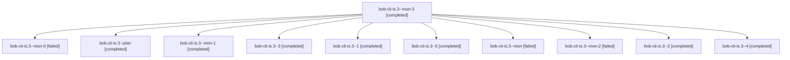

# Session: bob-cli-is.3

[Agent Hoods](../README.md) / [bbugyi200](../users/bbugyi200/README.md) / [apollo](../users/bbugyi200/machines/apollo/README.md) / [bob-cli-is](../users/bbugyi200/machines/apollo/hoods/bob-cli-is/README.md) / bob-cli-is.3

Owner: `bbugyi200.apollo` · Hood: `bob-cli-is` · Members: 11 · Bead: [bob-cli-is.3](https://github.com/bobs-org/bob-cli--beads/blob/main/pages/bob-cli-is/bob-cli-is.3.md)

## Lineage

The diagram is an optional enhancement; the ordered table below contains the same lineage in accessible text.

| Role | Agent | State | Model / provider | Timing | Commits | Prompt | Chat |
|---|---|---|---|---|---:|---|---|
| mon-3 | bob-cli-is.3--mon-3 | completed | gpt-6-astra / codex | 2026-11-08T23:23:51.596627+00:00 → 2026-11-08T23:38:54.144133+00:00 | 0 | — | [Chat](../agents/bbugyi200.apollo.bob-cli-is.3--mon-3/chat.md) |
| mon-0 | bob-cli-is.3--mon-0 | failed | gpt-6-astra / codex | 2026-11-08T22:22:50.093003+00:00 → 2026-11-08T22:46:43.024672+00:00 | 0 | — | [Chat](../agents/bbugyi200.apollo.bob-cli-is.3--mon-0/chat.md) |
| plan | bob-cli-is.3--plan | completed | gpt-6-astra / codex | 2026-11-08T21:47:14.468878+00:00 → 2026-11-08T22:10:57.976340+00:00 | 0 | [Prompt](../agents/bbugyi200.apollo.bob-cli-is.3--plan/prompt.md) | [Chat](../agents/bbugyi200.apollo.bob-cli-is.3--plan/chat.md) |
| mon-1 | bob-cli-is.3--mon-1 | completed | gpt-6-astra / codex | 2026-11-08T22:50:53.715514+00:00 → 2026-11-08T23:14:52.535988+00:00 | 0 | — | [Chat](../agents/bbugyi200.apollo.bob-cli-is.3--mon-1/chat.md) |
| 3 | bob-cli-is.3--3 | completed | gpt-6-astra / codex | 2026-11-08T23:14:57.571583+00:00 → 2026-11-08T23:19:16.683548+00:00 | 0 | [Prompt](../agents/bbugyi200.apollo.bob-cli-is.3--3/prompt.md) | [Chat](../agents/bbugyi200.apollo.bob-cli-is.3--3/chat.md) |
| 1 | bob-cli-is.3--1 | completed | gpt-6-astra / codex | 2026-11-08T22:20:46.770282+00:00 → 2026-11-08T22:23:24.997915+00:00 | 0 | [Prompt](../agents/bbugyi200.apollo.bob-cli-is.3--1/prompt.md) | [Chat](../agents/bbugyi200.apollo.bob-cli-is.3--1/chat.md) |
| 5 | bob-cli-is.3--5 | completed | gpt-6-astra / codex | 2026-11-08T23:38:54.011805+00:00 → 2026-11-08T23:40:55.366926+00:00 | 0 | [Prompt](../agents/bbugyi200.apollo.bob-cli-is.3--5/prompt.md) | [Chat](../agents/bbugyi200.apollo.bob-cli-is.3--5/chat.md) |
| mon | bob-cli-is.3--mon | failed | gpt-6-astra / codex | 2026-11-08T22:10:20.664500+00:00 → 2026-11-08T22:20:44.549966+00:00 | 0 | — | [Chat](../agents/bbugyi200.apollo.bob-cli-is.3--mon/chat.md) |
| mon-2 | bob-cli-is.3--mon-2 | failed | gpt-6-astra / codex | 2026-11-08T23:18:04.390759+00:00 → 2026-11-08T23:20:37.535019+00:00 | 0 | — | [Chat](../agents/bbugyi200.apollo.bob-cli-is.3--mon-2/chat.md) |
| 2 | bob-cli-is.3--2 | completed | gpt-6-astra / codex | 2026-11-08T22:46:42.846212+00:00 → 2026-11-08T22:51:25.362362+00:00 | 0 | [Prompt](../agents/bbugyi200.apollo.bob-cli-is.3--2/prompt.md) | [Chat](../agents/bbugyi200.apollo.bob-cli-is.3--2/chat.md) |
| 4 | bob-cli-is.3--4 | completed | gpt-6-astra / codex | 2026-11-08T23:20:39.763201+00:00 → 2026-11-08T23:24:22.983013+00:00 | 0 | [Prompt](../agents/bbugyi200.apollo.bob-cli-is.3--4/prompt.md) | [Chat](../agents/bbugyi200.apollo.bob-cli-is.3--4/chat.md) |

## Neighbors

| Agent | Relation | State |
|---|---|---|
| [bob-cli-is.1](../agents/bbugyi200.apollo.bob-cli-is.1/README.md) | bob-cli-is hood | completed |
| [bob-cli-is.2](bbugyi200.apollo.bob-cli-is.2.md) (session · 13) | bob-cli-is hood | completed 8, failed 5 |
| [bob-cli-is.land](bbugyi200.apollo.bob-cli-is.land.md) (session · 3) | bob-cli-is hood | completed 3 |
