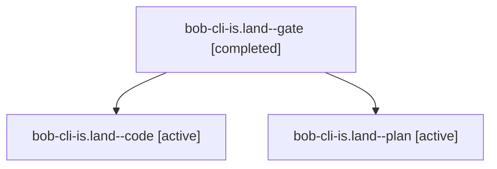

# Session: bob-cli-is.land

[Agent Hoods](../README.md) / [bbugyi200](../users/bbugyi200/README.md) / [apollo](../users/bbugyi200/machines/apollo/README.md) / [bob-cli-is](../users/bbugyi200/machines/apollo/hoods/bob-cli-is/README.md) / bob-cli-is.land

Owner: `bbugyi200.apollo` · Hood: `bob-cli-is` · Members: 3 · Bead: [bob-cli-is](https://github.com/bobs-org/bob-cli--beads/blob/main/pages/bob-cli-is/README.md)

## Lineage

The diagram is an optional enhancement; the ordered table below contains the same lineage in accessible text.

| Role | Agent | State | Model / provider | Timing | Commits | Prompt | Chat |
|---|---|---|---|---|---:|---|---|
| gate | bob-cli-is.land--gate | completed | gpt-6-astra / codex | 2026-11-08T23:51:26.302278+00:00 → 2026-11-08T23:51:38.777784+00:00 | 0 | — | [Chat](../agents/bbugyi200.apollo.bob-cli-is.land--gate/chat.md) |
| code | bob-cli-is.land--code | active | grok-4.6 / grok | 2026-11-08T23:52:07.178133+00:00 | 0 | — | — |
| plan | bob-cli-is.land--plan | active | gpt-6-astra / codex | 2026-11-08T23:41:53.040125+00:00 | 0 | [Prompt](../agents/bbugyi200.apollo.bob-cli-is.land--plan/prompt.md) | [Chat](../agents/bbugyi200.apollo.bob-cli-is.land--plan/chat.md) |

## Neighbors

| Agent | Relation | State |
|---|---|---|
| [bob-cli-is.1](../agents/bbugyi200.apollo.bob-cli-is.1/README.md) | bob-cli-is hood | completed |
| [bob-cli-is.2](bbugyi200.apollo.bob-cli-is.2.md) (session · 13) | bob-cli-is hood | completed 8, failed 5 |
| [bob-cli-is.3](bbugyi200.apollo.bob-cli-is.3.md) (session · 11) | bob-cli-is hood | completed 8, failed 3 |
| [bob-cli-is.3](../agents/bbugyi200.apollo.bob-cli-is.3/README.md) | bob-cli-is hood | completed |
