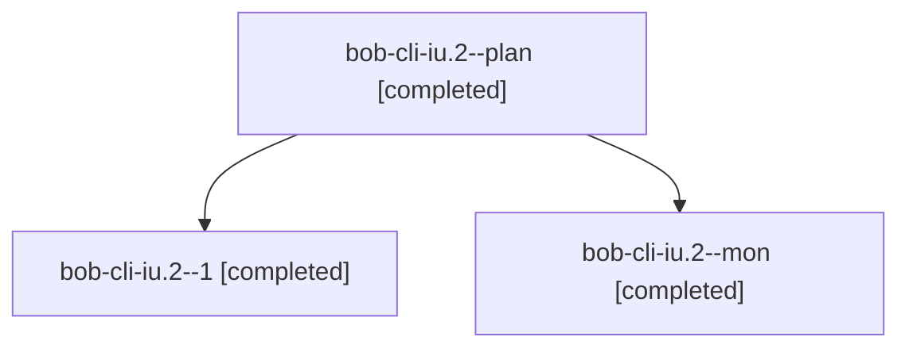

# Session: bob-cli-iu.2

[Agent Hoods](../README.md) / [bbugyi200](../users/bbugyi200/README.md) / [apollo](../users/bbugyi200/machines/apollo/README.md) / [bob-cli-iu](../users/bbugyi200/machines/apollo/hoods/bob-cli-iu/README.md) / bob-cli-iu.2

Owner: `bbugyi200.apollo` · Hood: `bob-cli-iu` · Members: 3 · Bead: [bob-cli-iu.2](https://github.com/bobs-org/bob-cli--beads/blob/main/pages/bob-cli-iu/bob-cli-iu.2.md)

## Lineage

The diagram is an optional enhancement; the ordered table below contains the same lineage in accessible text.

| Role | Agent | State | Model / provider | Timing | Commits | Prompt | Chat |
|---|---|---|---|---|---:|---|---|
| plan | bob-cli-iu.2--plan | completed | muse-spark-1.3-contributor / muse | 2026-11-08T21:48:04.343827+00:00 → 2026-11-08T22:58:18.421536+00:00 | 0 | [Prompt](../agents/bbugyi200.apollo.bob-cli-iu.2--plan/prompt.md) | [Chat](../agents/bbugyi200.apollo.bob-cli-iu.2--plan/chat.md) |
| 1 | bob-cli-iu.2--1 | completed | muse-spark-1.3-contributor / muse | 2026-11-08T23:01:38.460338+00:00 → 2026-11-08T23:03:41.214290+00:00 | 0 | [Prompt](../agents/bbugyi200.apollo.bob-cli-iu.2--1/prompt.md) | [Chat](../agents/bbugyi200.apollo.bob-cli-iu.2--1/chat.md) |
| mon | bob-cli-iu.2--mon | completed | muse-spark-1.3-contributor / muse | 2026-11-08T22:02:38.693510+00:00 → 2026-11-08T23:01:37.223336+00:00 | 0 | — | [Chat](../agents/bbugyi200.apollo.bob-cli-iu.2--mon/chat.md) |

## Neighbors

| Agent | Relation | State |
|---|---|---|
| [bob-cli-iu.1](../agents/bbugyi200.apollo.bob-cli-iu.1/README.md) | bob-cli-iu hood | completed |
| [bob-cli-iu.land](bbugyi200.apollo.bob-cli-iu.land.md) (session · 3) | bob-cli-iu hood | active 2, completed 1 |
