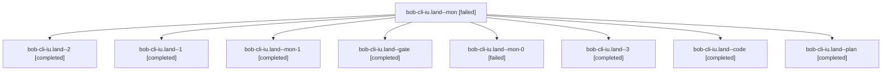

# Session: bob-cli-iu.land

[Agent Hoods](../README.md) / [bbugyi200](../users/bbugyi200/README.md) / [apollo](../users/bbugyi200/machines/apollo/README.md) / [bob-cli-iu](../users/bbugyi200/machines/apollo/hoods/bob-cli-iu/README.md) / bob-cli-iu.land

Owner: `bbugyi200.apollo` · Hood: `bob-cli-iu` · Members: 9 · Bead: [bob-cli-iu](https://github.com/bobs-org/bob-cli--beads/blob/main/pages/bob-cli-iu/README.md)

## Lineage

The diagram is an optional enhancement; the ordered table below contains the same lineage in accessible text.

| Role | Agent | State | Model / provider | Timing | Commits | Prompt | Chat |
|---|---|---|---|---|---:|---|---|
| mon | bob-cli-iu.land--mon | failed | gpt-6-luna / codex | 2026-11-09T00:05:20.594968+00:00 → 2026-11-09T00:24:09.405525+00:00 | 0 | — | [Chat](../agents/bbugyi200.apollo.bob-cli-iu.land--mon/chat.md) |
| 2 | bob-cli-iu.land--2 | completed | gpt-6-luna / codex | 2026-11-09T00:33:29.154061+00:00 → 2026-11-09T00:35:39.972675+00:00 | 0 | [Prompt](../agents/bbugyi200.apollo.bob-cli-iu.land--2/prompt.md) | [Chat](../agents/bbugyi200.apollo.bob-cli-iu.land--2/chat.md) |
| 1 | bob-cli-iu.land--1 | completed | gpt-6-luna / codex | 2026-11-09T00:24:11.056945+00:00 → 2026-11-09T00:30:53.701055+00:00 | 0 | [Prompt](../agents/bbugyi200.apollo.bob-cli-iu.land--1/prompt.md) | [Chat](../agents/bbugyi200.apollo.bob-cli-iu.land--1/chat.md) |
| mon-1 | bob-cli-iu.land--mon-1 | completed | gpt-6-luna / codex | 2026-11-09T00:35:03.853430+00:00 → 2026-11-09T00:54:34.308339+00:00 | 0 | — | [Chat](../agents/bbugyi200.apollo.bob-cli-iu.land--mon-1/chat.md) |
| gate | bob-cli-iu.land--gate | completed | gpt-6-astra / codex | 2026-11-08T23:14:42.548347+00:00 → 2026-11-08T23:14:55.468684+00:00 | 0 | — | [Chat](../agents/bbugyi200.apollo.bob-cli-iu.land--gate/chat.md) |
| mon-0 | bob-cli-iu.land--mon-0 | failed | gpt-6-luna / codex | 2026-11-09T00:30:02.069157+00:00 → 2026-11-09T00:33:28.701435+00:00 | 0 | — | [Chat](../agents/bbugyi200.apollo.bob-cli-iu.land--mon-0/chat.md) |
| 3 | bob-cli-iu.land--3 | completed | grok-4.6 / grok | 2026-11-09T00:54:34.281644+00:00 → 2026-11-09T00:59:59.254941+00:00 | 0 | [Prompt](../agents/bbugyi200.apollo.bob-cli-iu.land--3/prompt.md) | [Chat](../agents/bbugyi200.apollo.bob-cli-iu.land--3/chat.md) |
| code | bob-cli-iu.land--code | completed | gpt-6-luna / codex | 2026-11-08T23:15:21.658962+00:00 → 2026-11-09T00:06:17.363212+00:00 | 0 | — | [Chat](../agents/bbugyi200.apollo.bob-cli-iu.land--code/chat.md) |
| plan | bob-cli-iu.land--plan | completed | gpt-6-astra / codex | 2026-11-08T23:04:44.514092+00:00 → 2026-11-09T00:06:17.363212+00:00 | 0 | [Prompt](../agents/bbugyi200.apollo.bob-cli-iu.land--plan/prompt.md) | [Chat](../agents/bbugyi200.apollo.bob-cli-iu.land--plan/chat.md) |

## Neighbors

| Agent | Relation | State |
|---|---|---|
| [bob-cli-iu.1](../agents/bbugyi200.apollo.bob-cli-iu.1/README.md) | bob-cli-iu hood | completed |
| [bob-cli-iu.2](bbugyi200.apollo.bob-cli-iu.2.md) (session · 3) | bob-cli-iu hood | completed 3 |
