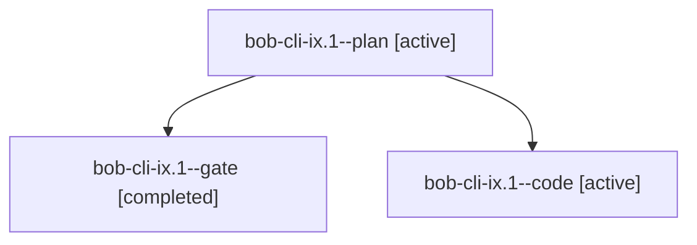

# Session: bob-cli-ix.1

[Agent Hoods](../README.md) / [bbugyi200](../users/bbugyi200/README.md) / [apollo](../users/bbugyi200/machines/apollo/README.md) / [bob-cli-ix](../users/bbugyi200/machines/apollo/hoods/bob-cli-ix/README.md) / bob-cli-ix.1

Owner: `bbugyi200.apollo` · Hood: `bob-cli-ix` · Members: 3 · Bead: [bob-cli-ix.1](https://github.com/bobs-org/bob-cli--beads/blob/main/pages/bob-cli-ix/bob-cli-ix.1.md)

## Lineage

The diagram is an optional enhancement; the ordered table below contains the same lineage in accessible text.

| Role | Agent | State | Model / provider | Timing | Commits | Prompt | Chat |
|---|---|---|---|---|---:|---|---|
| plan | bob-cli-ix.1--plan | active | gpt-6-astra / codex | 2026-11-09T10:26:01.854838+00:00 | 0 | [Prompt](../agents/bbugyi200.apollo.bob-cli-ix.1--plan/prompt.md) | [Chat](../agents/bbugyi200.apollo.bob-cli-ix.1--plan/chat.md) |
| gate | bob-cli-ix.1--gate | completed | gpt-6-astra / codex | 2026-11-09T10:32:47.307626+00:00 → 2026-11-09T10:32:58.667935+00:00 | 0 | — | [Chat](../agents/bbugyi200.apollo.bob-cli-ix.1--gate/chat.md) |
| code | bob-cli-ix.1--code | active | grok-4.6 / grok | 2026-11-09T10:33:23.231625+00:00 | 0 | — | — |

## Neighbors

| Agent | Relation | State |
|---|---|---|
| [bob-cli-ix.2](../agents/bbugyi200.apollo.bob-cli-ix.2/README.md) | bob-cli-ix hood | waiting |
| [bob-cli-ix.3](../agents/bbugyi200.apollo.bob-cli-ix.3/README.md) | bob-cli-ix hood | waiting |
| [bob-cli-ix.4](../agents/bbugyi200.apollo.bob-cli-ix.4/README.md) | bob-cli-ix hood | waiting |
| [bob-cli-ix.land](../agents/bbugyi200.apollo.bob-cli-ix.land/README.md) | bob-cli-ix hood | waiting |
