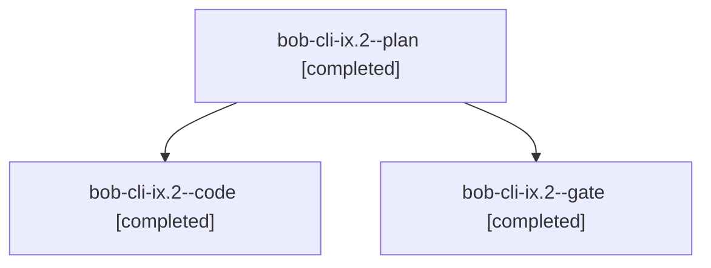

# Session: bob-cli-ix.2

[Agent Hoods](../README.md) / [bbugyi200](../users/bbugyi200/README.md) / [apollo](../users/bbugyi200/machines/apollo/README.md) / [bob-cli-ix](../users/bbugyi200/machines/apollo/hoods/bob-cli-ix/README.md) / bob-cli-ix.2

Owner: `bbugyi200.apollo` · Hood: `bob-cli-ix` · Members: 3 · Bead: [bob-cli-ix.2](https://github.com/bobs-org/bob-cli--beads/blob/main/pages/bob-cli-ix/bob-cli-ix.2.md)

## Lineage

The diagram is an optional enhancement; the ordered table below contains the same lineage in accessible text.

| Role | Agent | State | Model / provider | Timing | Commits | Prompt | Chat |
|---|---|---|---|---|---:|---|---|
| plan | bob-cli-ix.2--plan | completed | gpt-6-astra / codex | 2026-11-09T11:56:09.810689+00:00 → 2026-11-09T12:50:16.811433+00:00 | 0 | [Prompt](../agents/bbugyi200.apollo.bob-cli-ix.2--plan/prompt.md) | [Chat](../agents/bbugyi200.apollo.bob-cli-ix.2--plan/chat.md) |
| code | bob-cli-ix.2--code | completed | muse-spark-1.3-contributor / muse | 2026-11-09T12:02:57.514944+00:00 → 2026-11-09T12:50:16.811433+00:00 | [1](../agents/bbugyi200.apollo.bob-cli-ix.2--code/README.md#commits) | — | [Chat](../agents/bbugyi200.apollo.bob-cli-ix.2--code/chat.md) |
| gate | bob-cli-ix.2--gate | completed | gpt-6-astra / codex | 2026-11-09T12:02:14.806226+00:00 → 2026-11-09T12:02:29.161577+00:00 | 0 | — | [Chat](../agents/bbugyi200.apollo.bob-cli-ix.2--gate/chat.md) |

## Commits

| Role | Repo | Commit | Subject | Committed |
|---|---|---|---|---|
| code | bob-cli | [`135793b`](https://github.com/bobs-org/bob-cli/commit/135793bf355c18cf44788d0114c68549bcb0d9bb) | feat(capture): close the running Pomodoro at a stated size | 2026-11-09 07:49:26 EST |

## Neighbors

| Agent | Relation | State |
|---|---|---|
| [bob-cli-ix.1](bbugyi200.apollo.bob-cli-ix.1.md) (session · 5) | bob-cli-ix hood | completed 5 |
| [bob-cli-ix.3](../agents/bbugyi200.apollo.bob-cli-ix.3/README.md) | bob-cli-ix hood | completed |
| [bob-cli-ix.4](bbugyi200.apollo.bob-cli-ix.4.md) (session · 4) | bob-cli-ix hood | completed 3, failed 1 |
| [bob-cli-ix.land](bbugyi200.apollo.bob-cli-ix.land.md) (session · 4) | bob-cli-ix hood | active 2, completed 1, failed 1 |
