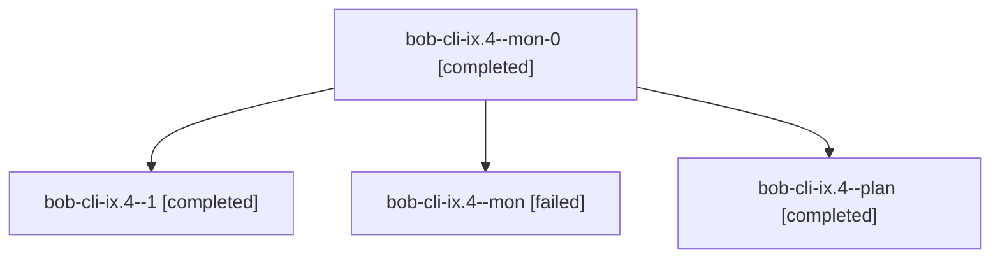

# Session: bob-cli-ix.4

[Agent Hoods](../README.md) / [bbugyi200](../users/bbugyi200/README.md) / [apollo](../users/bbugyi200/machines/apollo/README.md) / [bob-cli-ix](../users/bbugyi200/machines/apollo/hoods/bob-cli-ix/README.md) / bob-cli-ix.4

Owner: `bbugyi200.apollo` · Hood: `bob-cli-ix` · Members: 4 · Bead: [bob-cli-ix.4](https://github.com/bobs-org/bob-cli--beads/blob/main/pages/bob-cli-ix/bob-cli-ix.4.md)

## Lineage

The diagram is an optional enhancement; the ordered table below contains the same lineage in accessible text.

| Role | Agent | State | Model / provider | Timing | Commits | Prompt | Chat |
|---|---|---|---|---|---:|---|---|
| mon-0 | bob-cli-ix.4--mon-0 | completed | gpt-6-luna / codex | 2026-11-09T13:12:18.623292+00:00 → 2026-11-09T13:47:38.325891+00:00 | 0 | — | [Chat](../agents/bbugyi200.apollo.bob-cli-ix.4--mon-0/chat.md) |
| 1 | bob-cli-ix.4--1 | completed | gpt-6-luna / codex | 2026-11-09T13:47:37.943871+00:00 → 2026-11-09T13:52:06.020577+00:00 | 0 | [Prompt](../agents/bbugyi200.apollo.bob-cli-ix.4--1/prompt.md) | [Chat](../agents/bbugyi200.apollo.bob-cli-ix.4--1/chat.md) |
| mon | bob-cli-ix.4--mon | failed | gpt-6-luna / codex | 2026-11-09T13:11:24.016068+00:00 → 2026-11-09T13:11:27.325124+00:00 | 0 | — | — |
| plan | bob-cli-ix.4--plan | completed | gpt-6-luna / codex | 2026-11-09T12:52:53.565731+00:00 → 2026-11-09T13:13:13.584066+00:00 | 0 | [Prompt](../agents/bbugyi200.apollo.bob-cli-ix.4--plan/prompt.md) | [Chat](../agents/bbugyi200.apollo.bob-cli-ix.4--plan/chat.md) |

## Neighbors

| Agent | Relation | State |
|---|---|---|
| [bob-cli-ix.1](bbugyi200.apollo.bob-cli-ix.1.md) (session · 5) | bob-cli-ix hood | completed 5 |
| [bob-cli-ix.2](bbugyi200.apollo.bob-cli-ix.2.md) (session · 3) | bob-cli-ix hood | completed 3 |
| [bob-cli-ix.3](../agents/bbugyi200.apollo.bob-cli-ix.3/README.md) | bob-cli-ix hood | completed |
| [bob-cli-ix.land](bbugyi200.apollo.bob-cli-ix.land.md) (session · 4) | bob-cli-ix hood | active 2, completed 1, failed 1 |
