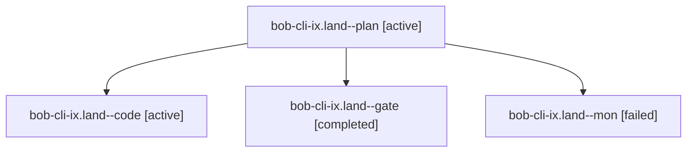

# Session: bob-cli-ix.land

[Agent Hoods](../README.md) / [bbugyi200](../users/bbugyi200/README.md) / [apollo](../users/bbugyi200/machines/apollo/README.md) / [bob-cli-ix](../users/bbugyi200/machines/apollo/hoods/bob-cli-ix/README.md) / bob-cli-ix.land

Owner: `bbugyi200.apollo` · Hood: `bob-cli-ix` · Members: 4 · Bead: [bob-cli-ix](https://github.com/bobs-org/bob-cli--beads/blob/main/pages/bob-cli-ix/README.md)

## Lineage

The diagram is an optional enhancement; the ordered table below contains the same lineage in accessible text.

| Role | Agent | State | Model / provider | Timing | Commits | Prompt | Chat |
|---|---|---|---|---|---:|---|---|
| plan | bob-cli-ix.land--plan | active | opus / claude | 2026-11-09T15:53:25.970719+00:00 | 0 | [Prompt](../agents/bbugyi200.apollo.bob-cli-ix.land--plan/prompt.md) | [Chat](../agents/bbugyi200.apollo.bob-cli-ix.land--plan/chat.md) |
| code | bob-cli-ix.land--code | active | grok-4.6 / grok | 2026-11-09T16:05:18.689791+00:00 | 0 | — | — |
| gate | bob-cli-ix.land--gate | completed | opus / claude | 2026-11-09T16:04:41.323827+00:00 → 2026-11-09T16:04:54.229567+00:00 | 0 | — | [Chat](../agents/bbugyi200.apollo.bob-cli-ix.land--gate/chat.md) |
| mon | bob-cli-ix.land--mon | failed | muse-spark-1.3-contributor / muse | 2026-11-09T14:46:54.370998+00:00 → 2026-11-09T14:46:59.115692+00:00 | 0 | — | — |

## Commits

| Role | Repo | Commit | Subject | Committed |
|---|---|---|---|---|
| — | bob-cli | [`2a0c258`](https://github.com/bobs-org/bob-cli/commit/2a0c258fab15ae45b8e7a195e53c6cced904695b) | feat(capture): finish sized-close acceptance and land bob-cli-ix | 2026-11-09 10:03:28 EST |

## Neighbors

| Agent | Relation | State |
|---|---|---|
| [bob-cli-ix.1](bbugyi200.apollo.bob-cli-ix.1.md) (session · 5) | bob-cli-ix hood | completed 5 |
| [bob-cli-ix.2](bbugyi200.apollo.bob-cli-ix.2.md) (session · 3) | bob-cli-ix hood | completed 3 |
| [bob-cli-ix.3](../agents/bbugyi200.apollo.bob-cli-ix.3/README.md) | bob-cli-ix hood | completed |
| [bob-cli-ix.4](bbugyi200.apollo.bob-cli-ix.4.md) (session · 4) | bob-cli-ix hood | completed 3, failed 1 |
