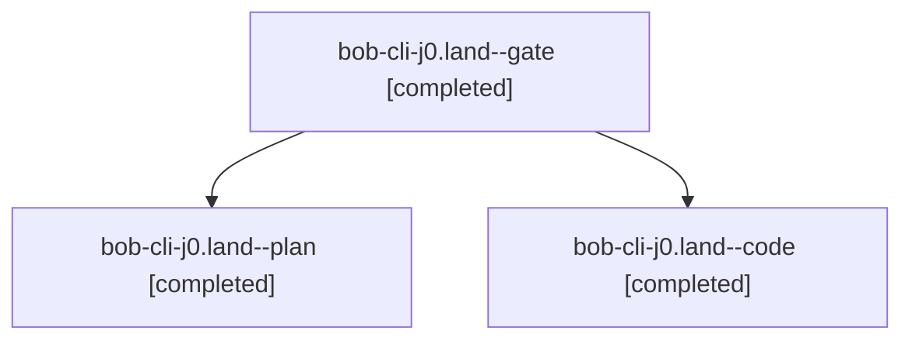

# Session: bob-cli-j0.land

[Agent Hoods](../README.md) / [bbugyi200](../users/bbugyi200/README.md) / [apollo](../users/bbugyi200/machines/apollo/README.md) / [bob-cli-j0](../users/bbugyi200/machines/apollo/hoods/bob-cli-j0/README.md) / bob-cli-j0.land

Owner: `bbugyi200.apollo` · Hood: `bob-cli-j0` · Members: 3 · Bead: [bob-cli-j0](https://github.com/bobs-org/bob-cli--beads/blob/main/pages/bob-cli-j0/README.md)

## Lineage

The diagram is an optional enhancement; the ordered table below contains the same lineage in accessible text.

| Role | Agent | State | Model / provider | Timing | Commits | Prompt | Chat |
|---|---|---|---|---|---:|---|---|
| gate | bob-cli-j0.land--gate | completed | gpt-6-astra / codex | 2026-11-09T14:04:43.120731+00:00 → 2026-11-09T14:04:55.872250+00:00 | 0 | — | [Chat](../agents/bbugyi200.apollo.bob-cli-j0.land--gate/chat.md) |
| plan | bob-cli-j0.land--plan | completed | gpt-6-astra / codex | 2026-11-09T13:47:22.631565+00:00 → 2026-11-09T15:03:57.926921+00:00 | 0 | [Prompt](../agents/bbugyi200.apollo.bob-cli-j0.land--plan/prompt.md) | [Chat](../agents/bbugyi200.apollo.bob-cli-j0.land--plan/chat.md) |
| code | bob-cli-j0.land--code | completed | grok-4.6 / grok | 2026-11-09T14:05:38.133883+00:00 → 2026-11-09T15:03:57.926921+00:00 | [1](../agents/bbugyi200.apollo.bob-cli-j0.land--code/README.md#commits) | — | [Chat](../agents/bbugyi200.apollo.bob-cli-j0.land--code/chat.md) |

## Commits

| Role | Repo | Commit | Subject | Committed |
|---|---|---|---|---|
| code | bob-cli | [`cb27f8b`](https://github.com/bobs-org/bob-cli/commit/cb27f8bca373ef30d4f734221addd2d2b8a1e005) | fix(vault-sync): key inbound task-loss links by resolved note | 2026-11-09 10:01:59 EST |

## Neighbors

| Agent | Relation | State |
|---|---|---|
| [bob-cli-j0.1](../agents/bbugyi200.apollo.bob-cli-j0.1/README.md) | bob-cli-j0 hood | completed |
| [bob-cli-j0.2](../agents/bbugyi200.apollo.bob-cli-j0.2/README.md) | bob-cli-j0 hood | completed |
| [bob-cli-j0.3](../agents/bbugyi200.apollo.bob-cli-j0.3/README.md) | bob-cli-j0 hood | completed |
| [bob-cli-j0.4](../agents/bbugyi200.apollo.bob-cli-j0.4/README.md) | bob-cli-j0 hood | completed |
