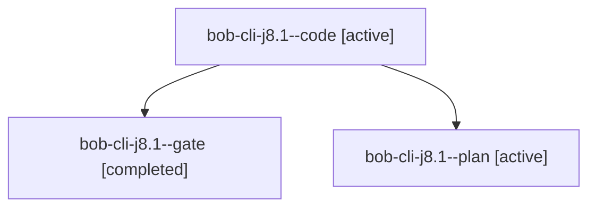

# Session: bob-cli-j8.1

[Agent Hoods](../README.md) / [bbugyi200](../users/bbugyi200/README.md) / [apollo](../users/bbugyi200/machines/apollo/README.md) / [bob-cli-j8](../users/bbugyi200/machines/apollo/hoods/bob-cli-j8/README.md) / bob-cli-j8.1

Owner: `bbugyi200.apollo` · Hood: `bob-cli-j8` · Members: 3 · Bead: [bob-cli-j8.1](https://github.com/bobs-org/bob-cli--beads/blob/main/pages/bob-cli-j8/bob-cli-j8.1.md)

## Lineage

The diagram is an optional enhancement; the ordered table below contains the same lineage in accessible text.

| Role | Agent | State | Model / provider | Timing | Commits | Prompt | Chat |
|---|---|---|---|---|---:|---|---|
| code | bob-cli-j8.1--code | active | muse-spark-1.3-contributor / muse | 2026-11-09T17:20:55.302508+00:00 | 0 | — | — |
| gate | bob-cli-j8.1--gate | completed | gpt-6-astra / codex | 2026-11-09T17:20:28.356528+00:00 → 2026-11-09T17:20:41.187847+00:00 | 0 | — | [Chat](../agents/bbugyi200.apollo.bob-cli-j8.1--gate/chat.md) |
| plan | bob-cli-j8.1--plan | active | gpt-6-astra / codex | 2026-11-09T17:12:35.928366+00:00 | 0 | [Prompt](../agents/bbugyi200.apollo.bob-cli-j8.1--plan/prompt.md) | [Chat](../agents/bbugyi200.apollo.bob-cli-j8.1--plan/chat.md) |

## Neighbors

| Agent | Relation | State |
|---|---|---|
| [bob-cli-j8.10](../agents/bbugyi200.apollo.bob-cli-j8.10/README.md) | bob-cli-j8 hood | waiting |
| [bob-cli-j8.2](../agents/bbugyi200.apollo.bob-cli-j8.2/README.md) | bob-cli-j8 hood | waiting |
| [bob-cli-j8.3](../agents/bbugyi200.apollo.bob-cli-j8.3/README.md) | bob-cli-j8 hood | waiting |
| [bob-cli-j8.4](../agents/bbugyi200.apollo.bob-cli-j8.4/README.md) | bob-cli-j8 hood | waiting |
| [bob-cli-j8.5](../agents/bbugyi200.apollo.bob-cli-j8.5/README.md) | bob-cli-j8 hood | waiting |
| [bob-cli-j8.6](../agents/bbugyi200.apollo.bob-cli-j8.6/README.md) | bob-cli-j8 hood | waiting |
| [bob-cli-j8.7](../agents/bbugyi200.apollo.bob-cli-j8.7/README.md) | bob-cli-j8 hood | waiting |
| [bob-cli-j8.8](../agents/bbugyi200.apollo.bob-cli-j8.8/README.md) | bob-cli-j8 hood | waiting |
| [bob-cli-j8.9](../agents/bbugyi200.apollo.bob-cli-j8.9/README.md) | bob-cli-j8 hood | waiting |
| [bob-cli-j8.land](../agents/bbugyi200.apollo.bob-cli-j8.land/README.md) | bob-cli-j8 hood | waiting |
