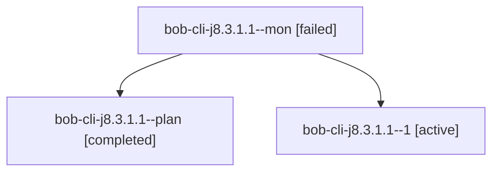

# Session: bob-cli-j8.3.1.1

[Agent Hoods](../README.md) / [bbugyi200](../users/bbugyi200/README.md) / [apollo](../users/bbugyi200/machines/apollo/README.md) / [bob-cli-j8](../users/bbugyi200/machines/apollo/hoods/bob-cli-j8/README.md) / bob-cli-j8.3.1.1

Owner: `bbugyi200.apollo` · Hood: `bob-cli-j8` · Members: 3 · Bead: [bob-cli-j8.3.1.1](https://github.com/bobs-org/bob-cli--beads/blob/main/pages/bob-cli-j8/bob-cli-j8.3.1.1.md)

## Lineage

The diagram is an optional enhancement; the ordered table below contains the same lineage in accessible text.

| Role | Agent | State | Model / provider | Timing | Commits | Prompt | Chat |
|---|---|---|---|---|---:|---|---|
| mon | bob-cli-j8.3.1.1--mon | failed | gpt-6-luna / codex | 2026-11-09T19:41:37.306663+00:00 → 2026-11-09T19:47:37.740456+00:00 | 0 | — | [Chat](../agents/bbugyi200.apollo.bob-cli-j8.3.1.1--mon/chat.md) |
| plan | bob-cli-j8.3.1.1--plan | completed | gpt-6-luna / codex | 2026-11-09T18:51:41.869278+00:00 → 2026-11-09T19:42:54.446063+00:00 | 0 | [Prompt](../agents/bbugyi200.apollo.bob-cli-j8.3.1.1--plan/prompt.md) | [Chat](../agents/bbugyi200.apollo.bob-cli-j8.3.1.1--plan/chat.md) |
| 1 | bob-cli-j8.3.1.1--1 | active | gpt-6-luna / codex | 2026-11-09T19:47:37.456441+00:00 | 0 | [Prompt](../agents/bbugyi200.apollo.bob-cli-j8.3.1.1--1/prompt.md) | — |

## Neighbors

| Agent | Relation | State |
|---|---|---|
| [bob-cli-j8.3](bbugyi200.apollo.bob-cli-j8.3.md) (session · 3) | ancestor | active 1, completed 2 |
| [bob-cli-j8.3.1.2](../agents/bbugyi200.apollo.bob-cli-j8.3.1.2/README.md) | bob-cli-j8.3.1 hood | waiting |
| [bob-cli-j8.3.1.3](../agents/bbugyi200.apollo.bob-cli-j8.3.1.3/README.md) | bob-cli-j8.3.1 hood | waiting |
| [bob-cli-j8.3.1.4](../agents/bbugyi200.apollo.bob-cli-j8.3.1.4/README.md) | bob-cli-j8.3.1 hood | waiting |
| [bob-cli-j8.3.1.land](../agents/bbugyi200.apollo.bob-cli-j8.3.1.land/README.md) | bob-cli-j8.3.1 hood | waiting |
| [bob-cli-j8.1](bbugyi200.apollo.bob-cli-j8.1.md) (session · 3) | bob-cli-j8 hood | completed 3 |
| [bob-cli-j8.10](../agents/bbugyi200.apollo.bob-cli-j8.10/README.md) | bob-cli-j8 hood | waiting |
| [bob-cli-j8.2](bbugyi200.apollo.bob-cli-j8.2.md) (session · 3) | bob-cli-j8 hood | completed 3 |
| [bob-cli-j8.4](../agents/bbugyi200.apollo.bob-cli-j8.4/README.md) | bob-cli-j8 hood | waiting |
| [bob-cli-j8.5](../agents/bbugyi200.apollo.bob-cli-j8.5/README.md) | bob-cli-j8 hood | waiting |
| [bob-cli-j8.6](../agents/bbugyi200.apollo.bob-cli-j8.6/README.md) | bob-cli-j8 hood | waiting |
| [bob-cli-j8.7](../agents/bbugyi200.apollo.bob-cli-j8.7/README.md) | bob-cli-j8 hood | waiting |
| [bob-cli-j8.8](../agents/bbugyi200.apollo.bob-cli-j8.8/README.md) | bob-cli-j8 hood | waiting |
| [bob-cli-j8.9](../agents/bbugyi200.apollo.bob-cli-j8.9/README.md) | bob-cli-j8 hood | waiting |
| [bob-cli-j8.land](../agents/bbugyi200.apollo.bob-cli-j8.land/README.md) | bob-cli-j8 hood | waiting |
