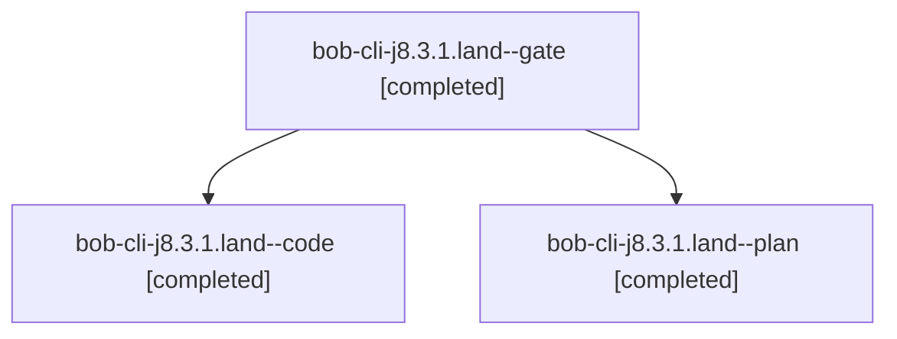

# Session: bob-cli-j8.3.1.land

[Agent Hoods](../README.md) / [bbugyi200](../users/bbugyi200/README.md) / [apollo](../users/bbugyi200/machines/apollo/README.md) / [bob-cli-j8](../users/bbugyi200/machines/apollo/hoods/bob-cli-j8/README.md) / bob-cli-j8.3.1.land

Owner: `bbugyi200.apollo` · Hood: `bob-cli-j8` · Members: 3 · Bead: [bob-cli-j8.3.1](https://github.com/bobs-org/bob-cli--beads/blob/main/pages/bob-cli-j8/bob-cli-j8.3.1.md)

## Lineage



The diagram is an optional enhancement; the ordered table below contains the same lineage in accessible text.

| Role | Agent | State | Model / provider | Timing | Commits | Prompt | Chat |
|---|---|---|---|---|---:|---|---|
| <a id="member-gate"></a>gate | bob-cli-j8.3.1.land--gate | completed | gpt-6-astra / codex | 2026-11-10T01:48:32.418769+00:00 → 2026-11-10T01:48:43.722579+00:00 | 0 | — | [Chat](../agents/bbugyi200.apollo.bob-cli-j8.3.1.land--gate/chat.md) |
| <a id="member-code"></a>code | bob-cli-j8.3.1.land--code | completed | gpt-6-luna / codex | 2026-11-10T01:49:09.642743+00:00 → 2026-11-10T03:39:32.149177+00:00 | [1](../agents/bbugyi200.apollo.bob-cli-j8.3.1.land--code/README.md#commits) | — | [Chat](../agents/bbugyi200.apollo.bob-cli-j8.3.1.land--code/chat.md) |
| <a id="member-plan"></a>plan | bob-cli-j8.3.1.land--plan | completed | gpt-6-astra / codex | 2026-11-10T01:34:05.656058+00:00 → 2026-11-10T03:39:32.149177+00:00 | 0 | [Prompt](../agents/bbugyi200.apollo.bob-cli-j8.3.1.land--plan/prompt.md) | [Chat](../agents/bbugyi200.apollo.bob-cli-j8.3.1.land--plan/chat.md) |

## Commits

| Role | Repo | Commit | Subject | Committed |
|---|---|---|---|---|
| code | bob-cli | [`843642f`](https://github.com/bobs-org/bob-cli/commit/843642f9fc34e0edf60b126751bb221d2fe6283c) | feat(capture)!: repair notebook capture landing | 2026-11-09 22:37:58 EST |

## Variables

| Role | Variable | Value |
|---|---|---|
| code | `artifacts` | \[{bead: bob-cli-j5, kind: markdown, label: Task merge custom archive path reproduction, path: /home/bryan/.sase/artifacts/agents/gh\_bobs-org\_\_bob-cli/20261109204850/sase-task-merge-repro-de51947185a1… |

#### artifacts

**Role:** `code`

```yaml
- bead: bob-cli-j5
  kind: markdown
  label: Task merge custom archive path reproduction
  path: /home/bryan/.sase/artifacts/agents/gh_bobs-org__bob-cli/20261109204850/sase-task-merge-repro-de51947185a1.md
  ref: file:explicit:82c6a707ddd506f8b0f9d403
```

Values are truncated for display; see each member's agent meta.json for the full values.

## Neighbors

| Agent | Relation | State |
|---|---|---|
| [bob-cli-j8.3](bbugyi200.apollo.bob-cli-j8.3.md) (session · 3) | ancestor | active 1, completed 2 |
| [bob-cli-j8.3.1.1](bbugyi200.apollo.bob-cli-j8.3.1.1.md) (session · 3) | bob-cli-j8.3.1 hood | completed 2, failed 1 |
| [bob-cli-j8.3.1.2](../agents/bbugyi200.apollo.bob-cli-j8.3.1.2/README.md) | bob-cli-j8.3.1 hood | completed |
| [bob-cli-j8.3.1.3](../agents/bbugyi200.apollo.bob-cli-j8.3.1.3/README.md) | bob-cli-j8.3.1 hood | completed |
| [bob-cli-j8.3.1.4](../agents/bbugyi200.apollo.bob-cli-j8.3.1.4/README.md) | bob-cli-j8.3.1 hood | completed |
| [bob-cli-j8.1](bbugyi200.apollo.bob-cli-j8.1.md) (session · 3) | bob-cli-j8 hood | completed 3 |
| [bob-cli-j8.10](../agents/bbugyi200.apollo.bob-cli-j8.10/README.md) | bob-cli-j8 hood | waiting |
| [bob-cli-j8.2](bbugyi200.apollo.bob-cli-j8.2.md) (session · 3) | bob-cli-j8 hood | completed 3 |
| [bob-cli-j8.4](bbugyi200.apollo.bob-cli-j8.4.md) (session · 3) | bob-cli-j8 hood | active 2, completed 1 |
| [bob-cli-j8.5](../agents/bbugyi200.apollo.bob-cli-j8.5/README.md) | bob-cli-j8 hood | waiting |
| [bob-cli-j8.6](bbugyi200.apollo.bob-cli-j8.6.md) (session · 3) | bob-cli-j8 hood | active 1, completed 2 |
| [bob-cli-j8.6.1.1](bbugyi200.apollo.bob-cli-j8.6.1.1.md) (session · 3) | bob-cli-j8 hood | completed 3 |
| [bob-cli-j8.6.1.2](../agents/bbugyi200.apollo.bob-cli-j8.6.1.2/README.md) | bob-cli-j8 hood | completed |
| [bob-cli-j8.6.1.3](../agents/bbugyi200.apollo.bob-cli-j8.6.1.3/README.md) | bob-cli-j8 hood | completed |
| [bob-cli-j8.6.1.land](bbugyi200.apollo.bob-cli-j8.6.1.land.md) (session · 3) | bob-cli-j8 hood | completed 3 |
| [bob-cli-j8.7](../agents/bbugyi200.apollo.bob-cli-j8.7/README.md) | bob-cli-j8 hood | completed |
| [bob-cli-j8.8](../agents/bbugyi200.apollo.bob-cli-j8.8/README.md) | bob-cli-j8 hood | waiting |
| [bob-cli-j8.9](bbugyi200.apollo.bob-cli-j8.9.md) (session · 4) | bob-cli-j8 hood | active 1, completed 3 |
| [bob-cli-j8.land](../agents/bbugyi200.apollo.bob-cli-j8.land/README.md) | bob-cli-j8 hood | waiting |
