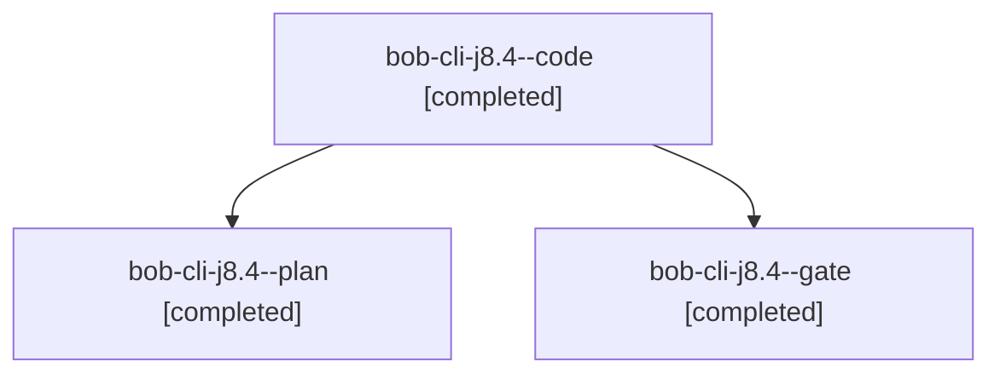

# Session: bob-cli-j8.4

[Agent Hoods](../README.md) / [bbugyi200](../users/bbugyi200/README.md) / [apollo](../users/bbugyi200/machines/apollo/README.md) / [bob-cli-j8](../users/bbugyi200/machines/apollo/hoods/bob-cli-j8/README.md) / bob-cli-j8.4

Owner: `bbugyi200.apollo` · Hood: `bob-cli-j8` · Members: 3 · Bead: [bob-cli-j8.4](https://github.com/bobs-org/bob-cli--beads/blob/main/pages/bob-cli-j8/bob-cli-j8.4.md)

## Lineage

The diagram is an optional enhancement; the ordered table below contains the same lineage in accessible text.

| Role | Agent | State | Model / provider | Timing | Commits | Prompt | Chat |
|---|---|---|---|---|---:|---|---|
| code | bob-cli-j8.4--code | completed | grok-4.6 / grok | 2026-11-10T03:45:49.128892+00:00 → 2026-11-10T05:21:12.020521+00:00 | [1](../agents/bbugyi200.apollo.bob-cli-j8.4--code/README.md#commits) | — | [Chat](../agents/bbugyi200.apollo.bob-cli-j8.4--code/chat.md) |
| plan | bob-cli-j8.4--plan | completed | gpt-6-astra / codex | 2026-11-10T03:36:27.446126+00:00 → 2026-11-10T05:21:12.020521+00:00 | 0 | [Prompt](../agents/bbugyi200.apollo.bob-cli-j8.4--plan/prompt.md) | [Chat](../agents/bbugyi200.apollo.bob-cli-j8.4--plan/chat.md) |
| gate | bob-cli-j8.4--gate | completed | gpt-6-astra / codex | 2026-11-10T03:45:11.778617+00:00 → 2026-11-10T03:45:26.451408+00:00 | 0 | — | [Chat](../agents/bbugyi200.apollo.bob-cli-j8.4--gate/chat.md) |

## Commits

| Role | Repo | Commit | Subject | Committed |
|---|---|---|---|---|
| code | bob-cli | [`ab021e2`](https://github.com/bobs-org/bob-cli/commit/ab021e2db09c3776d737e9380a236f823bcb42b4) | feat(capture)!: create notebooks from sealed @parent^id@ %n drafts | 2026-11-10 00:20:18 EST |

## Neighbors

| Agent | Relation | State |
|---|---|---|
| [bob-cli-j8.1](bbugyi200.apollo.bob-cli-j8.1.md) (session · 3) | bob-cli-j8 hood | completed 3 |
| [bob-cli-j8.10](../agents/bbugyi200.apollo.bob-cli-j8.10/README.md) | bob-cli-j8 hood | waiting |
| [bob-cli-j8.2](bbugyi200.apollo.bob-cli-j8.2.md) (session · 3) | bob-cli-j8 hood | completed 3 |
| [bob-cli-j8.3](bbugyi200.apollo.bob-cli-j8.3.md) (session · 3) | bob-cli-j8 hood | active 1, completed 2 |
| [bob-cli-j8.3.1.1](bbugyi200.apollo.bob-cli-j8.3.1.1.md) (session · 3) | bob-cli-j8 hood | completed 2, failed 1 |
| [bob-cli-j8.3.1.2](../agents/bbugyi200.apollo.bob-cli-j8.3.1.2/README.md) | bob-cli-j8 hood | completed |
| [bob-cli-j8.3.1.3](../agents/bbugyi200.apollo.bob-cli-j8.3.1.3/README.md) | bob-cli-j8 hood | completed |
| [bob-cli-j8.3.1.4](../agents/bbugyi200.apollo.bob-cli-j8.3.1.4/README.md) | bob-cli-j8 hood | completed |
| [bob-cli-j8.3.1.land](bbugyi200.apollo.bob-cli-j8.3.1.land.md) (session · 3) | bob-cli-j8 hood | completed 3 |
| [bob-cli-j8.5](bbugyi200.apollo.bob-cli-j8.5.md) (session · 3) | bob-cli-j8 hood | completed 3 |
| [bob-cli-j8.6](bbugyi200.apollo.bob-cli-j8.6.md) (session · 3) | bob-cli-j8 hood | active 1, completed 2 |
| [bob-cli-j8.6.1.1](bbugyi200.apollo.bob-cli-j8.6.1.1.md) (session · 3) | bob-cli-j8 hood | completed 3 |
| [bob-cli-j8.6.1.2](../agents/bbugyi200.apollo.bob-cli-j8.6.1.2/README.md) | bob-cli-j8 hood | completed |
| [bob-cli-j8.6.1.3](../agents/bbugyi200.apollo.bob-cli-j8.6.1.3/README.md) | bob-cli-j8 hood | completed |
| [bob-cli-j8.6.1.land](bbugyi200.apollo.bob-cli-j8.6.1.land.md) (session · 3) | bob-cli-j8 hood | completed 3 |
| [bob-cli-j8.7](../agents/bbugyi200.apollo.bob-cli-j8.7/README.md) | bob-cli-j8 hood | completed |
| [bob-cli-j8.8](bbugyi200.apollo.bob-cli-j8.8.md) (session · 3) | bob-cli-j8 hood | active 2, completed 1 |
| [bob-cli-j8.9](bbugyi200.apollo.bob-cli-j8.9.md) (session · 6) | bob-cli-j8 hood | active 1, completed 5 |
| [bob-cli-j8.land](../agents/bbugyi200.apollo.bob-cli-j8.land/README.md) | bob-cli-j8 hood | waiting |
