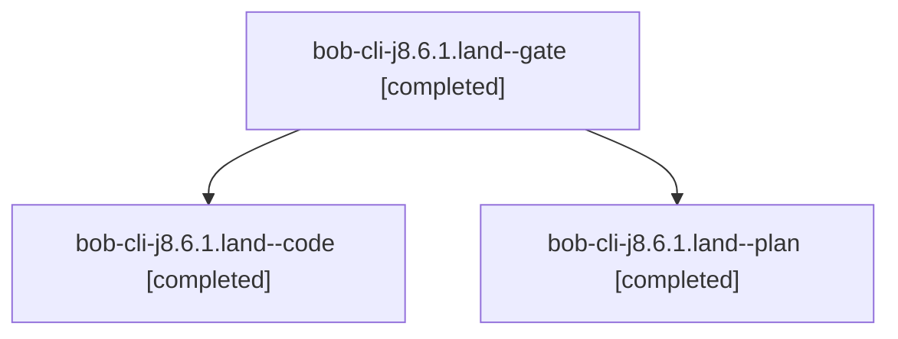

# Session: bob-cli-j8.6.1.land

[Agent Hoods](../README.md) / [bbugyi200](../users/bbugyi200/README.md) / [apollo](../users/bbugyi200/machines/apollo/README.md) / [bob-cli-j8](../users/bbugyi200/machines/apollo/hoods/bob-cli-j8/README.md) / bob-cli-j8.6.1.land

Owner: `bbugyi200.apollo` · Hood: `bob-cli-j8` · Members: 3 · Bead: [bob-cli-j8.6.1](https://github.com/bobs-org/bob-cli--beads/blob/main/pages/bob-cli-j8/bob-cli-j8.6.1.md)

## Lineage



The diagram is an optional enhancement; the ordered table below contains the same lineage in accessible text.

| Role | Agent | State | Model / provider | Timing | Commits | Prompt | Chat |
|---|---|---|---|---|---:|---|---|
| <a id="member-gate"></a>gate | bob-cli-j8.6.1.land--gate | completed | gpt-6-astra / codex | 2026-11-10T00:11:43.453329+00:00 → 2026-11-10T00:11:56.194046+00:00 | 0 | — | [Chat](../agents/bbugyi200.apollo.bob-cli-j8.6.1.land--gate/chat.md) |
| <a id="member-code"></a>code | bob-cli-j8.6.1.land--code | completed | grok-4.6 / grok | 2026-11-10T00:12:23.179419+00:00 → 2026-11-10T01:25:13.700550+00:00 | 0 | — | [Chat](../agents/bbugyi200.apollo.bob-cli-j8.6.1.land--code/chat.md) |
| <a id="member-plan"></a>plan | bob-cli-j8.6.1.land--plan | completed | gpt-6-astra / codex | 2026-11-09T23:58:01.962938+00:00 → 2026-11-10T01:25:13.700550+00:00 | 0 | [Prompt](../agents/bbugyi200.apollo.bob-cli-j8.6.1.land--plan/prompt.md) | [Chat](../agents/bbugyi200.apollo.bob-cli-j8.6.1.land--plan/chat.md) |

## Variables

| Role | Variable | Value |
|---|---|---|
| code | `artifacts` | \[{bead: bob-cli-j8.6.1, kind: image, label: Notebook header in Reading view, path: /home/bryan/.sase/artifacts/agents/gh\_bobs-org\_\_bob-cli/20261109191206/notebook-git-reading-light-c38094193693.png,… |
| plan | `artifacts` | \[{bead: bob-cli-j8.6.1, kind: markdown, label: Notebook UI landing audit and reproducible remaining defects, path: /home/bryan/.sase/artifacts/agents/gh\_bobs-org\_\_bob-cli/20261109151630/j861-landing-… |

#### artifacts

**Role:** `code`

```yaml
- bead: bob-cli-j8.6.1
  kind: image
  label: Notebook header in Reading view
  path: /home/bryan/.sase/artifacts/agents/gh_bobs-org__bob-cli/20261109191206/notebook-git-reading-light-c38094193693.png
  ref: file:explicit:93f70086784fcf546d527688
  source_path: /tmp/notebook-ui-shots/notebook-git-reading-light.png
- bead: bob-cli-j8.6.1
  kind: image
  label: Notebook catalog card in Reading view
  path: /home/bryan/.sase/artifacts/agents/gh_bobs-org__bob-cli/20261109191206/notebook-area-reading-light-4b1e24cd20f5.png
  ref: file:explicit:5c0afbb7d9ac3ecdd1970142
  source_path: /tmp/notebook-ui-shots/notebook-area-reading-light.png
- bead: bob-cli-j8.6.1
  kind: image
  label: Notebook catalog chips wrap at 375px
  path: /home/bryan/.sase/artifacts/agents/gh_bobs-org__bob-cli/20261109191206/notebook-area-375-a9c3688c75bb.png
  ref: file:explicit:7c10b6b995bc56feb7db1c53
  source_path: /tmp/notebook-ui-shots/notebook-area-375.png
- bead: bob-cli-j8.6.1
  kind: image
  label: Notebook header inside a Reading embed
  path: /home/bryan/.sase/artifacts/agents/gh_bobs-org__bob-cli/20261109191206/notebook-embed-reading-845bf2010236.png
  ref: file:explicit:a3b883e95c1a1f3612d66548
  source_path: /tmp/notebook-ui-shots/notebook-embed-reading.png
- bead: bob-cli-j8.6.1
  kind: image
  label: Notebook header in Live Preview light
  path: /home/bryan/.sase/artifacts/agents/gh_bobs-org__bob-cli/20261109191206/notebook-git-lp-light-de27fefb0197.png
  ref: file:explicit:04792cc56b09bf906d3c21b7
  source_path: /tmp/notebook-ui-shots/notebook-git-lp-light.png
- bead: bob-cli-j8.6.1
  kind: file
  label: Athena Obsidian notebook UI e2e report
  path: /home/bryan/.sase/artifacts/agents/gh_bobs-org__bob-cli/20261109191206/notebook-ui-report-0401969128ba.json
  ref: file:explicit:8a4a31b59d519aafb72eaa21
  source_path: /tmp/notebook-ui-report.json
```

#### artifacts

**Role:** `plan`

```yaml
- bead: bob-cli-j8.6.1
  kind: markdown
  label: Notebook UI landing audit and reproducible remaining defects
  path: /home/bryan/.sase/artifacts/agents/gh_bobs-org__bob-cli/20261109151630/j861-landing-audit-6df04c1ecbf5.md
  ref: file:explicit:bc690a37fdcaf7a084746ce3
  source_path: /tmp/j861-landing-audit.md
```

Values are truncated for display; see each member's agent meta.json for the full values.

## Neighbors

| Agent | Relation | State |
|---|---|---|
| [bob-cli-j8.6](bbugyi200.apollo.bob-cli-j8.6.md) (session · 3) | ancestor | active 1, completed 2 |
| [bob-cli-j8.6.1.1](bbugyi200.apollo.bob-cli-j8.6.1.1.md) (session · 3) | bob-cli-j8.6.1 hood | completed 3 |
| [bob-cli-j8.6.1.2](../agents/bbugyi200.apollo.bob-cli-j8.6.1.2/README.md) | bob-cli-j8.6.1 hood | completed |
| [bob-cli-j8.6.1.3](../agents/bbugyi200.apollo.bob-cli-j8.6.1.3/README.md) | bob-cli-j8.6.1 hood | completed |
| [bob-cli-j8.1](bbugyi200.apollo.bob-cli-j8.1.md) (session · 3) | bob-cli-j8 hood | completed 3 |
| [bob-cli-j8.10](../agents/bbugyi200.apollo.bob-cli-j8.10/README.md) | bob-cli-j8 hood | waiting |
| [bob-cli-j8.2](bbugyi200.apollo.bob-cli-j8.2.md) (session · 3) | bob-cli-j8 hood | completed 3 |
| [bob-cli-j8.3](bbugyi200.apollo.bob-cli-j8.3.md) (session · 3) | bob-cli-j8 hood | active 1, completed 2 |
| [bob-cli-j8.3.1.1](bbugyi200.apollo.bob-cli-j8.3.1.1.md) (session · 3) | bob-cli-j8 hood | completed 2, failed 1 |
| [bob-cli-j8.3.1.2](../agents/bbugyi200.apollo.bob-cli-j8.3.1.2/README.md) | bob-cli-j8 hood | completed |
| [bob-cli-j8.3.1.3](../agents/bbugyi200.apollo.bob-cli-j8.3.1.3/README.md) | bob-cli-j8 hood | completed |
| [bob-cli-j8.3.1.4](../agents/bbugyi200.apollo.bob-cli-j8.3.1.4/README.md) | bob-cli-j8 hood | completed |
| [bob-cli-j8.3.1.land](bbugyi200.apollo.bob-cli-j8.3.1.land.md) (session · 3) | bob-cli-j8 hood | active 2, completed 1 |
| [bob-cli-j8.4](../agents/bbugyi200.apollo.bob-cli-j8.4/README.md) | bob-cli-j8 hood | waiting |
| [bob-cli-j8.5](../agents/bbugyi200.apollo.bob-cli-j8.5/README.md) | bob-cli-j8 hood | waiting |
| [bob-cli-j8.7](../agents/bbugyi200.apollo.bob-cli-j8.7/README.md) | bob-cli-j8 hood | completed |
| [bob-cli-j8.8](../agents/bbugyi200.apollo.bob-cli-j8.8/README.md) | bob-cli-j8 hood | waiting |
| [bob-cli-j8.9](../agents/bbugyi200.apollo.bob-cli-j8.9/README.md) | bob-cli-j8 hood | waiting |
| [bob-cli-j8.land](../agents/bbugyi200.apollo.bob-cli-j8.land/README.md) | bob-cli-j8 hood | waiting |
