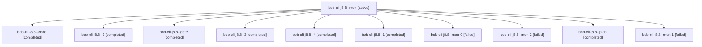

# Session: bob-cli-j8.8

[Agent Hoods](../README.md) / [bbugyi200](../users/bbugyi200/README.md) / [apollo](../users/bbugyi200/machines/apollo/README.md) / [bob-cli-j8](../users/bbugyi200/machines/apollo/hoods/bob-cli-j8/README.md) / bob-cli-j8.8

Owner: `bbugyi200.apollo` · Hood: `bob-cli-j8` · Members: 11 · Bead: [bob-cli-j8.8](https://github.com/bobs-org/bob-cli--beads/blob/main/pages/bob-cli-j8/bob-cli-j8.8.md)

## Lineage

The diagram is an optional enhancement; the ordered table below contains the same lineage in accessible text.

| Role | Agent | State | Model / provider | Timing | Commits | Prompt | Chat |
|---|---|---|---|---|---:|---|---|
| mon | bob-cli-j8.8--mon | active | grok-4.6 / grok | 2026-11-10T11:35:42.670384+00:00 | 0 | — | — |
| code | bob-cli-j8.8--code | completed | grok-4.6 / grok | 2026-11-10T11:08:36.053255+00:00 → 2026-11-10T11:37:42.624018+00:00 | 0 | — | [Chat](../agents/bbugyi200.apollo.bob-cli-j8.8--code/chat.md) |
| 2 | bob-cli-j8.8--2 | completed | gpt-6-luna / codex | 2026-11-10T09:28:49.154995+00:00 → 2026-11-10T09:34:53.618740+00:00 | 0 | [Prompt](../agents/bbugyi200.apollo.bob-cli-j8.8--2/prompt.md) | [Chat](../agents/bbugyi200.apollo.bob-cli-j8.8--2/chat.md) |
| gate | bob-cli-j8.8--gate | completed | gpt-6-astra / codex | 2026-11-10T11:08:03.047388+00:00 → 2026-11-10T11:08:13.561674+00:00 | 0 | — | [Chat](../agents/bbugyi200.apollo.bob-cli-j8.8--gate/chat.md) |
| 3 | bob-cli-j8.8--3 | completed | gpt-6-luna / codex | 2026-11-10T09:38:52.600758+00:00 → 2026-11-10T09:43:30.655094+00:00 | 0 | [Prompt](../agents/bbugyi200.apollo.bob-cli-j8.8--3/prompt.md) | [Chat](../agents/bbugyi200.apollo.bob-cli-j8.8--3/chat.md) |
| 4 | bob-cli-j8.8--4 | completed | gpt-6-luna / codex | 2026-11-10T09:51:08.352474+00:00 → 2026-11-10T10:03:43.742275+00:00 | [1](../agents/bbugyi200.apollo.bob-cli-j8.8--4/README.md#commits) | [Prompt](../agents/bbugyi200.apollo.bob-cli-j8.8--4/prompt.md) | [Chat](../agents/bbugyi200.apollo.bob-cli-j8.8--4/chat.md) |
| 1 | bob-cli-j8.8--1 | completed | gpt-6-luna / codex | 2026-11-10T09:14:20.395691+00:00 → 2026-11-10T09:23:33.053149+00:00 | 0 | [Prompt](../agents/bbugyi200.apollo.bob-cli-j8.8--1/prompt.md) | [Chat](../agents/bbugyi200.apollo.bob-cli-j8.8--1/chat.md) |
| mon-0 | bob-cli-j8.8--mon-0 | failed | gpt-6-luna / codex | 2026-11-10T09:21:58.671255+00:00 → 2026-11-10T09:28:49.201217+00:00 | 0 | — | [Chat](../agents/bbugyi200.apollo.bob-cli-j8.8--mon-0/chat.md) |
| mon-2 | bob-cli-j8.8--mon-2 | failed | gpt-6-luna / codex | 2026-11-10T09:42:49.651246+00:00 → 2026-11-10T09:51:08.738616+00:00 | 0 | — | [Chat](../agents/bbugyi200.apollo.bob-cli-j8.8--mon-2/chat.md) |
| plan | bob-cli-j8.8--plan | completed | gpt-6-astra / codex | 2026-11-10T10:59:48.401486+00:00 → 2026-11-10T11:37:42.624018+00:00 | 0 | [Prompt](../agents/bbugyi200.apollo.bob-cli-j8.8--plan/prompt.md) | [Chat](../agents/bbugyi200.apollo.bob-cli-j8.8--plan/chat.md) |
| mon-1 | bob-cli-j8.8--mon-1 | failed | gpt-6-luna / codex | 2026-11-10T09:33:43.834764+00:00 → 2026-11-10T09:38:52.949745+00:00 | 0 | — | [Chat](../agents/bbugyi200.apollo.bob-cli-j8.8--mon-1/chat.md) |

## Commits

| Role | Repo | Commit | Subject | Committed |
|---|---|---|---|---|
| 4 | bob-cli | [`f2882ea`](https://github.com/bobs-org/bob-cli/commit/f2882ea6fc30894c848bafa4a68e4f81b7c148ed) | fix(ci): select Mac Capture workflow for exact-SHA checks | 2026-11-10 05:02:21 EST |

## Neighbors

| Agent | Relation | State |
|---|---|---|
| [bob-cli-j8.1](bbugyi200.apollo.bob-cli-j8.1.md) (session · 3) | bob-cli-j8 hood | completed 3 |
| [bob-cli-j8.10](../agents/bbugyi200.apollo.bob-cli-j8.10/README.md) | bob-cli-j8 hood | waiting |
| [bob-cli-j8.2](bbugyi200.apollo.bob-cli-j8.2.md) (session · 3) | bob-cli-j8 hood | completed 3 |
| [bob-cli-j8.3](bbugyi200.apollo.bob-cli-j8.3.md) (session · 3) | bob-cli-j8 hood | active 1, completed 2 |
| [bob-cli-j8.3.1.1](bbugyi200.apollo.bob-cli-j8.3.1.1.md) (session · 3) | bob-cli-j8 hood | completed 2, failed 1 |
| [bob-cli-j8.3.1.2](../agents/bbugyi200.apollo.bob-cli-j8.3.1.2/README.md) | bob-cli-j8 hood | completed |
| [bob-cli-j8.3.1.3](../agents/bbugyi200.apollo.bob-cli-j8.3.1.3/README.md) | bob-cli-j8 hood | completed |
| [bob-cli-j8.3.1.4](../agents/bbugyi200.apollo.bob-cli-j8.3.1.4/README.md) | bob-cli-j8 hood | completed |
| [bob-cli-j8.3.1.land](bbugyi200.apollo.bob-cli-j8.3.1.land.md) (session · 3) | bob-cli-j8 hood | completed 3 |
| [bob-cli-j8.4](bbugyi200.apollo.bob-cli-j8.4.md) (session · 3) | bob-cli-j8 hood | completed 3 |
| [bob-cli-j8.5](bbugyi200.apollo.bob-cli-j8.5.md) (session · 3) | bob-cli-j8 hood | completed 3 |
| [bob-cli-j8.6](bbugyi200.apollo.bob-cli-j8.6.md) (session · 3) | bob-cli-j8 hood | active 1, completed 2 |
| [bob-cli-j8.6.1.1](bbugyi200.apollo.bob-cli-j8.6.1.1.md) (session · 3) | bob-cli-j8 hood | completed 3 |
| [bob-cli-j8.6.1.2](../agents/bbugyi200.apollo.bob-cli-j8.6.1.2/README.md) | bob-cli-j8 hood | completed |
| [bob-cli-j8.6.1.3](../agents/bbugyi200.apollo.bob-cli-j8.6.1.3/README.md) | bob-cli-j8 hood | completed |
| [bob-cli-j8.6.1.land](bbugyi200.apollo.bob-cli-j8.6.1.land.md) (session · 3) | bob-cli-j8 hood | completed 3 |
| [bob-cli-j8.7](../agents/bbugyi200.apollo.bob-cli-j8.7/README.md) | bob-cli-j8 hood | completed |
| [bob-cli-j8.9](bbugyi200.apollo.bob-cli-j8.9.md) (session · 11) | bob-cli-j8 hood | active 1, completed 9, failed 1 |
| [bob-cli-j8.land](../agents/bbugyi200.apollo.bob-cli-j8.land/README.md) | bob-cli-j8 hood | waiting |
