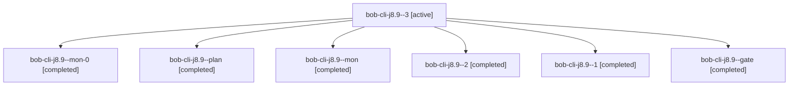

# Session: bob-cli-j8.9

[Agent Hoods](../README.md) / [bbugyi200](../users/bbugyi200/README.md) / [apollo](../users/bbugyi200/machines/apollo/README.md) / [bob-cli-j8](../users/bbugyi200/machines/apollo/hoods/bob-cli-j8/README.md) / bob-cli-j8.9

Owner: `bbugyi200.apollo` · Hood: `bob-cli-j8` · Members: 7 · Bead: [bob-cli-j8.9](https://github.com/bobs-org/bob-cli--beads/blob/main/pages/bob-cli-j8/bob-cli-j8.9.md)

## Lineage

The diagram is an optional enhancement; the ordered table below contains the same lineage in accessible text.

| Role | Agent | State | Model / provider | Timing | Commits | Prompt | Chat |
|---|---|---|---|---|---:|---|---|
| 3 | bob-cli-j8.9--3 | active | gpt-6-luna / codex | 2026-11-10T11:18:37.901201+00:00 | 0 | [Prompt](../agents/bbugyi200.apollo.bob-cli-j8.9--3/prompt.md) | — |
| mon-0 | bob-cli-j8.9--mon-0 | completed | gpt-6-luna / codex | 2026-11-10T03:55:43.677513+00:00 → 2026-11-10T04:00:12.904139+00:00 | 0 | — | [Chat](../agents/bbugyi200.apollo.bob-cli-j8.9--mon-0/chat.md) |
| plan | bob-cli-j8.9--plan | completed | gpt-6-luna / codex | 2026-11-10T03:36:30.378968+00:00 → 2026-11-10T03:44:40.216719+00:00 | 0 | [Prompt](../agents/bbugyi200.apollo.bob-cli-j8.9--plan/prompt.md) | [Chat](../agents/bbugyi200.apollo.bob-cli-j8.9--plan/chat.md) |
| mon | bob-cli-j8.9--mon | completed | gpt-6-luna / codex | 2026-11-10T03:43:47.827081+00:00 → 2026-11-10T03:50:56.498640+00:00 | 0 | — | [Chat](../agents/bbugyi200.apollo.bob-cli-j8.9--mon/chat.md) |
| 2 | bob-cli-j8.9--2 | completed | gpt-6-luna / codex | 2026-11-10T04:00:12.690228+00:00 → 2026-11-10T04:07:40.622081+00:00 | 0 | [Prompt](../agents/bbugyi200.apollo.bob-cli-j8.9--2/prompt.md) | [Chat](../agents/bbugyi200.apollo.bob-cli-j8.9--2/chat.md) |
| 1 | bob-cli-j8.9--1 | completed | gpt-6-luna / codex | 2026-11-10T03:50:56.299314+00:00 → 2026-11-10T03:56:18.235551+00:00 | 0 | [Prompt](../agents/bbugyi200.apollo.bob-cli-j8.9--1/prompt.md) | [Chat](../agents/bbugyi200.apollo.bob-cli-j8.9--1/chat.md) |
| gate | bob-cli-j8.9--gate | completed | gpt-6-luna / codex | 2026-11-10T11:17:15.254085+00:00 → 2026-11-10T11:17:43.690056+00:00 | 0 | — | [Chat](../agents/bbugyi200.apollo.bob-cli-j8.9--gate/chat.md) |

## Neighbors

| Agent | Relation | State |
|---|---|---|
| [bob-cli-j8.1](bbugyi200.apollo.bob-cli-j8.1.md) (session · 3) | bob-cli-j8 hood | completed 3 |
| [bob-cli-j8.10](../agents/bbugyi200.apollo.bob-cli-j8.10/README.md) | bob-cli-j8 hood | waiting |
| [bob-cli-j8.2](bbugyi200.apollo.bob-cli-j8.2.md) (session · 3) | bob-cli-j8 hood | completed 3 |
| [bob-cli-j8.3](bbugyi200.apollo.bob-cli-j8.3.md) (session · 3) | bob-cli-j8 hood | active 1, completed 2 |
| [bob-cli-j8.3.1.1](bbugyi200.apollo.bob-cli-j8.3.1.1.md) (session · 3) | bob-cli-j8 hood | completed 2, failed 1 |
| [bob-cli-j8.3.1.2](../agents/bbugyi200.apollo.bob-cli-j8.3.1.2/README.md) | bob-cli-j8 hood | completed |
| [bob-cli-j8.3.1.3](../agents/bbugyi200.apollo.bob-cli-j8.3.1.3/README.md) | bob-cli-j8 hood | completed |
| [bob-cli-j8.3.1.4](../agents/bbugyi200.apollo.bob-cli-j8.3.1.4/README.md) | bob-cli-j8 hood | completed |
| [bob-cli-j8.3.1.land](bbugyi200.apollo.bob-cli-j8.3.1.land.md) (session · 3) | bob-cli-j8 hood | completed 3 |
| [bob-cli-j8.4](bbugyi200.apollo.bob-cli-j8.4.md) (session · 3) | bob-cli-j8 hood | completed 3 |
| [bob-cli-j8.5](bbugyi200.apollo.bob-cli-j8.5.md) (session · 3) | bob-cli-j8 hood | completed 3 |
| [bob-cli-j8.6](bbugyi200.apollo.bob-cli-j8.6.md) (session · 3) | bob-cli-j8 hood | active 1, completed 2 |
| [bob-cli-j8.6.1.1](bbugyi200.apollo.bob-cli-j8.6.1.1.md) (session · 3) | bob-cli-j8 hood | completed 3 |
| [bob-cli-j8.6.1.2](../agents/bbugyi200.apollo.bob-cli-j8.6.1.2/README.md) | bob-cli-j8 hood | completed |
| [bob-cli-j8.6.1.3](../agents/bbugyi200.apollo.bob-cli-j8.6.1.3/README.md) | bob-cli-j8 hood | completed |
| [bob-cli-j8.6.1.land](bbugyi200.apollo.bob-cli-j8.6.1.land.md) (session · 3) | bob-cli-j8 hood | completed 3 |
| [bob-cli-j8.7](../agents/bbugyi200.apollo.bob-cli-j8.7/README.md) | bob-cli-j8 hood | completed |
| [bob-cli-j8.8](bbugyi200.apollo.bob-cli-j8.8.md) (session · 11) | bob-cli-j8 hood | active 2, completed 5, failed 4 |
| [bob-cli-j8.land](../agents/bbugyi200.apollo.bob-cli-j8.land/README.md) | bob-cli-j8 hood | waiting |
