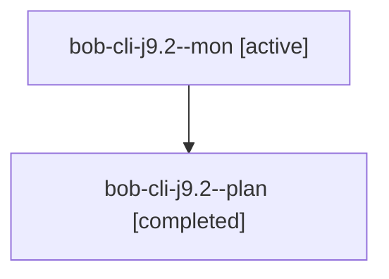

# Session: bob-cli-j9.2

[Agent Hoods](../README.md) / [bbugyi200](../users/bbugyi200/README.md) / [apollo](../users/bbugyi200/machines/apollo/README.md) / [bob-cli-j9](../users/bbugyi200/machines/apollo/hoods/bob-cli-j9/README.md) / bob-cli-j9.2

Owner: `bbugyi200.apollo` · Hood: `bob-cli-j9` · Members: 2 · Bead: [bob-cli-j9.2](https://github.com/bobs-org/bob-cli--beads/blob/main/pages/bob-cli-j9/bob-cli-j9.2.md)

## Lineage

The diagram is an optional enhancement; the ordered table below contains the same lineage in accessible text.

| Role | Agent | State | Model / provider | Timing | Commits | Prompt | Chat |
|---|---|---|---|---|---:|---|---|
| mon | bob-cli-j9.2--mon | active | muse-spark-1.3-contributor / muse | 2026-11-09T17:36:01.652048+00:00 | 0 | — | — |
| plan | bob-cli-j9.2--plan | completed | muse-spark-1.3-contributor / muse | 2026-11-09T17:19:37.900499+00:00 → 2026-11-09T17:38:58.864681+00:00 | 0 | [Prompt](../agents/bbugyi200.apollo.bob-cli-j9.2--plan/prompt.md) | [Chat](../agents/bbugyi200.apollo.bob-cli-j9.2--plan/chat.md) |

## Neighbors

| Agent | Relation | State |
|---|---|---|
| [bob-cli-j9.1](../agents/bbugyi200.apollo.bob-cli-j9.1/README.md) | bob-cli-j9 hood | active |
| [bob-cli-j9.3](../agents/bbugyi200.apollo.bob-cli-j9.3/README.md) | bob-cli-j9 hood | waiting |
| [bob-cli-j9.4](../agents/bbugyi200.apollo.bob-cli-j9.4/README.md) | bob-cli-j9 hood | waiting |
| [bob-cli-j9.land](../agents/bbugyi200.apollo.bob-cli-j9.land/README.md) | bob-cli-j9 hood | waiting |
