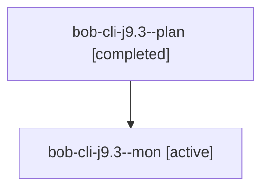

# Session: bob-cli-j9.3

[Agent Hoods](../README.md) / [bbugyi200](../users/bbugyi200/README.md) / [apollo](../users/bbugyi200/machines/apollo/README.md) / [bob-cli-j9](../users/bbugyi200/machines/apollo/hoods/bob-cli-j9/README.md) / bob-cli-j9.3

Owner: `bbugyi200.apollo` · Hood: `bob-cli-j9` · Members: 2 · Bead: [bob-cli-j9.3](https://github.com/bobs-org/bob-cli--beads/blob/main/pages/bob-cli-j9/bob-cli-j9.3.md)

## Lineage

The diagram is an optional enhancement; the ordered table below contains the same lineage in accessible text.

| Role | Agent | State | Model / provider | Timing | Commits | Prompt | Chat |
|---|---|---|---|---|---:|---|---|
| plan | bob-cli-j9.3--plan | completed | grok-4.6 / grok | 2026-11-09T18:12:15.740589+00:00 → 2026-11-09T19:08:07.629273+00:00 | 0 | [Prompt](../agents/bbugyi200.apollo.bob-cli-j9.3--plan/prompt.md) | [Chat](../agents/bbugyi200.apollo.bob-cli-j9.3--plan/chat.md) |
| mon | bob-cli-j9.3--mon | active | grok-4.6 / grok | 2026-11-09T19:05:27.138238+00:00 | 0 | — | — |

## Neighbors

| Agent | Relation | State |
|---|---|---|
| [bob-cli-j9.1](../agents/bbugyi200.apollo.bob-cli-j9.1/README.md) | bob-cli-j9 hood | completed |
| [bob-cli-j9.2](bbugyi200.apollo.bob-cli-j9.2.md) (session · 3) | bob-cli-j9 hood | completed 2, failed 1 |
| [bob-cli-j9.4](../agents/bbugyi200.apollo.bob-cli-j9.4/README.md) | bob-cli-j9 hood | waiting |
| [bob-cli-j9.land](../agents/bbugyi200.apollo.bob-cli-j9.land/README.md) | bob-cli-j9 hood | waiting |
