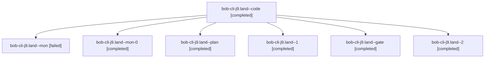

# Session: bob-cli-j9.land

[Agent Hoods](../README.md) / [bbugyi200](../users/bbugyi200/README.md) / [apollo](../users/bbugyi200/machines/apollo/README.md) / [bob-cli-j9](../users/bbugyi200/machines/apollo/hoods/bob-cli-j9/README.md) / bob-cli-j9.land

Owner: `bbugyi200.apollo` · Hood: `bob-cli-j9` · Members: 7 · Bead: [bob-cli-j9](https://github.com/bobs-org/bob-cli--beads/blob/main/pages/bob-cli-j9/README.md)

## Lineage



The diagram is an optional enhancement; the ordered table below contains the same lineage in accessible text.

| Role | Agent | State | Model / provider | Timing | Commits | Prompt | Chat |
|---|---|---|---|---|---:|---|---|
| <a id="member-code"></a>code | bob-cli-j9.land--code | completed | gpt-6-luna / codex | 2026-11-09T21:30:23.271673+00:00 → 2026-11-09T22:39:43.256982+00:00 | 0 | — | [Chat](../agents/bbugyi200.apollo.bob-cli-j9.land--code/chat.md) |
| <a id="member-mon"></a>mon | bob-cli-j9.land--mon | failed | gpt-6-luna / codex | 2026-11-09T22:38:20.267907+00:00 → 2026-11-09T22:59:25.720671+00:00 | 0 | — | [Chat](../agents/bbugyi200.apollo.bob-cli-j9.land--mon/chat.md) |
| <a id="member-mon-0"></a>mon-0 | bob-cli-j9.land--mon-0 | completed | gpt-6-luna / codex | 2026-11-09T23:11:28.859299+00:00 → 2026-11-09T23:36:49.897835+00:00 | 0 | — | [Chat](../agents/bbugyi200.apollo.bob-cli-j9.land--mon-0/chat.md) |
| <a id="member-plan"></a>plan | bob-cli-j9.land--plan | completed | gpt-6-astra / codex | 2026-11-09T21:14:41.197388+00:00 → 2026-11-09T22:39:43.256982+00:00 | 0 | [Prompt](../agents/bbugyi200.apollo.bob-cli-j9.land--plan/prompt.md) | [Chat](../agents/bbugyi200.apollo.bob-cli-j9.land--plan/chat.md) |
| <a id="member-1"></a>1 | bob-cli-j9.land--1 | completed | gpt-6-luna / codex | 2026-11-09T22:59:39.973145+00:00 → 2026-11-09T23:13:09.080277+00:00 | 0 | [Prompt](../agents/bbugyi200.apollo.bob-cli-j9.land--1/prompt.md) | [Chat](../agents/bbugyi200.apollo.bob-cli-j9.land--1/chat.md) |
| <a id="member-gate"></a>gate | bob-cli-j9.land--gate | completed | gpt-6-astra / codex | 2026-11-09T21:29:46.869832+00:00 → 2026-11-09T21:29:58.338695+00:00 | 0 | — | [Chat](../agents/bbugyi200.apollo.bob-cli-j9.land--gate/chat.md) |
| <a id="member-2"></a>2 | bob-cli-j9.land--2 | completed | gpt-6-luna / codex | 2026-11-09T23:36:50.925049+00:00 → 2026-11-09T23:42:54.859674+00:00 | [1](../agents/bbugyi200.apollo.bob-cli-j9.land--2/README.md#commits) | [Prompt](../agents/bbugyi200.apollo.bob-cli-j9.land--2/prompt.md) | [Chat](../agents/bbugyi200.apollo.bob-cli-j9.land--2/chat.md) |

## Commits

| Role | Repo | Commit | Subject | Committed |
|---|---|---|---|---|
| 2 | bob-cli | [`b519670`](https://github.com/bobs-org/bob-cli/commit/b5196709021e4efb0d27c0547d6d9f84d6db31c2) | docs(capture): document alias typing tip JSON fields | 2026-11-09 18:41:15 EST |

## Variables

| Role | Variable | Value |
|---|---|---|
| plan | `artifacts` | \[{kind: file, label: j9 landing CI follow-up evidence, path: /home/bryan/.sase/artifacts/agents/gh\_bobs-org\_\_bob-cli/20261109121923/j9\_land\_ci\_evidence-3e288135b236.txt, ref: file:explicit:1d6d71ab02… |

#### artifacts

**Role:** `plan`

```yaml
- kind: file
  label: j9 landing CI follow-up evidence
  path: /home/bryan/.sase/artifacts/agents/gh_bobs-org__bob-cli/20261109121923/j9_land_ci_evidence-3e288135b236.txt
  ref: file:explicit:1d6d71ab0242c32754b782ca
```

Values are truncated for display; see each member's agent meta.json for the full values.

## Neighbors

| Agent | Relation | State |
|---|---|---|
| [bob-cli-j9.1](../agents/bbugyi200.apollo.bob-cli-j9.1/README.md) | bob-cli-j9 hood | completed |
| [bob-cli-j9.2](bbugyi200.apollo.bob-cli-j9.2.md) (session · 3) | bob-cli-j9 hood | completed 2, failed 1 |
| [bob-cli-j9.3](bbugyi200.apollo.bob-cli-j9.3.md) (session · 5) | bob-cli-j9 hood | completed 4, failed 1 |
| [bob-cli-j9.4](../agents/bbugyi200.apollo.bob-cli-j9.4/README.md) | bob-cli-j9 hood | completed |
