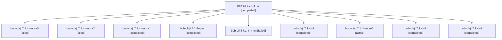

# Session: bob-cli-ji.7.1.4

[Agent Hoods](../README.md) / [bbugyi200](../users/bbugyi200/README.md) / [apollo](../users/bbugyi200/machines/apollo/README.md) / [bob-cli-ji](../users/bbugyi200/machines/apollo/hoods/bob-cli-ji/README.md) / bob-cli-ji.7.1.4

Owner: `bbugyi200.apollo` · Hood: `bob-cli-ji` · Members: 10 · Bead: [bob-cli-ji.7.1.4](https://github.com/bobs-org/bob-cli--beads/blob/main/pages/bob-cli-ji/bob-cli-ji.7.1.4.md)

## Lineage

The diagram is an optional enhancement; the ordered table below contains the same lineage in accessible text.

| Role | Agent | State | Model / provider | Timing | Commits | Prompt | Chat |
|---|---|---|---|---|---:|---|---|
| 4 | bob-cli-ji.7.1.4--4 | completed | grok-4.6 / grok | 2026-11-10T18:48:20.777856+00:00 → 2026-11-10T18:54:53.389384+00:00 | 0 | [Prompt](../agents/bbugyi200.apollo.bob-cli-ji.7.1.4--4/prompt.md) | [Chat](../agents/bbugyi200.apollo.bob-cli-ji.7.1.4--4/chat.md) |
| mon-0 | bob-cli-ji.7.1.4--mon-0 | failed | gpt-6-luna / codex | 2026-11-10T18:06:21.560899+00:00 → 2026-11-10T18:15:50.034129+00:00 | 0 | — | [Chat](../agents/bbugyi200.apollo.bob-cli-ji.7.1.4--mon-0/chat.md) |
| mon-2 | bob-cli-ji.7.1.4--mon-2 | failed | grok-4.6 / grok | 2026-11-10T18:28:38.923294+00:00 → 2026-11-10T18:48:21.000284+00:00 | 0 | — | [Chat](../agents/bbugyi200.apollo.bob-cli-ji.7.1.4--mon-2/chat.md) |
| mon-1 | bob-cli-ji.7.1.4--mon-1 | completed | gpt-6-luna / codex | 2026-11-10T18:18:48.457255+00:00 → 2026-11-10T18:22:47.042859+00:00 | 0 | — | — |
| plan | bob-cli-ji.7.1.4--plan | completed | gpt-6-luna / codex | 2026-11-10T17:29:18.490266+00:00 → 2026-11-10T18:01:56.219868+00:00 | 0 | [Prompt](../agents/bbugyi200.apollo.bob-cli-ji.7.1.4--plan/prompt.md) | [Chat](../agents/bbugyi200.apollo.bob-cli-ji.7.1.4--plan/chat.md) |
| mon | bob-cli-ji.7.1.4--mon | failed | gpt-6-luna / codex | 2026-11-10T18:00:59.956172+00:00 → 2026-11-10T18:03:17.162712+00:00 | 0 | — | [Chat](../agents/bbugyi200.apollo.bob-cli-ji.7.1.4--mon/chat.md) |
| 3 | bob-cli-ji.7.1.4--3 | completed | grok-4.6 / grok | 2026-11-10T18:22:46.819258+00:00 → 2026-11-10T18:29:23.402064+00:00 | 0 | [Prompt](../agents/bbugyi200.apollo.bob-cli-ji.7.1.4--3/prompt.md) | [Chat](../agents/bbugyi200.apollo.bob-cli-ji.7.1.4--3/chat.md) |
| mon-3 | bob-cli-ji.7.1.4--mon-3 | active | grok-4.6 / grok | 2026-11-10T18:52:44.077946+00:00 | 0 | — | — |
| 2 | bob-cli-ji.7.1.4--2 | completed | gpt-6-luna / codex | 2026-11-10T18:15:54.068264+00:00 → 2026-11-10T18:21:27.218351+00:00 | 0 | [Prompt](../agents/bbugyi200.apollo.bob-cli-ji.7.1.4--2/prompt.md) | [Chat](../agents/bbugyi200.apollo.bob-cli-ji.7.1.4--2/chat.md) |
| 1 | bob-cli-ji.7.1.4--1 | completed | gpt-6-luna / codex | 2026-11-10T18:03:16.900338+00:00 → 2026-11-10T18:07:05.540405+00:00 | 0 | [Prompt](../agents/bbugyi200.apollo.bob-cli-ji.7.1.4--1/prompt.md) | [Chat](../agents/bbugyi200.apollo.bob-cli-ji.7.1.4--1/chat.md) |

## Neighbors

| Agent | Relation | State |
|---|---|---|
| [bob-cli-ji.7](bbugyi200.apollo.bob-cli-ji.7.md) (session · 3) | ancestor | active 1, completed 2 |
| [bob-cli-ji.7.1.1](../agents/bbugyi200.apollo.bob-cli-ji.7.1.1/README.md) | bob-cli-ji.7.1 hood | completed |
| [bob-cli-ji.7.1.2](bbugyi200.apollo.bob-cli-ji.7.1.2.md) (session · 3) | bob-cli-ji.7.1 hood | completed 2, failed 1 |
| [bob-cli-ji.7.1.3](bbugyi200.apollo.bob-cli-ji.7.1.3.md) (session · 3) | bob-cli-ji.7.1 hood | completed 2, failed 1 |
| [bob-cli-ji.7.1.5](../agents/bbugyi200.apollo.bob-cli-ji.7.1.5/README.md) | bob-cli-ji.7.1 hood | waiting |
| [bob-cli-ji.7.1.6](../agents/bbugyi200.apollo.bob-cli-ji.7.1.6/README.md) | bob-cli-ji.7.1 hood | waiting |
| [bob-cli-ji.7.1.land](../agents/bbugyi200.apollo.bob-cli-ji.7.1.land/README.md) | bob-cli-ji.7.1 hood | waiting |
| [bob-cli-ji.1](../agents/bbugyi200.apollo.bob-cli-ji.1/README.md) | bob-cli-ji hood | completed |
| [bob-cli-ji.2](../agents/bbugyi200.apollo.bob-cli-ji.2/README.md) | bob-cli-ji hood | completed |
| [bob-cli-ji.3](../agents/bbugyi200.apollo.bob-cli-ji.3/README.md) | bob-cli-ji hood | completed |
| [bob-cli-ji.4](../agents/bbugyi200.apollo.bob-cli-ji.4/README.md) | bob-cli-ji hood | completed |
| [bob-cli-ji.5](../agents/bbugyi200.apollo.bob-cli-ji.5/README.md) | bob-cli-ji hood | completed |
| [bob-cli-ji.6](../agents/bbugyi200.apollo.bob-cli-ji.6/README.md) | bob-cli-ji hood | completed |
| [bob-cli-ji.land](../agents/bbugyi200.apollo.bob-cli-ji.land/README.md) | bob-cli-ji hood | waiting |
