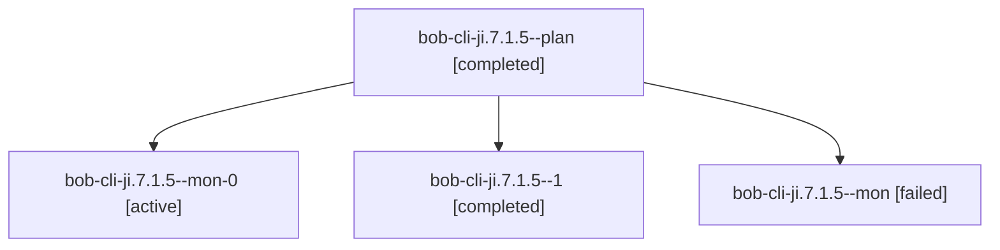

# Session: bob-cli-ji.7.1.5

[Agent Hoods](../README.md) / [bbugyi200](../users/bbugyi200/README.md) / [apollo](../users/bbugyi200/machines/apollo/README.md) / [bob-cli-ji](../users/bbugyi200/machines/apollo/hoods/bob-cli-ji/README.md) / bob-cli-ji.7.1.5

Owner: `bbugyi200.apollo` · Hood: `bob-cli-ji` · Members: 4 · Bead: [bob-cli-ji.7.1.5](https://github.com/bobs-org/bob-cli--beads/blob/main/pages/bob-cli-ji/bob-cli-ji.7.1.5.md)

## Lineage

The diagram is an optional enhancement; the ordered table below contains the same lineage in accessible text.

| Role | Agent | State | Model / provider | Timing | Commits | Prompt | Chat |
|---|---|---|---|---|---:|---|---|
| plan | bob-cli-ji.7.1.5--plan | completed | grok-4.6 / grok | 2026-11-10T20:08:20.569175+00:00 → 2026-11-10T21:01:55.008912+00:00 | 0 | [Prompt](../agents/bbugyi200.apollo.bob-cli-ji.7.1.5--plan/prompt.md) | [Chat](../agents/bbugyi200.apollo.bob-cli-ji.7.1.5--plan/chat.md) |
| mon-0 | bob-cli-ji.7.1.5--mon-0 | active | grok-4.6 / grok | 2026-11-10T21:34:29.798270+00:00 | 0 | — | — |
| 1 | bob-cli-ji.7.1.5--1 | completed | grok-4.6 / grok | 2026-11-10T21:19:11.791623+00:00 → 2026-11-10T21:36:09.365961+00:00 | 0 | [Prompt](../agents/bbugyi200.apollo.bob-cli-ji.7.1.5--1/prompt.md) | [Chat](../agents/bbugyi200.apollo.bob-cli-ji.7.1.5--1/chat.md) |
| mon | bob-cli-ji.7.1.5--mon | failed | grok-4.6 / grok | 2026-11-10T20:58:27.299254+00:00 → 2026-11-10T21:19:12.188979+00:00 | 0 | — | [Chat](../agents/bbugyi200.apollo.bob-cli-ji.7.1.5--mon/chat.md) |

## Neighbors

| Agent | Relation | State |
|---|---|---|
| [bob-cli-ji.7](bbugyi200.apollo.bob-cli-ji.7.md) (session · 3) | ancestor | active 1, completed 2 |
| [bob-cli-ji.7.1.1](../agents/bbugyi200.apollo.bob-cli-ji.7.1.1/README.md) | bob-cli-ji.7.1 hood | completed |
| [bob-cli-ji.7.1.2](bbugyi200.apollo.bob-cli-ji.7.1.2.md) (session · 3) | bob-cli-ji.7.1 hood | completed 2, failed 1 |
| [bob-cli-ji.7.1.3](bbugyi200.apollo.bob-cli-ji.7.1.3.md) (session · 3) | bob-cli-ji.7.1 hood | completed 2, failed 1 |
| [bob-cli-ji.7.1.4](bbugyi200.apollo.bob-cli-ji.7.1.4.md) (session · 15) | bob-cli-ji.7.1 hood | completed 9, failed 6 |
| [bob-cli-ji.7.1.6](../agents/bbugyi200.apollo.bob-cli-ji.7.1.6/README.md) | bob-cli-ji.7.1 hood | waiting |
| [bob-cli-ji.7.1.land](../agents/bbugyi200.apollo.bob-cli-ji.7.1.land/README.md) | bob-cli-ji.7.1 hood | waiting |
| [bob-cli-ji.1](../agents/bbugyi200.apollo.bob-cli-ji.1/README.md) | bob-cli-ji hood | completed |
| [bob-cli-ji.2](../agents/bbugyi200.apollo.bob-cli-ji.2/README.md) | bob-cli-ji hood | completed |
| [bob-cli-ji.3](../agents/bbugyi200.apollo.bob-cli-ji.3/README.md) | bob-cli-ji hood | completed |
| [bob-cli-ji.4](../agents/bbugyi200.apollo.bob-cli-ji.4/README.md) | bob-cli-ji hood | completed |
| [bob-cli-ji.5](../agents/bbugyi200.apollo.bob-cli-ji.5/README.md) | bob-cli-ji hood | completed |
| [bob-cli-ji.6](../agents/bbugyi200.apollo.bob-cli-ji.6/README.md) | bob-cli-ji hood | completed |
| [bob-cli-ji.land](../agents/bbugyi200.apollo.bob-cli-ji.land/README.md) | bob-cli-ji hood | waiting |
