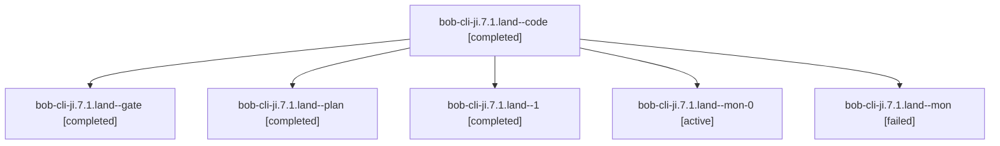

# Session: bob-cli-ji.7.1.land

[Agent Hoods](../README.md) / [bbugyi200](../users/bbugyi200/README.md) / [apollo](../users/bbugyi200/machines/apollo/README.md) / [bob-cli-ji](../users/bbugyi200/machines/apollo/hoods/bob-cli-ji/README.md) / bob-cli-ji.7.1.land

Owner: `bbugyi200.apollo` · Hood: `bob-cli-ji` · Members: 6 · Bead: [bob-cli-ji.7.1](https://github.com/bobs-org/bob-cli--beads/blob/main/pages/bob-cli-ji/bob-cli-ji.7.1.md)

## Lineage

The diagram is an optional enhancement; the ordered table below contains the same lineage in accessible text.

| Role | Agent | State | Model / provider | Timing | Commits | Prompt | Chat |
|---|---|---|---|---|---:|---|---|
| code | bob-cli-ji.7.1.land--code | completed | gpt-6-luna / codex | 2026-11-10T22:37:38.505008+00:00 → 2026-11-10T23:14:54.047036+00:00 | 0 | — | [Chat](../agents/bbugyi200.apollo.bob-cli-ji.7.1.land--code/chat.md) |
| gate | bob-cli-ji.7.1.land--gate | completed | opus / claude | 2026-11-10T22:37:01.682750+00:00 → 2026-11-10T22:37:13.745746+00:00 | 0 | — | [Chat](../agents/bbugyi200.apollo.bob-cli-ji.7.1.land--gate/chat.md) |
| plan | bob-cli-ji.7.1.land--plan | completed | opus / claude | 2026-11-10T22:13:35.268804+00:00 → 2026-11-10T23:14:54.047036+00:00 | 0 | [Prompt](../agents/bbugyi200.apollo.bob-cli-ji.7.1.land--plan/prompt.md) | [Chat](../agents/bbugyi200.apollo.bob-cli-ji.7.1.land--plan/chat.md) |
| 1 | bob-cli-ji.7.1.land--1 | completed | gpt-6-luna / codex | 2026-11-10T23:19:27.176871+00:00 → 2026-11-10T23:29:45.471209+00:00 | [1](../agents/bbugyi200.apollo.bob-cli-ji.7.1.land--1/README.md#commits) | [Prompt](../agents/bbugyi200.apollo.bob-cli-ji.7.1.land--1/prompt.md) | [Chat](../agents/bbugyi200.apollo.bob-cli-ji.7.1.land--1/chat.md) |
| mon-0 | bob-cli-ji.7.1.land--mon-0 | active | gpt-6-luna / codex | 2026-11-10T23:27:23.248797+00:00 | 0 | — | — |
| mon | bob-cli-ji.7.1.land--mon | failed | gpt-6-luna / codex | 2026-11-10T23:13:51.850224+00:00 → 2026-11-10T23:19:27.471976+00:00 | 0 | — | [Chat](../agents/bbugyi200.apollo.bob-cli-ji.7.1.land--mon/chat.md) |

## Commits

| Role | Repo | Commit | Subject | Committed |
|---|---|---|---|---|
| 1 | bob-cli | [`4c1f7dd`](https://github.com/bobs-org/bob-cli/commit/4c1f7dde9f6e8515f069ccfd3e58c30047d76a0e) | fix(gcal): clean event note lint and add preview fixtures | 2026-11-10 18:28:36 EST |

## Neighbors

| Agent | Relation | State |
|---|---|---|
| [bob-cli-ji.7](bbugyi200.apollo.bob-cli-ji.7.md) (session · 3) | ancestor | active 1, completed 2 |
| [bob-cli-ji.7.1.1](../agents/bbugyi200.apollo.bob-cli-ji.7.1.1/README.md) | bob-cli-ji.7.1 hood | completed |
| [bob-cli-ji.7.1.2](bbugyi200.apollo.bob-cli-ji.7.1.2.md) (session · 3) | bob-cli-ji.7.1 hood | completed 2, failed 1 |
| [bob-cli-ji.7.1.3](bbugyi200.apollo.bob-cli-ji.7.1.3.md) (session · 3) | bob-cli-ji.7.1 hood | completed 2, failed 1 |
| [bob-cli-ji.7.1.4](bbugyi200.apollo.bob-cli-ji.7.1.4.md) (session · 15) | bob-cli-ji.7.1 hood | completed 9, failed 6 |
| [bob-cli-ji.7.1.5](bbugyi200.apollo.bob-cli-ji.7.1.5.md) (session · 5) | bob-cli-ji.7.1 hood | completed 3, failed 2 |
| [bob-cli-ji.7.1.6](../agents/bbugyi200.apollo.bob-cli-ji.7.1.6/README.md) | bob-cli-ji.7.1 hood | completed |
| [bob-cli-ji.1](../agents/bbugyi200.apollo.bob-cli-ji.1/README.md) | bob-cli-ji hood | completed |
| [bob-cli-ji.2](../agents/bbugyi200.apollo.bob-cli-ji.2/README.md) | bob-cli-ji hood | completed |
| [bob-cli-ji.3](../agents/bbugyi200.apollo.bob-cli-ji.3/README.md) | bob-cli-ji hood | completed |
| [bob-cli-ji.4](../agents/bbugyi200.apollo.bob-cli-ji.4/README.md) | bob-cli-ji hood | completed |
| [bob-cli-ji.5](../agents/bbugyi200.apollo.bob-cli-ji.5/README.md) | bob-cli-ji hood | completed |
| [bob-cli-ji.6](../agents/bbugyi200.apollo.bob-cli-ji.6/README.md) | bob-cli-ji hood | completed |
| [bob-cli-ji.land](../agents/bbugyi200.apollo.bob-cli-ji.land/README.md) | bob-cli-ji hood | waiting |
