# Session: bob-cli-ji.7.1.land

[Agent Hoods](../README.md) / [bbugyi200](../users/bbugyi200/README.md) / [apollo](../users/bbugyi200/machines/apollo/README.md) / [bob-cli-ji](../users/bbugyi200/machines/apollo/hoods/bob-cli-ji/README.md) / bob-cli-ji.7.1.land

Owner: `bbugyi200.apollo` · Hood: `bob-cli-ji` · Members: 21 · Bead: [bob-cli-ji.7.1](https://github.com/bobs-org/bob-cli--beads/blob/main/pages/bob-cli-ji/bob-cli-ji.7.1.md)

## Lineage

```mermaid
flowchart TD
  n0["bob-cli-ji.7.1.land--7 [completed]"]
  n1["bob-cli-ji.7.1.land--5 [completed]"]
  n0 --> n1
  n2["bob-cli-ji.7.1.land--9 [completed]"]
  n0 --> n2
  n3["bob-cli-ji.7.1.land--code [completed]"]
  n0 --> n3
  n4["bob-cli-ji.7.1.land--mon-6 [failed]"]
  n0 --> n4
  n5["bob-cli-ji.7.1.land--gate [completed]"]
  n0 --> n5
  n6["bob-cli-ji.7.1.land--plan [completed]"]
  n0 --> n6
  n7["bob-cli-ji.7.1.land--1 [completed]"]
  n0 --> n7
  n8["bob-cli-ji.7.1.land--4 [completed]"]
  n0 --> n8
  n9["bob-cli-ji.7.1.land--mon-3 [failed]"]
  n0 --> n9
  n10["bob-cli-ji.7.1.land--mon-1 [failed]"]
  n0 --> n10
  n11["bob-cli-ji.7.1.land--2 [completed]"]
  n0 --> n11
  n12["bob-cli-ji.7.1.land--mon-0 [failed]"]
  n0 --> n12
  n13["bob-cli-ji.7.1.land--8 [completed]"]
  n0 --> n13
  n14["bob-cli-ji.7.1.land--mon-5 [failed]"]
  n0 --> n14
  n15["bob-cli-ji.7.1.land--mon-7 [failed]"]
  n0 --> n15
  n16["bob-cli-ji.7.1.land--mon-2 [failed]"]
  n0 --> n16
  n17["bob-cli-ji.7.1.land--6 [completed]"]
  n0 --> n17
  n18["bob-cli-ji.7.1.land--mon-4 [failed]"]
  n0 --> n18
  n19["bob-cli-ji.7.1.land--mon [failed]"]
  n0 --> n19
  n20["bob-cli-ji.7.1.land--3 [completed]"]
  n0 --> n20
```

The diagram is an optional enhancement; the ordered table below contains the same lineage in accessible text.

| Role | Agent | State | Model / provider | Timing | Commits | Prompt | Chat |
|---|---|---|---|---|---:|---|---|
| 7 | bob-cli-ji.7.1.land--7 | completed | gpt-6-luna / codex | 2026-11-11T01:43:33.336367+00:00 → 2026-11-11T01:45:28.671918+00:00 | 0 | [Prompt](../agents/bbugyi200.apollo.bob-cli-ji.7.1.land--7/prompt.md) | [Chat](../agents/bbugyi200.apollo.bob-cli-ji.7.1.land--7/chat.md) |
| 5 | bob-cli-ji.7.1.land--5 | completed | gpt-6-luna / codex | 2026-11-11T01:02:03.489753+00:00 → 2026-11-11T01:15:23.632717+00:00 | [1](../agents/bbugyi200.apollo.bob-cli-ji.7.1.land--5/README.md#commits) | [Prompt](../agents/bbugyi200.apollo.bob-cli-ji.7.1.land--5/prompt.md) | [Chat](../agents/bbugyi200.apollo.bob-cli-ji.7.1.land--5/chat.md) |
| 9 | bob-cli-ji.7.1.land--9 | completed | gpt-6-luna / codex | 2026-11-11T03:05:59.353745+00:00 → 2026-11-11T03:09:48.610643+00:00 | 0 | [Prompt](../agents/bbugyi200.apollo.bob-cli-ji.7.1.land--9/prompt.md) | [Chat](../agents/bbugyi200.apollo.bob-cli-ji.7.1.land--9/chat.md) |
| code | bob-cli-ji.7.1.land--code | completed | gpt-6-luna / codex | 2026-11-10T22:37:38.505008+00:00 → 2026-11-10T23:14:54.047036+00:00 | 0 | — | [Chat](../agents/bbugyi200.apollo.bob-cli-ji.7.1.land--code/chat.md) |
| mon-6 | bob-cli-ji.7.1.land--mon-6 | failed | gpt-6-luna / codex | 2026-11-11T01:44:50.357761+00:00 → 2026-11-11T02:06:01.097643+00:00 | 0 | — | [Chat](../agents/bbugyi200.apollo.bob-cli-ji.7.1.land--mon-6/chat.md) |
| gate | bob-cli-ji.7.1.land--gate | completed | opus / claude | 2026-11-10T22:37:01.682750+00:00 → 2026-11-10T22:37:13.745746+00:00 | 0 | — | [Chat](../agents/bbugyi200.apollo.bob-cli-ji.7.1.land--gate/chat.md) |
| plan | bob-cli-ji.7.1.land--plan | completed | opus / claude | 2026-11-10T22:13:35.268804+00:00 → 2026-11-10T23:14:54.047036+00:00 | 0 | [Prompt](../agents/bbugyi200.apollo.bob-cli-ji.7.1.land--plan/prompt.md) | [Chat](../agents/bbugyi200.apollo.bob-cli-ji.7.1.land--plan/chat.md) |
| 1 | bob-cli-ji.7.1.land--1 | completed | gpt-6-luna / codex | 2026-11-10T23:19:27.176871+00:00 → 2026-11-10T23:29:45.471209+00:00 | [1](../agents/bbugyi200.apollo.bob-cli-ji.7.1.land--1/README.md#commits) | [Prompt](../agents/bbugyi200.apollo.bob-cli-ji.7.1.land--1/prompt.md) | [Chat](../agents/bbugyi200.apollo.bob-cli-ji.7.1.land--1/chat.md) |
| 4 | bob-cli-ji.7.1.land--4 | completed | gpt-6-luna / codex | 2026-11-11T00:36:42.756828+00:00 → 2026-11-11T00:40:26.133974+00:00 | 0 | [Prompt](../agents/bbugyi200.apollo.bob-cli-ji.7.1.land--4/prompt.md) | [Chat](../agents/bbugyi200.apollo.bob-cli-ji.7.1.land--4/chat.md) |
| mon-3 | bob-cli-ji.7.1.land--mon-3 | failed | gpt-6-luna / codex | 2026-11-11T00:39:14.915573+00:00 → 2026-11-11T01:02:03.697489+00:00 | 0 | — | [Chat](../agents/bbugyi200.apollo.bob-cli-ji.7.1.land--mon-3/chat.md) |
| mon-1 | bob-cli-ji.7.1.land--mon-1 | failed | gpt-6-luna / codex | 2026-11-10T23:48:12.069367+00:00 → 2026-11-11T00:21:31.121012+00:00 | 0 | — | [Chat](../agents/bbugyi200.apollo.bob-cli-ji.7.1.land--mon-1/chat.md) |
| 2 | bob-cli-ji.7.1.land--2 | completed | gpt-6-luna / codex | 2026-11-10T23:41:09.839732+00:00 → 2026-11-10T23:49:25.743470+00:00 | 0 | [Prompt](../agents/bbugyi200.apollo.bob-cli-ji.7.1.land--2/prompt.md) | [Chat](../agents/bbugyi200.apollo.bob-cli-ji.7.1.land--2/chat.md) |
| mon-0 | bob-cli-ji.7.1.land--mon-0 | failed | gpt-6-luna / codex | 2026-11-10T23:27:23.248797+00:00 → 2026-11-10T23:41:09.923841+00:00 | 0 | — | [Chat](../agents/bbugyi200.apollo.bob-cli-ji.7.1.land--mon-0/chat.md) |
| 8 | bob-cli-ji.7.1.land--8 | completed | gpt-6-luna / codex | 2026-11-11T02:06:00.672624+00:00 → 2026-11-11T03:04:55.130436+00:00 | 0 | [Prompt](../agents/bbugyi200.apollo.bob-cli-ji.7.1.land--8/prompt.md) | [Chat](../agents/bbugyi200.apollo.bob-cli-ji.7.1.land--8/chat.md) |
| mon-5 | bob-cli-ji.7.1.land--mon-5 | failed | gpt-6-luna / codex | 2026-11-11T01:41:17.605051+00:00 → 2026-11-11T01:43:33.766180+00:00 | 0 | — | [Chat](../agents/bbugyi200.apollo.bob-cli-ji.7.1.land--mon-5/chat.md) |
| mon-7 | bob-cli-ji.7.1.land--mon-7 | failed | gpt-6-luna / codex | 2026-11-11T02:10:00.593367+00:00 → 2026-11-11T03:05:59.495528+00:00 | 0 | — | [Chat](../agents/bbugyi200.apollo.bob-cli-ji.7.1.land--mon-7/chat.md) |
| mon-2 | bob-cli-ji.7.1.land--mon-2 | failed | gpt-6-luna / codex | 2026-11-11T00:33:56.909699+00:00 → 2026-11-11T00:36:43.188988+00:00 | 0 | — | [Chat](../agents/bbugyi200.apollo.bob-cli-ji.7.1.land--mon-2/chat.md) |
| 6 | bob-cli-ji.7.1.land--6 | completed | gpt-6-luna / codex | 2026-11-11T01:35:25.866898+00:00 → 2026-11-11T01:42:16.987867+00:00 | 0 | [Prompt](../agents/bbugyi200.apollo.bob-cli-ji.7.1.land--6/prompt.md) | [Chat](../agents/bbugyi200.apollo.bob-cli-ji.7.1.land--6/chat.md) |
| mon-4 | bob-cli-ji.7.1.land--mon-4 | failed | gpt-6-luna / codex | 2026-11-11T01:12:47.151487+00:00 → 2026-11-11T01:35:26.160955+00:00 | 0 | — | [Chat](../agents/bbugyi200.apollo.bob-cli-ji.7.1.land--mon-4/chat.md) |
| mon | bob-cli-ji.7.1.land--mon | failed | gpt-6-luna / codex | 2026-11-10T23:13:51.850224+00:00 → 2026-11-10T23:19:27.471976+00:00 | 0 | — | [Chat](../agents/bbugyi200.apollo.bob-cli-ji.7.1.land--mon/chat.md) |
| 3 | bob-cli-ji.7.1.land--3 | completed | gpt-6-luna / codex | 2026-11-11T00:21:30.806924+00:00 → 2026-11-11T00:35:14.534292+00:00 | 0 | [Prompt](../agents/bbugyi200.apollo.bob-cli-ji.7.1.land--3/prompt.md) | [Chat](../agents/bbugyi200.apollo.bob-cli-ji.7.1.land--3/chat.md) |

## Commits

| Role | Repo | Commit | Subject | Committed |
|---|---|---|---|---|
| 1 | bob-cli | [`4c1f7dd`](https://github.com/bobs-org/bob-cli/commit/4c1f7dde9f6e8515f069ccfd3e58c30047d76a0e) | fix(gcal): clean event note lint and add preview fixtures | 2026-11-10 18:28:36 EST |
| 5 | bob-cli | [`85e618d`](https://github.com/bobs-org/bob-cli/commit/85e618d889ab2172c29ab5b25cae66d209968936) | test(cli): align catalog and gcal doctor expectations | 2026-11-10 20:14:17 EST |

## Neighbors

| Agent | Relation | State |
|---|---|---|
| [bob-cli-ji.7](bbugyi200.apollo.bob-cli-ji.7.md) (session · 3) | ancestor | active 1, completed 2 |
| [bob-cli-ji.7.1.1](../agents/bbugyi200.apollo.bob-cli-ji.7.1.1/README.md) | bob-cli-ji.7.1 hood | completed |
| [bob-cli-ji.7.1.2](bbugyi200.apollo.bob-cli-ji.7.1.2.md) (session · 3) | bob-cli-ji.7.1 hood | completed 2, failed 1 |
| [bob-cli-ji.7.1.3](bbugyi200.apollo.bob-cli-ji.7.1.3.md) (session · 3) | bob-cli-ji.7.1 hood | completed 2, failed 1 |
| [bob-cli-ji.7.1.4](bbugyi200.apollo.bob-cli-ji.7.1.4.md) (session · 15) | bob-cli-ji.7.1 hood | completed 9, failed 6 |
| [bob-cli-ji.7.1.5](bbugyi200.apollo.bob-cli-ji.7.1.5.md) (session · 5) | bob-cli-ji.7.1 hood | completed 3, failed 2 |
| [bob-cli-ji.7.1.6](../agents/bbugyi200.apollo.bob-cli-ji.7.1.6/README.md) | bob-cli-ji.7.1 hood | completed |
| [bob-cli-ji.1](../agents/bbugyi200.apollo.bob-cli-ji.1/README.md) | bob-cli-ji hood | completed |
| [bob-cli-ji.2](../agents/bbugyi200.apollo.bob-cli-ji.2/README.md) | bob-cli-ji hood | completed |
| [bob-cli-ji.3](../agents/bbugyi200.apollo.bob-cli-ji.3/README.md) | bob-cli-ji hood | completed |
| [bob-cli-ji.4](../agents/bbugyi200.apollo.bob-cli-ji.4/README.md) | bob-cli-ji hood | completed |
| [bob-cli-ji.5](../agents/bbugyi200.apollo.bob-cli-ji.5/README.md) | bob-cli-ji hood | completed |
| [bob-cli-ji.6](../agents/bbugyi200.apollo.bob-cli-ji.6/README.md) | bob-cli-ji hood | completed |
| [bob-cli-ji.8.1](../agents/bbugyi200.apollo.bob-cli-ji.8.1/README.md) | bob-cli-ji hood | completed |
| [bob-cli-ji.8.2](../agents/bbugyi200.apollo.bob-cli-ji.8.2/README.md) | bob-cli-ji hood | completed |
| [bob-cli-ji.8.3](../agents/bbugyi200.apollo.bob-cli-ji.8.3/README.md) | bob-cli-ji hood | waiting |
| [bob-cli-ji.8.4](../agents/bbugyi200.apollo.bob-cli-ji.8.4/README.md) | bob-cli-ji hood | waiting |
| [bob-cli-ji.8.land](../agents/bbugyi200.apollo.bob-cli-ji.8.land/README.md) | bob-cli-ji hood | waiting |
| [bob-cli-ji.land](bbugyi200.apollo.bob-cli-ji.land.md) (session · 3) | bob-cli-ji hood | active 1, completed 2 |
