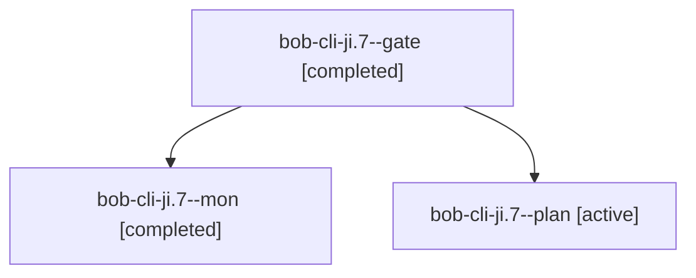

# Session: bob-cli-ji.7

[Agent Hoods](../README.md) / [bbugyi200](../users/bbugyi200/README.md) / [apollo](../users/bbugyi200/machines/apollo/README.md) / [bob-cli-ji](../users/bbugyi200/machines/apollo/hoods/bob-cli-ji/README.md) / bob-cli-ji.7

Owner: `bbugyi200.apollo` · Hood: `bob-cli-ji` · Members: 3 · Bead: [bob-cli-ji.7](https://github.com/bobs-org/bob-cli--beads/blob/main/pages/bob-cli-ji/bob-cli-ji.7.md)

## Lineage

The diagram is an optional enhancement; the ordered table below contains the same lineage in accessible text.

| Role | Agent | State | Model / provider | Timing | Commits | Prompt | Chat |
|---|---|---|---|---|---:|---|---|
| gate | bob-cli-ji.7--gate | completed | gpt-6-astra / codex | 2026-11-10T15:29:18.411210+00:00 → 2026-11-10T15:29:39.232609+00:00 | 0 | — | [Chat](../agents/bbugyi200.apollo.bob-cli-ji.7--gate/chat.md) |
| mon | bob-cli-ji.7--mon | completed | gpt-6-astra / codex | 2026-11-10T15:29:37.421263+00:00 → 2026-11-10T15:31:35.518191+00:00 | 0 | — | [Chat](../agents/bbugyi200.apollo.bob-cli-ji.7--mon/chat.md) |
| plan | bob-cli-ji.7--plan | active | gpt-6-astra / codex | 2026-11-10T15:16:24.226708+00:00 → 2026-11-10T15:29:47.613449+00:00 | 0 | [Prompt](../agents/bbugyi200.apollo.bob-cli-ji.7--plan/prompt.md) | [Chat](../agents/bbugyi200.apollo.bob-cli-ji.7--plan/chat.md) |

## Neighbors

| Agent | Relation | State |
|---|---|---|
| [bob-cli-ji.7.1.1](../agents/bbugyi200.apollo.bob-cli-ji.7.1.1/README.md) | descendant | completed |
| [bob-cli-ji.7.1.2](bbugyi200.apollo.bob-cli-ji.7.1.2.md) (session · 2) | descendant | active 1, completed 1 |
| [bob-cli-ji.7.1.3](bbugyi200.apollo.bob-cli-ji.7.1.3.md) (session · 3) | descendant | active 1, completed 1, failed 1 |
| [bob-cli-ji.7.1.4](../agents/bbugyi200.apollo.bob-cli-ji.7.1.4/README.md) | descendant | waiting |
| [bob-cli-ji.7.1.5](../agents/bbugyi200.apollo.bob-cli-ji.7.1.5/README.md) | descendant | waiting |
| [bob-cli-ji.7.1.6](../agents/bbugyi200.apollo.bob-cli-ji.7.1.6/README.md) | descendant | waiting |
| [bob-cli-ji.7.1.land](../agents/bbugyi200.apollo.bob-cli-ji.7.1.land/README.md) | descendant | waiting |
| [bob-cli-ji.1](../agents/bbugyi200.apollo.bob-cli-ji.1/README.md) | bob-cli-ji hood | completed |
| [bob-cli-ji.2](../agents/bbugyi200.apollo.bob-cli-ji.2/README.md) | bob-cli-ji hood | completed |
| [bob-cli-ji.3](../agents/bbugyi200.apollo.bob-cli-ji.3/README.md) | bob-cli-ji hood | completed |
| [bob-cli-ji.4](../agents/bbugyi200.apollo.bob-cli-ji.4/README.md) | bob-cli-ji hood | completed |
| [bob-cli-ji.5](../agents/bbugyi200.apollo.bob-cli-ji.5/README.md) | bob-cli-ji hood | completed |
| [bob-cli-ji.6](../agents/bbugyi200.apollo.bob-cli-ji.6/README.md) | bob-cli-ji hood | completed |
| [bob-cli-ji.land](../agents/bbugyi200.apollo.bob-cli-ji.land/README.md) | bob-cli-ji hood | waiting |
