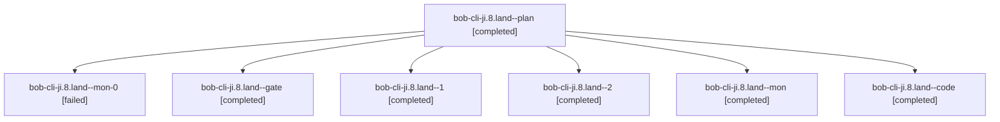

# Session: bob-cli-ji.8.land

[Agent Hoods](../README.md) / [bbugyi200](../users/bbugyi200/README.md) / [apollo](../users/bbugyi200/machines/apollo/README.md) / [bob-cli-ji](../users/bbugyi200/machines/apollo/hoods/bob-cli-ji/README.md) / bob-cli-ji.8.land

Owner: `bbugyi200.apollo` · Hood: `bob-cli-ji` · Members: 7 · Bead: [bob-cli-ji.8](https://github.com/bobs-org/bob-cli--beads/blob/main/pages/bob-cli-ji/bob-cli-ji.8.md)

## Lineage

The diagram is an optional enhancement; the ordered table below contains the same lineage in accessible text.

| Role | Agent | State | Model / provider | Timing | Commits | Prompt | Chat |
|---|---|---|---|---|---:|---|---|
| plan | bob-cli-ji.8.land--plan | completed | gpt-6-astra / codex | 2026-11-11T06:26:05.242672+00:00 → 2026-11-11T07:14:27.192717+00:00 | 0 | [Prompt](../agents/bbugyi200.apollo.bob-cli-ji.8.land--plan/prompt.md) | [Chat](../agents/bbugyi200.apollo.bob-cli-ji.8.land--plan/chat.md) |
| mon-0 | bob-cli-ji.8.land--mon-0 | failed | muse-spark-1.3-contributor / muse | 2026-11-11T07:22:12.591195+00:00 → 2026-11-11T07:40:53.022660+00:00 | 0 | — | [Chat](../agents/bbugyi200.apollo.bob-cli-ji.8.land--mon-0/chat.md) |
| gate | bob-cli-ji.8.land--gate | completed | gpt-6-astra / codex | 2026-11-11T06:39:00.711298+00:00 → 2026-11-11T06:39:12.413445+00:00 | 0 | — | [Chat](../agents/bbugyi200.apollo.bob-cli-ji.8.land--gate/chat.md) |
| 1 | bob-cli-ji.8.land--1 | completed | muse-spark-1.3-contributor / muse | 2026-11-11T07:19:19.775759+00:00 → 2026-11-11T07:23:18.331404+00:00 | 0 | [Prompt](../agents/bbugyi200.apollo.bob-cli-ji.8.land--1/prompt.md) | [Chat](../agents/bbugyi200.apollo.bob-cli-ji.8.land--1/chat.md) |
| 2 | bob-cli-ji.8.land--2 | completed | muse-spark-1.3-contributor / muse | 2026-11-11T07:40:52.635934+00:00 → 2026-11-11T07:48:39.709387+00:00 | 0 | [Prompt](../agents/bbugyi200.apollo.bob-cli-ji.8.land--2/prompt.md) | [Chat](../agents/bbugyi200.apollo.bob-cli-ji.8.land--2/chat.md) |
| mon | bob-cli-ji.8.land--mon | completed | muse-spark-1.3-contributor / muse | 2026-11-11T07:11:58.400487+00:00 → 2026-11-11T07:19:20.282800+00:00 | 0 | — | [Chat](../agents/bbugyi200.apollo.bob-cli-ji.8.land--mon/chat.md) |
| code | bob-cli-ji.8.land--code | completed | muse-spark-1.3-contributor / muse | 2026-11-11T06:39:37.422702+00:00 → 2026-11-11T07:14:27.192717+00:00 | [1](../agents/bbugyi200.apollo.bob-cli-ji.8.land--code/README.md#commits) | — | [Chat](../agents/bbugyi200.apollo.bob-cli-ji.8.land--code/chat.md) |

## Commits

| Role | Repo | Commit | Subject | Committed |
|---|---|---|---|---|
| code | bob-cli | [`05ec825`](https://github.com/bobs-org/bob-cli/commit/05ec8253f144ed6e5947f659a17eb50dea45d251) | fix(gcal): finish private note landing boundary cases | 2026-11-11 02:12:55 EST |

## Neighbors

| Agent | Relation | State |
|---|---|---|
| [bob-cli-ji.8.1](../agents/bbugyi200.apollo.bob-cli-ji.8.1/README.md) | bob-cli-ji.8 hood | completed |
| [bob-cli-ji.8.2](../agents/bbugyi200.apollo.bob-cli-ji.8.2/README.md) | bob-cli-ji.8 hood | completed |
| [bob-cli-ji.8.3](../agents/bbugyi200.apollo.bob-cli-ji.8.3/README.md) | bob-cli-ji.8 hood | completed |
| [bob-cli-ji.8.4](../agents/bbugyi200.apollo.bob-cli-ji.8.4/README.md) | bob-cli-ji.8 hood | completed |
| [bob-cli-ji.1](../agents/bbugyi200.apollo.bob-cli-ji.1/README.md) | bob-cli-ji hood | completed |
| [bob-cli-ji.2](../agents/bbugyi200.apollo.bob-cli-ji.2/README.md) | bob-cli-ji hood | completed |
| [bob-cli-ji.3](../agents/bbugyi200.apollo.bob-cli-ji.3/README.md) | bob-cli-ji hood | completed |
| [bob-cli-ji.4](../agents/bbugyi200.apollo.bob-cli-ji.4/README.md) | bob-cli-ji hood | completed |
| [bob-cli-ji.5](../agents/bbugyi200.apollo.bob-cli-ji.5/README.md) | bob-cli-ji hood | completed |
| [bob-cli-ji.6](../agents/bbugyi200.apollo.bob-cli-ji.6/README.md) | bob-cli-ji hood | completed |
| [bob-cli-ji.7](bbugyi200.apollo.bob-cli-ji.7.md) (session · 3) | bob-cli-ji hood | active 1, completed 2 |
| [bob-cli-ji.7.1.1](../agents/bbugyi200.apollo.bob-cli-ji.7.1.1/README.md) | bob-cli-ji hood | completed |
| [bob-cli-ji.7.1.2](bbugyi200.apollo.bob-cli-ji.7.1.2.md) (session · 3) | bob-cli-ji hood | completed 2, failed 1 |
| [bob-cli-ji.7.1.3](bbugyi200.apollo.bob-cli-ji.7.1.3.md) (session · 3) | bob-cli-ji hood | completed 2, failed 1 |
| [bob-cli-ji.7.1.4](bbugyi200.apollo.bob-cli-ji.7.1.4.md) (session · 15) | bob-cli-ji hood | completed 9, failed 6 |
| [bob-cli-ji.7.1.5](bbugyi200.apollo.bob-cli-ji.7.1.5.md) (session · 5) | bob-cli-ji hood | completed 3, failed 2 |
| [bob-cli-ji.7.1.6](../agents/bbugyi200.apollo.bob-cli-ji.7.1.6/README.md) | bob-cli-ji hood | completed |
| [bob-cli-ji.7.1.land](bbugyi200.apollo.bob-cli-ji.7.1.land.md) (session · 21) | bob-cli-ji hood | completed 12, failed 9 |
| [bob-cli-ji.land](bbugyi200.apollo.bob-cli-ji.land.md) (session · 3) | bob-cli-ji hood | active 1, completed 2 |
