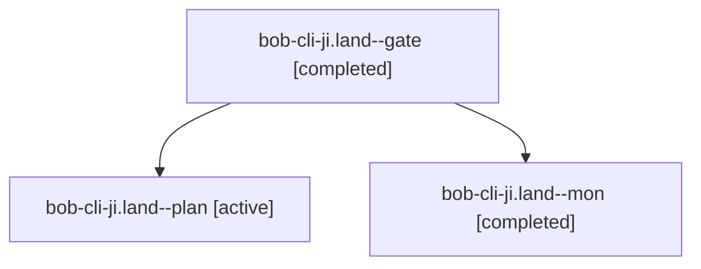

# Session: bob-cli-ji.land

[Agent Hoods](../README.md) / [bbugyi200](../users/bbugyi200/README.md) / [apollo](../users/bbugyi200/machines/apollo/README.md) / [bob-cli-ji](../users/bbugyi200/machines/apollo/hoods/bob-cli-ji/README.md) / bob-cli-ji.land

Owner: `bbugyi200.apollo` · Hood: `bob-cli-ji` · Members: 3 · Bead: [bob-cli-ji](https://github.com/bobs-org/bob-cli--beads/blob/main/pages/bob-cli-ji/README.md)

## Lineage

The diagram is an optional enhancement; the ordered table below contains the same lineage in accessible text.

| Role | Agent | State | Model / provider | Timing | Commits | Prompt | Chat |
|---|---|---|---|---|---:|---|---|
| gate | bob-cli-ji.land--gate | completed | opus / claude | 2026-11-11T03:31:22.792877+00:00 → 2026-11-11T03:31:39.818789+00:00 | 0 | — | [Chat](../agents/bbugyi200.apollo.bob-cli-ji.land--gate/chat.md) |
| plan | bob-cli-ji.land--plan | active | opus / claude | 2026-11-11T03:04:22.805033+00:00 → 2026-11-11T03:31:47.501375+00:00 | 0 | [Prompt](../agents/bbugyi200.apollo.bob-cli-ji.land--plan/prompt.md) | [Chat](../agents/bbugyi200.apollo.bob-cli-ji.land--plan/chat.md) |
| mon | bob-cli-ji.land--mon | completed | opus / claude | 2026-11-11T03:31:38.272571+00:00 → 2026-11-11T03:33:12.613806+00:00 | 0 | — | [Chat](../agents/bbugyi200.apollo.bob-cli-ji.land--mon/chat.md) |

## Neighbors

| Agent | Relation | State |
|---|---|---|
| [bob-cli-ji.1](../agents/bbugyi200.apollo.bob-cli-ji.1/README.md) | bob-cli-ji hood | completed |
| [bob-cli-ji.2](../agents/bbugyi200.apollo.bob-cli-ji.2/README.md) | bob-cli-ji hood | completed |
| [bob-cli-ji.3](../agents/bbugyi200.apollo.bob-cli-ji.3/README.md) | bob-cli-ji hood | completed |
| [bob-cli-ji.4](../agents/bbugyi200.apollo.bob-cli-ji.4/README.md) | bob-cli-ji hood | completed |
| [bob-cli-ji.5](../agents/bbugyi200.apollo.bob-cli-ji.5/README.md) | bob-cli-ji hood | completed |
| [bob-cli-ji.6](../agents/bbugyi200.apollo.bob-cli-ji.6/README.md) | bob-cli-ji hood | completed |
| [bob-cli-ji.7](bbugyi200.apollo.bob-cli-ji.7.md) (session · 3) | bob-cli-ji hood | active 1, completed 2 |
| [bob-cli-ji.7.1.1](../agents/bbugyi200.apollo.bob-cli-ji.7.1.1/README.md) | bob-cli-ji hood | completed |
| [bob-cli-ji.7.1.2](bbugyi200.apollo.bob-cli-ji.7.1.2.md) (session · 3) | bob-cli-ji hood | completed 2, failed 1 |
| [bob-cli-ji.7.1.3](bbugyi200.apollo.bob-cli-ji.7.1.3.md) (session · 3) | bob-cli-ji hood | completed 2, failed 1 |
| [bob-cli-ji.7.1.4](bbugyi200.apollo.bob-cli-ji.7.1.4.md) (session · 15) | bob-cli-ji hood | completed 9, failed 6 |
| [bob-cli-ji.7.1.5](bbugyi200.apollo.bob-cli-ji.7.1.5.md) (session · 5) | bob-cli-ji hood | completed 3, failed 2 |
| [bob-cli-ji.7.1.6](../agents/bbugyi200.apollo.bob-cli-ji.7.1.6/README.md) | bob-cli-ji hood | completed |
| [bob-cli-ji.7.1.land](bbugyi200.apollo.bob-cli-ji.7.1.land.md) (session · 21) | bob-cli-ji hood | completed 12, failed 9 |
| [bob-cli-ji.8.1](../agents/bbugyi200.apollo.bob-cli-ji.8.1/README.md) | bob-cli-ji hood | completed |
| [bob-cli-ji.8.2](../agents/bbugyi200.apollo.bob-cli-ji.8.2/README.md) | bob-cli-ji hood | completed |
| [bob-cli-ji.8.3](../agents/bbugyi200.apollo.bob-cli-ji.8.3/README.md) | bob-cli-ji hood | completed |
| [bob-cli-ji.8.4](../agents/bbugyi200.apollo.bob-cli-ji.8.4/README.md) | bob-cli-ji hood | waiting |
| [bob-cli-ji.8.land](../agents/bbugyi200.apollo.bob-cli-ji.8.land/README.md) | bob-cli-ji hood | waiting |
