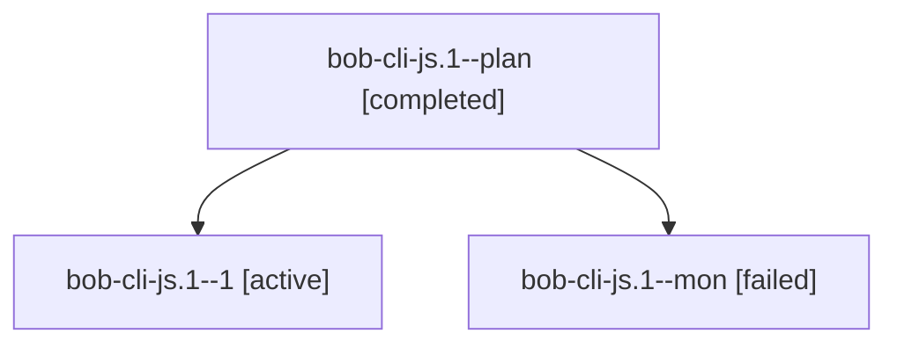

# Session: bob-cli-js.1

[Agent Hoods](../README.md) / [bbugyi200](../users/bbugyi200/README.md) / [apollo](../users/bbugyi200/machines/apollo/README.md) / [bob-cli-js](../users/bbugyi200/machines/apollo/hoods/bob-cli-js/README.md) / bob-cli-js.1

Owner: `bbugyi200.apollo` · Hood: `bob-cli-js` · Members: 3 · Bead: [bob-cli-js.1](https://github.com/bobs-org/bob-cli--beads/blob/main/pages/bob-cli-js/bob-cli-js.1.md)

## Lineage

The diagram is an optional enhancement; the ordered table below contains the same lineage in accessible text.

| Role | Agent | State | Model / provider | Timing | Commits | Prompt | Chat |
|---|---|---|---|---|---:|---|---|
| plan | bob-cli-js.1--plan | completed | gpt-6-luna / codex | 2026-11-10T16:50:36.060053+00:00 → 2026-11-10T17:25:40.124962+00:00 | 0 | [Prompt](../agents/bbugyi200.apollo.bob-cli-js.1--plan/prompt.md) | [Chat](../agents/bbugyi200.apollo.bob-cli-js.1--plan/chat.md) |
| 1 | bob-cli-js.1--1 | active | gpt-6-luna / codex | 2026-11-10T17:27:57.330091+00:00 | 0 | [Prompt](../agents/bbugyi200.apollo.bob-cli-js.1--1/prompt.md) | — |
| mon | bob-cli-js.1--mon | failed | gpt-6-luna / codex | 2026-11-10T17:24:30.585824+00:00 → 2026-11-10T17:27:47.623633+00:00 | 0 | — | [Chat](../agents/bbugyi200.apollo.bob-cli-js.1--mon/chat.md) |

## Neighbors

| Agent | Relation | State |
|---|---|---|
| [bob-cli-js.2](../agents/bbugyi200.apollo.bob-cli-js.2/README.md) | bob-cli-js hood | completed |
| [bob-cli-js.3](../agents/bbugyi200.apollo.bob-cli-js.3/README.md) | bob-cli-js hood | active |
| [bob-cli-js.4](../agents/bbugyi200.apollo.bob-cli-js.4/README.md) | bob-cli-js hood | waiting |
| [bob-cli-js.5](../agents/bbugyi200.apollo.bob-cli-js.5/README.md) | bob-cli-js hood | waiting |
| [bob-cli-js.land](../agents/bbugyi200.apollo.bob-cli-js.land/README.md) | bob-cli-js hood | waiting |
