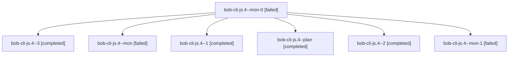

# Session: bob-cli-js.4

[Agent Hoods](../README.md) / [bbugyi200](../users/bbugyi200/README.md) / [apollo](../users/bbugyi200/machines/apollo/README.md) / [bob-cli-js](../users/bbugyi200/machines/apollo/hoods/bob-cli-js/README.md) / bob-cli-js.4

Owner: `bbugyi200.apollo` · Hood: `bob-cli-js` · Members: 7 · Bead: [bob-cli-js.4](https://github.com/bobs-org/bob-cli--beads/blob/main/pages/bob-cli-js/bob-cli-js.4.md)

## Lineage

The diagram is an optional enhancement; the ordered table below contains the same lineage in accessible text.

| Role | Agent | State | Model / provider | Timing | Commits | Prompt | Chat |
|---|---|---|---|---|---:|---|---|
| mon-0 | bob-cli-js.4--mon-0 | failed | gpt-6-luna / codex | 2026-11-10T19:02:02.406879+00:00 → 2026-11-10T19:05:22.059330+00:00 | 0 | — | [Chat](../agents/bbugyi200.apollo.bob-cli-js.4--mon-0/chat.md) |
| 3 | bob-cli-js.4--3 | completed | gpt-6-luna / codex | 2026-11-10T19:10:16.160342+00:00 → 2026-11-10T19:21:52.144758+00:00 | [1](../agents/bbugyi200.apollo.bob-cli-js.4--3/README.md#commits) | [Prompt](../agents/bbugyi200.apollo.bob-cli-js.4--3/prompt.md) | [Chat](../agents/bbugyi200.apollo.bob-cli-js.4--3/chat.md) |
| mon | bob-cli-js.4--mon | failed | gpt-6-luna / codex | 2026-11-10T18:56:25.349140+00:00 → 2026-11-10T18:58:57.375803+00:00 | 0 | — | [Chat](../agents/bbugyi200.apollo.bob-cli-js.4--mon/chat.md) |
| 1 | bob-cli-js.4--1 | completed | gpt-6-luna / codex | 2026-11-10T18:58:57.025107+00:00 → 2026-11-10T19:03:09.251431+00:00 | 0 | [Prompt](../agents/bbugyi200.apollo.bob-cli-js.4--1/prompt.md) | [Chat](../agents/bbugyi200.apollo.bob-cli-js.4--1/chat.md) |
| plan | bob-cli-js.4--plan | completed | gpt-6-luna / codex | 2026-11-10T18:20:37.215427+00:00 → 2026-11-10T18:57:12.980139+00:00 | 0 | [Prompt](../agents/bbugyi200.apollo.bob-cli-js.4--plan/prompt.md) | [Chat](../agents/bbugyi200.apollo.bob-cli-js.4--plan/chat.md) |
| 2 | bob-cli-js.4--2 | completed | gpt-6-luna / codex | 2026-11-10T19:05:21.685359+00:00 → 2026-11-10T19:08:01.818399+00:00 | 0 | [Prompt](../agents/bbugyi200.apollo.bob-cli-js.4--2/prompt.md) | [Chat](../agents/bbugyi200.apollo.bob-cli-js.4--2/chat.md) |
| mon-1 | bob-cli-js.4--mon-1 | failed | gpt-6-luna / codex | 2026-11-10T19:07:09.189921+00:00 → 2026-11-10T19:10:16.350872+00:00 | 0 | — | [Chat](../agents/bbugyi200.apollo.bob-cli-js.4--mon-1/chat.md) |

## Commits

| Role | Repo | Commit | Subject | Committed |
|---|---|---|---|---|
| 3 | bob-cli | [`9cd4ec3`](https://github.com/bobs-org/bob-cli/commit/9cd4ec3e590d187ecdad70e685c198bd45095b6c) | docs(stats): describe aligned period charts | 2026-11-10 14:20:54 EST |

## Neighbors

| Agent | Relation | State |
|---|---|---|
| [bob-cli-js.1](bbugyi200.apollo.bob-cli-js.1.md) (session · 3) | bob-cli-js hood | completed 2, failed 1 |
| [bob-cli-js.2](../agents/bbugyi200.apollo.bob-cli-js.2/README.md) | bob-cli-js hood | completed |
| [bob-cli-js.3](../agents/bbugyi200.apollo.bob-cli-js.3/README.md) | bob-cli-js hood | completed |
| [bob-cli-js.5](../agents/bbugyi200.apollo.bob-cli-js.5/README.md) | bob-cli-js hood | completed |
| [bob-cli-js.land](../agents/bbugyi200.apollo.bob-cli-js.land/README.md) | bob-cli-js hood | waiting |
