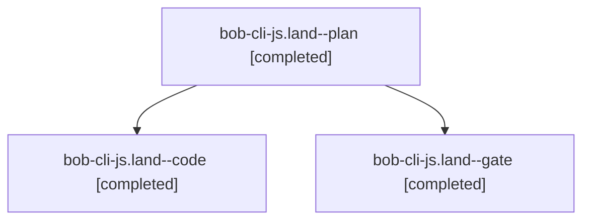

# Session: bob-cli-js.land

[Agent Hoods](../README.md) / [bbugyi200](../users/bbugyi200/README.md) / [apollo](../users/bbugyi200/machines/apollo/README.md) / [bob-cli-js](../users/bbugyi200/machines/apollo/hoods/bob-cli-js/README.md) / bob-cli-js.land

Owner: `bbugyi200.apollo` · Hood: `bob-cli-js` · Members: 3 · Bead: [bob-cli-js](https://github.com/bobs-org/bob-cli--beads/blob/main/pages/bob-cli-js/README.md)

## Lineage

The diagram is an optional enhancement; the ordered table below contains the same lineage in accessible text.

| Role | Agent | State | Model / provider | Timing | Commits | Prompt | Chat |
|---|---|---|---|---|---:|---|---|
| plan | bob-cli-js.land--plan | completed | opus / claude | 2026-11-10T19:53:59.712601+00:00 → 2026-11-10T20:50:58.250957+00:00 | 0 | [Prompt](../agents/bbugyi200.apollo.bob-cli-js.land--plan/prompt.md) | [Chat](../agents/bbugyi200.apollo.bob-cli-js.land--plan/chat.md) |
| code | bob-cli-js.land--code | completed | muse-spark-1.3-contributor / muse | 2026-11-10T20:21:10.367440+00:00 → 2026-11-10T20:50:58.250957+00:00 | [1](../agents/bbugyi200.apollo.bob-cli-js.land--code/README.md#commits) | — | [Chat](../agents/bbugyi200.apollo.bob-cli-js.land--code/chat.md) |
| gate | bob-cli-js.land--gate | completed | opus / claude | 2026-11-10T20:20:21.416199+00:00 → 2026-11-10T20:20:37.583413+00:00 | 0 | — | [Chat](../agents/bbugyi200.apollo.bob-cli-js.land--gate/chat.md) |

## Commits

| Role | Repo | Commit | Subject | Committed |
|---|---|---|---|---|
| code | bob-cli | [`991e270`](https://github.com/bobs-org/bob-cli/commit/991e270e4eae5d6f979c8cae902b90a0174cf9c6) | docs(stats): record period strip geometry, fills, and budgets beside Controls | 2026-11-10 15:49:00 EST |

## Neighbors

| Agent | Relation | State |
|---|---|---|
| [bob-cli-js.1](bbugyi200.apollo.bob-cli-js.1.md) (session · 3) | bob-cli-js hood | completed 2, failed 1 |
| [bob-cli-js.2](../agents/bbugyi200.apollo.bob-cli-js.2/README.md) | bob-cli-js hood | completed |
| [bob-cli-js.3](../agents/bbugyi200.apollo.bob-cli-js.3/README.md) | bob-cli-js hood | completed |
| [bob-cli-js.4](bbugyi200.apollo.bob-cli-js.4.md) (session · 7) | bob-cli-js hood | completed 4, failed 3 |
| [bob-cli-js.5](../agents/bbugyi200.apollo.bob-cli-js.5/README.md) | bob-cli-js hood | completed |
