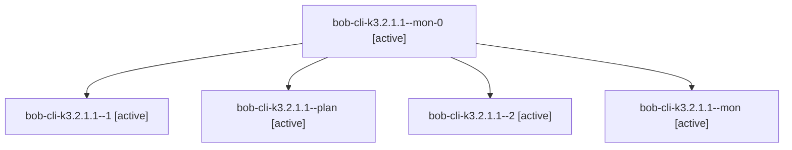

# Session: bob-cli-k3.2.1.1

[Agent Hoods](../README.md) / [bbugyi200](../users/bbugyi200/README.md) / [apollo](../users/bbugyi200/machines/apollo/README.md) / [bob-cli-k3](../users/bbugyi200/machines/apollo/hoods/bob-cli-k3/README.md) / bob-cli-k3.2.1.1

Owner: `bbugyi200.apollo` · Hood: `bob-cli-k3` · Members: 5 · Bead: [bob-cli-k3.2.1.1](https://github.com/bobs-org/bob-cli--beads/blob/main/pages/bob-cli-k3/bob-cli-k3.2.1.1.md)

## Lineage

The diagram is an optional enhancement; the ordered table below contains the same lineage in accessible text.

| Role | Agent | State | Model / provider | Timing | Commits | Prompt | Chat |
|---|---|---|---|---|---:|---|---|
| mon-0 | bob-cli-k3.2.1.1--mon-0 | active | gpt-6-luna / codex | 2026-11-11T10:51:37.195964+00:00 | 0 | — | [Chat](../agents/bbugyi200.apollo.bob-cli-k3.2.1.1--mon-0/chat.md) |
| 1 | bob-cli-k3.2.1.1--1 | active | gpt-6-luna / codex | 2026-11-11T10:48:23.983446+00:00 | 0 | [Prompt](../agents/bbugyi200.apollo.bob-cli-k3.2.1.1--1/prompt.md) | [Chat](../agents/bbugyi200.apollo.bob-cli-k3.2.1.1--1/chat.md) |
| plan | bob-cli-k3.2.1.1--plan | active | gpt-6-luna / codex | 2026-11-11T10:08:07.546818+00:00 | 0 | [Prompt](../agents/bbugyi200.apollo.bob-cli-k3.2.1.1--plan/prompt.md) | [Chat](../agents/bbugyi200.apollo.bob-cli-k3.2.1.1--plan/chat.md) |
| 2 | bob-cli-k3.2.1.1--2 | active | gpt-6-luna / codex | 2026-11-11T10:57:31.077495+00:00 | [1](../agents/bbugyi200.apollo.bob-cli-k3.2.1.1--2/README.md#commits) | [Prompt](../agents/bbugyi200.apollo.bob-cli-k3.2.1.1--2/prompt.md) | [Chat](../agents/bbugyi200.apollo.bob-cli-k3.2.1.1--2/chat.md) |
| mon | bob-cli-k3.2.1.1--mon | active | gpt-6-luna / codex | 2026-11-11T10:42:37.292767+00:00 | 0 | — | [Chat](../agents/bbugyi200.apollo.bob-cli-k3.2.1.1--mon/chat.md) |

## Commits

| Role | Repo | Commit | Subject | Committed |
|---|---|---|---|---|
| 2 | bob-cli | [`f977009`](https://github.com/bobs-org/bob-cli/commit/f977009a26f64775b377c27ed885fdf61ef6f1da) | feat(albums): parse declarations through shared schema validation | 2026-11-11 06:00:18 EST |

## Neighbors

| Agent | Relation | State |
|---|---|---|
| [bob-cli-k3.2](bbugyi200.apollo.bob-cli-k3.2.md) (session · 3) | ancestor | active 1, completed 2 |
| [bob-cli-k3.2.1.2](../agents/bbugyi200.apollo.bob-cli-k3.2.1.2/README.md) | bob-cli-k3.2.1 hood | failed |
| [bob-cli-k3.2.1.3](../agents/bbugyi200.apollo.bob-cli-k3.2.1.3/README.md) | bob-cli-k3.2.1 hood | waiting |
| [bob-cli-k3.2.1.land](../agents/bbugyi200.apollo.bob-cli-k3.2.1.land/README.md) | bob-cli-k3.2.1 hood | waiting |
| [bob-cli-k3.1](../agents/bbugyi200.apollo.bob-cli-k3.1/README.md) | bob-cli-k3 hood | active |
| [bob-cli-k3.10](../agents/bbugyi200.apollo.bob-cli-k3.10/README.md) | bob-cli-k3 hood | waiting |
| [bob-cli-k3.11](../agents/bbugyi200.apollo.bob-cli-k3.11/README.md) | bob-cli-k3 hood | waiting |
| [bob-cli-k3.3](bbugyi200.apollo.bob-cli-k3.3.md) (session · 3) | bob-cli-k3 hood | completed 3 |
| [bob-cli-k3.4](../agents/bbugyi200.apollo.bob-cli-k3.4/README.md) | bob-cli-k3 hood | waiting |
| [bob-cli-k3.5](../agents/bbugyi200.apollo.bob-cli-k3.5/README.md) | bob-cli-k3 hood | waiting |
| [bob-cli-k3.6](../agents/bbugyi200.apollo.bob-cli-k3.6/README.md) | bob-cli-k3 hood | waiting |
| [bob-cli-k3.7](../agents/bbugyi200.apollo.bob-cli-k3.7/README.md) | bob-cli-k3 hood | waiting |
| [bob-cli-k3.8](../agents/bbugyi200.apollo.bob-cli-k3.8/README.md) | bob-cli-k3 hood | waiting |
| [bob-cli-k3.9](../agents/bbugyi200.apollo.bob-cli-k3.9/README.md) | bob-cli-k3 hood | waiting |
| [bob-cli-k3.land](../agents/bbugyi200.apollo.bob-cli-k3.land/README.md) | bob-cli-k3 hood | waiting |
