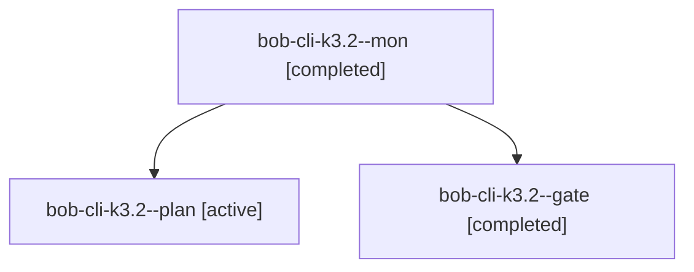

# Session: bob-cli-k3.2

[Agent Hoods](../README.md) / [bbugyi200](../users/bbugyi200/README.md) / [apollo](../users/bbugyi200/machines/apollo/README.md) / [bob-cli-k3](../users/bbugyi200/machines/apollo/hoods/bob-cli-k3/README.md) / bob-cli-k3.2

Owner: `bbugyi200.apollo` · Hood: `bob-cli-k3` · Members: 3 · Bead: [bob-cli-k3.2](https://github.com/bobs-org/bob-cli--beads/blob/main/pages/bob-cli-k3/bob-cli-k3.2.md)

## Lineage

The diagram is an optional enhancement; the ordered table below contains the same lineage in accessible text.

| Role | Agent | State | Model / provider | Timing | Commits | Prompt | Chat |
|---|---|---|---|---|---:|---|---|
| mon | bob-cli-k3.2--mon | completed | gpt-6-astra / codex | 2026-11-11T10:06:55.524384+00:00 → 2026-11-11T10:08:24.779264+00:00 | 0 | — | [Chat](../agents/bbugyi200.apollo.bob-cli-k3.2--mon/chat.md) |
| plan | bob-cli-k3.2--plan | active | gpt-6-astra / codex | 2026-11-11T09:57:47.503676+00:00 → 2026-11-11T10:07:03.689036+00:00 | 0 | [Prompt](../agents/bbugyi200.apollo.bob-cli-k3.2--plan/prompt.md) | [Chat](../agents/bbugyi200.apollo.bob-cli-k3.2--plan/chat.md) |
| gate | bob-cli-k3.2--gate | completed | gpt-6-astra / codex | 2026-11-11T10:06:39.404796+00:00 → 2026-11-11T10:06:57.178178+00:00 | 0 | — | [Chat](../agents/bbugyi200.apollo.bob-cli-k3.2--gate/chat.md) |

## Neighbors

| Agent | Relation | State |
|---|---|---|
| [bob-cli-k3.2.1.1](../agents/bbugyi200.apollo.bob-cli-k3.2.1.1/README.md) | descendant | active |
| [bob-cli-k3.2.1.2](../agents/bbugyi200.apollo.bob-cli-k3.2.1.2/README.md) | descendant | waiting |
| [bob-cli-k3.2.1.3](../agents/bbugyi200.apollo.bob-cli-k3.2.1.3/README.md) | descendant | waiting |
| [bob-cli-k3.2.1.land](../agents/bbugyi200.apollo.bob-cli-k3.2.1.land/README.md) | descendant | waiting |
| [bob-cli-k3.1](../agents/bbugyi200.apollo.bob-cli-k3.1/README.md) | bob-cli-k3 hood | active |
| [bob-cli-k3.10](../agents/bbugyi200.apollo.bob-cli-k3.10/README.md) | bob-cli-k3 hood | waiting |
| [bob-cli-k3.11](../agents/bbugyi200.apollo.bob-cli-k3.11/README.md) | bob-cli-k3 hood | waiting |
| [bob-cli-k3.3](../agents/bbugyi200.apollo.bob-cli-k3.3/README.md) | bob-cli-k3 hood | active |
| [bob-cli-k3.4](../agents/bbugyi200.apollo.bob-cli-k3.4/README.md) | bob-cli-k3 hood | waiting |
| [bob-cli-k3.5](../agents/bbugyi200.apollo.bob-cli-k3.5/README.md) | bob-cli-k3 hood | waiting |
| [bob-cli-k3.6](../agents/bbugyi200.apollo.bob-cli-k3.6/README.md) | bob-cli-k3 hood | waiting |
| [bob-cli-k3.7](../agents/bbugyi200.apollo.bob-cli-k3.7/README.md) | bob-cli-k3 hood | waiting |
| [bob-cli-k3.8](../agents/bbugyi200.apollo.bob-cli-k3.8/README.md) | bob-cli-k3 hood | waiting |
| [bob-cli-k3.9](../agents/bbugyi200.apollo.bob-cli-k3.9/README.md) | bob-cli-k3 hood | waiting |
| [bob-cli-k3.land](../agents/bbugyi200.apollo.bob-cli-k3.land/README.md) | bob-cli-k3 hood | waiting |
