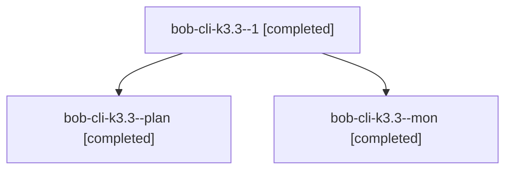

# Session: bob-cli-k3.3

[Agent Hoods](../README.md) / [bbugyi200](../users/bbugyi200/README.md) / [apollo](../users/bbugyi200/machines/apollo/README.md) / [bob-cli-k3](../users/bbugyi200/machines/apollo/hoods/bob-cli-k3/README.md) / bob-cli-k3.3

Owner: `bbugyi200.apollo` · Hood: `bob-cli-k3` · Members: 3 · Bead: [bob-cli-k3.3](https://github.com/bobs-org/bob-cli--beads/blob/main/pages/bob-cli-k3/bob-cli-k3.3.md)

## Lineage

The diagram is an optional enhancement; the ordered table below contains the same lineage in accessible text.

| Role | Agent | State | Model / provider | Timing | Commits | Prompt | Chat |
|---|---|---|---|---|---:|---|---|
| 1 | bob-cli-k3.3--1 | completed | grok-4.6 / grok | 2026-11-11T10:47:09.015573+00:00 → 2026-11-11T11:04:26.312717+00:00 | [1](../agents/bbugyi200.apollo.bob-cli-k3.3--1/README.md#commits) | [Prompt](../agents/bbugyi200.apollo.bob-cli-k3.3--1/prompt.md) | [Chat](../agents/bbugyi200.apollo.bob-cli-k3.3--1/chat.md) |
| plan | bob-cli-k3.3--plan | completed | grok-4.6 / grok | 2026-11-11T09:58:05.321582+00:00 → 2026-11-11T10:38:49.789867+00:00 | 0 | [Prompt](../agents/bbugyi200.apollo.bob-cli-k3.3--plan/prompt.md) | [Chat](../agents/bbugyi200.apollo.bob-cli-k3.3--plan/chat.md) |
| mon | bob-cli-k3.3--mon | completed | grok-4.6 / grok | 2026-11-11T10:37:39.378675+00:00 → 2026-11-11T10:47:09.210052+00:00 | 0 | — | [Chat](../agents/bbugyi200.apollo.bob-cli-k3.3--mon/chat.md) |

## Commits

| Role | Repo | Commit | Subject | Committed |
|---|---|---|---|---|
| 1 | bob-cli | [`d0ada55`](https://github.com/bobs-org/bob-cli/commit/d0ada555a8b60c74933f9ce4eb3aa8c0469b0d64) | refactor(notebooks): extract shared host-catalog region engine | 2026-11-11 06:03:48 EST |

## Neighbors

| Agent | Relation | State |
|---|---|---|
| [bob-cli-k3.1](../agents/bbugyi200.apollo.bob-cli-k3.1/README.md) | bob-cli-k3 hood | active |
| [bob-cli-k3.10](../agents/bbugyi200.apollo.bob-cli-k3.10/README.md) | bob-cli-k3 hood | waiting |
| [bob-cli-k3.11](../agents/bbugyi200.apollo.bob-cli-k3.11/README.md) | bob-cli-k3 hood | waiting |
| [bob-cli-k3.2](bbugyi200.apollo.bob-cli-k3.2.md) (session · 3) | bob-cli-k3 hood | active 1, completed 2 |
| [bob-cli-k3.2.1.1](bbugyi200.apollo.bob-cli-k3.2.1.1.md) (session · 5) | bob-cli-k3 hood | active 5 |
| [bob-cli-k3.2.1.2](../agents/bbugyi200.apollo.bob-cli-k3.2.1.2/README.md) | bob-cli-k3 hood | failed |
| [bob-cli-k3.2.1.3](../agents/bbugyi200.apollo.bob-cli-k3.2.1.3/README.md) | bob-cli-k3 hood | waiting |
| [bob-cli-k3.2.1.land](../agents/bbugyi200.apollo.bob-cli-k3.2.1.land/README.md) | bob-cli-k3 hood | waiting |
| [bob-cli-k3.4](../agents/bbugyi200.apollo.bob-cli-k3.4/README.md) | bob-cli-k3 hood | waiting |
| [bob-cli-k3.5](../agents/bbugyi200.apollo.bob-cli-k3.5/README.md) | bob-cli-k3 hood | waiting |
| [bob-cli-k3.6](../agents/bbugyi200.apollo.bob-cli-k3.6/README.md) | bob-cli-k3 hood | waiting |
| [bob-cli-k3.7](../agents/bbugyi200.apollo.bob-cli-k3.7/README.md) | bob-cli-k3 hood | waiting |
| [bob-cli-k3.8](../agents/bbugyi200.apollo.bob-cli-k3.8/README.md) | bob-cli-k3 hood | waiting |
| [bob-cli-k3.9](../agents/bbugyi200.apollo.bob-cli-k3.9/README.md) | bob-cli-k3 hood | waiting |
| [bob-cli-k3.land](../agents/bbugyi200.apollo.bob-cli-k3.land/README.md) | bob-cli-k3 hood | waiting |
