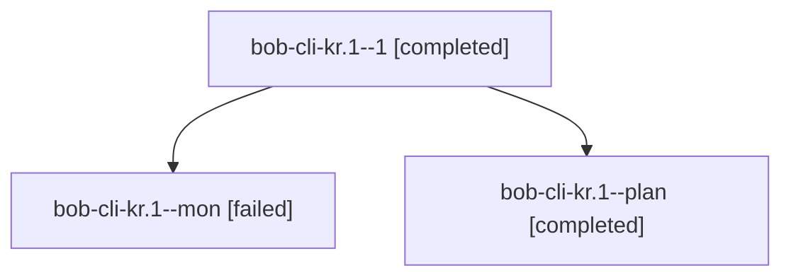

# Session: bob-cli-kr.1

[Agent Hoods](../README.md) / [bbugyi200](../users/bbugyi200/README.md) / [apollo](../users/bbugyi200/machines/apollo/README.md) / [bob-cli-kr](../users/bbugyi200/machines/apollo/hoods/bob-cli-kr/README.md) / bob-cli-kr.1

Owner: `bbugyi200.apollo` · Hood: `bob-cli-kr` · Members: 3 · Bead: [bob-cli-kr.1](https://github.com/bobs-org/bob-cli--beads/blob/main/pages/bob-cli-kr/bob-cli-kr.1.md)

## Lineage

The diagram is an optional enhancement; the ordered table below contains the same lineage in accessible text.

| Role | Agent | State | Model / provider | Timing | Commits | Prompt | Chat |
|---|---|---|---|---|---:|---|---|
| 1 | bob-cli-kr.1--1 | completed | gpt-6-luna / codex | 2026-11-12T12:27:52.200945+00:00 → 2026-11-12T12:45:58.542157+00:00 | [1](../agents/bbugyi200.apollo.bob-cli-kr.1--1/README.md#commits) | [Prompt](../agents/bbugyi200.apollo.bob-cli-kr.1--1/prompt.md) | [Chat](../agents/bbugyi200.apollo.bob-cli-kr.1--1/chat.md) |
| mon | bob-cli-kr.1--mon | failed | gpt-6-luna / codex | 2026-11-12T12:25:27.188853+00:00 → 2026-11-12T12:27:46.526380+00:00 | 0 | — | [Chat](../agents/bbugyi200.apollo.bob-cli-kr.1--mon/chat.md) |
| plan | bob-cli-kr.1--plan | completed | gpt-6-luna / codex | 2026-11-12T12:02:26.909083+00:00 → 2026-11-12T12:26:19.852277+00:00 | 0 | [Prompt](../agents/bbugyi200.apollo.bob-cli-kr.1--plan/prompt.md) | [Chat](../agents/bbugyi200.apollo.bob-cli-kr.1--plan/chat.md) |

## Commits

| Role | Repo | Commit | Subject | Committed |
|---|---|---|---|---|
| 1 | bob-cli | [`1174a17`](https://github.com/bobs-org/bob-cli/commit/1174a17b7cf18bf6d9b3e98968657e313b7aa5b6) | feat(albums): report schema metadata and emit canonical YAML records | 2026-11-12 07:45:21 EST |

## Neighbors

| Agent | Relation | State |
|---|---|---|
| [bob-cli-kr.2](bbugyi200.apollo.bob-cli-kr.2.md) (session · 3) | bob-cli-kr hood | active 1, completed 2 |
| [bob-cli-kr.2.1.1](../agents/bbugyi200.apollo.bob-cli-kr.2.1.1/README.md) | bob-cli-kr hood | completed |
| [bob-cli-kr.2.1.2](../agents/bbugyi200.apollo.bob-cli-kr.2.1.2/README.md) | bob-cli-kr hood | completed |
| [bob-cli-kr.2.1.3](../agents/bbugyi200.apollo.bob-cli-kr.2.1.3/README.md) | bob-cli-kr hood | completed |
| [bob-cli-kr.2.1.land](bbugyi200.apollo.bob-cli-kr.2.1.land.md) (session · 3) | bob-cli-kr hood | completed 3 |
| [bob-cli-kr.3](bbugyi200.apollo.bob-cli-kr.3.md) (session · 3) | bob-cli-kr hood | completed 3 |
| [bob-cli-kr.4](bbugyi200.apollo.bob-cli-kr.4.md) (session · 3) | bob-cli-kr hood | active 1, completed 2 |
| [bob-cli-kr.4.1.1](../agents/bbugyi200.apollo.bob-cli-kr.4.1.1/README.md) | bob-cli-kr hood | completed |
| [bob-cli-kr.4.1.2](bbugyi200.apollo.bob-cli-kr.4.1.2.md) (session · 3) | bob-cli-kr hood | completed 3 |
| [bob-cli-kr.4.1.3](../agents/bbugyi200.apollo.bob-cli-kr.4.1.3/README.md) | bob-cli-kr hood | completed |
| [bob-cli-kr.4.1.4](../agents/bbugyi200.apollo.bob-cli-kr.4.1.4/README.md) | bob-cli-kr hood | completed |
| [bob-cli-kr.4.1.land](../agents/bbugyi200.apollo.bob-cli-kr.4.1.land/README.md) | bob-cli-kr hood | waiting |
| [bob-cli-kr.land](../agents/bbugyi200.apollo.bob-cli-kr.land/README.md) | bob-cli-kr hood | waiting |
