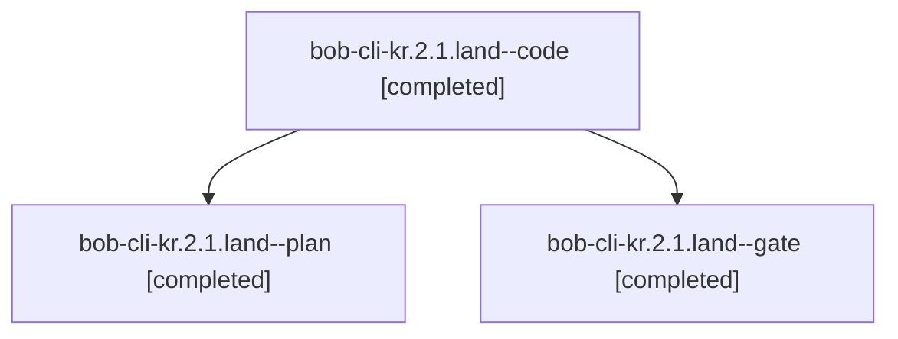

# Session: bob-cli-kr.2.1.land

[Agent Hoods](../README.md) / [bbugyi200](../users/bbugyi200/README.md) / [apollo](../users/bbugyi200/machines/apollo/README.md) / [bob-cli-kr](../users/bbugyi200/machines/apollo/hoods/bob-cli-kr/README.md) / bob-cli-kr.2.1.land

Owner: `bbugyi200.apollo` · Hood: `bob-cli-kr` · Members: 3 · Bead: [bob-cli-kr.2.1](https://github.com/bobs-org/bob-cli--beads/blob/main/pages/bob-cli-kr/bob-cli-kr.2.1.md)

## Lineage



The diagram is an optional enhancement; the ordered table below contains the same lineage in accessible text.

| Role | Agent | State | Model / provider | Timing | Commits | Prompt | Chat |
|---|---|---|---|---|---:|---|---|
| <a id="member-code"></a>code | bob-cli-kr.2.1.land--code | completed | muse-spark-1.3-contributor / muse | 2026-11-12T16:54:24.376810+00:00 → 2026-11-12T18:40:24.492738+00:00 | [1](../agents/bbugyi200.apollo.bob-cli-kr.2.1.land--code/README.md#commits) | — | [Chat](../agents/bbugyi200.apollo.bob-cli-kr.2.1.land--code/chat.md) |
| <a id="member-plan"></a>plan | bob-cli-kr.2.1.land--plan | completed | gpt-6-astra / codex | 2026-11-12T16:35:42.772006+00:00 → 2026-11-12T18:40:24.492738+00:00 | 0 | [Prompt](../agents/bbugyi200.apollo.bob-cli-kr.2.1.land--plan/prompt.md) | [Chat](../agents/bbugyi200.apollo.bob-cli-kr.2.1.land--plan/chat.md) |
| <a id="member-gate"></a>gate | bob-cli-kr.2.1.land--gate | completed | gpt-6-astra / codex | 2026-11-12T16:53:28.351437+00:00 → 2026-11-12T16:53:48.425394+00:00 | 0 | — | [Chat](../agents/bbugyi200.apollo.bob-cli-kr.2.1.land--gate/chat.md) |

## Commits

| Role | Repo | Commit | Subject | Committed |
|---|---|---|---|---|
| code | bob-cli | [`27dd275`](https://github.com/bobs-org/bob-cli/commit/27dd275664eb928df33f88cc952604b1dc18f106) | feat(albums): repair guarded writer landing | 2026-11-12 13:38:15 EST |

## Variables

| Role | Variable | Value |
|---|---|---|
| plan | `artifacts` | \[{kind: file, label: Album writer landing probes at 859c1571, path: /home/bryan/.sase/artifacts/agents/gh\_bobs-org\_\_bob-cli/20261112075734/album\_writer\_probe-0c05b2026f71.py, ref: file:explicit:4ba44… |

#### artifacts

**Role:** `plan`

```yaml
- kind: file
  label: Album writer landing probes at 859c1571
  path: /home/bryan/.sase/artifacts/agents/gh_bobs-org__bob-cli/20261112075734/album_writer_probe-0c05b2026f71.py
  ref: file:explicit:4ba442ece3ddd5ba8cac9f6c
  source_path: /tmp/album_writer_probe.py
- kind: file
  label: Album writer landing probe results at 859c1571
  path: /home/bryan/.sase/artifacts/agents/gh_bobs-org__bob-cli/20261112075734/album_writer_probe-30319e6ad9e8.jsonl
  ref: file:explicit:3dc194da13754b6cbd345f2b
  source_path: /tmp/album_writer_probe.jsonl
```

Values are truncated for display; see each member's agent meta.json for the full values.

## Neighbors

| Agent | Relation | State |
|---|---|---|
| [bob-cli-kr.2](bbugyi200.apollo.bob-cli-kr.2.md) (session · 3) | ancestor | active 1, completed 2 |
| [bob-cli-kr.2.1.1](../agents/bbugyi200.apollo.bob-cli-kr.2.1.1/README.md) | bob-cli-kr.2.1 hood | completed |
| [bob-cli-kr.2.1.2](../agents/bbugyi200.apollo.bob-cli-kr.2.1.2/README.md) | bob-cli-kr.2.1 hood | completed |
| [bob-cli-kr.2.1.3](../agents/bbugyi200.apollo.bob-cli-kr.2.1.3/README.md) | bob-cli-kr.2.1 hood | completed |
| [bob-cli-kr.1](bbugyi200.apollo.bob-cli-kr.1.md) (session · 3) | bob-cli-kr hood | completed 2, failed 1 |
| [bob-cli-kr.3](bbugyi200.apollo.bob-cli-kr.3.md) (session · 3) | bob-cli-kr hood | completed 3 |
| [bob-cli-kr.4](bbugyi200.apollo.bob-cli-kr.4.md) (session · 3) | bob-cli-kr hood | active 1, completed 2 |
| [bob-cli-kr.4.1.1](../agents/bbugyi200.apollo.bob-cli-kr.4.1.1/README.md) | bob-cli-kr hood | completed |
| [bob-cli-kr.4.1.2](bbugyi200.apollo.bob-cli-kr.4.1.2.md) (session · 3) | bob-cli-kr hood | completed 3 |
| [bob-cli-kr.4.1.3](../agents/bbugyi200.apollo.bob-cli-kr.4.1.3/README.md) | bob-cli-kr hood | completed |
| [bob-cli-kr.4.1.4](../agents/bbugyi200.apollo.bob-cli-kr.4.1.4/README.md) | bob-cli-kr hood | completed |
| [bob-cli-kr.4.1.land](../agents/bbugyi200.apollo.bob-cli-kr.4.1.land/README.md) | bob-cli-kr hood | waiting |
| [bob-cli-kr.land](../agents/bbugyi200.apollo.bob-cli-kr.land/README.md) | bob-cli-kr hood | waiting |
