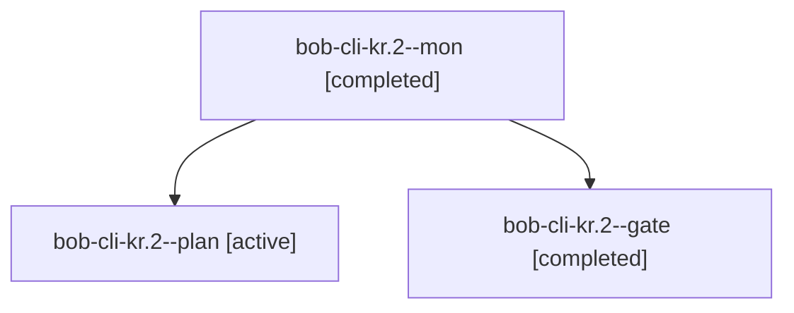

# Session: bob-cli-kr.2

[Agent Hoods](../README.md) / [bbugyi200](../users/bbugyi200/README.md) / [apollo](../users/bbugyi200/machines/apollo/README.md) / [bob-cli-kr](../users/bbugyi200/machines/apollo/hoods/bob-cli-kr/README.md) / bob-cli-kr.2

Owner: `bbugyi200.apollo` · Hood: `bob-cli-kr` · Members: 3 · Bead: [bob-cli-kr.2](https://github.com/bobs-org/bob-cli--beads/blob/main/pages/bob-cli-kr/bob-cli-kr.2.md)

## Lineage

The diagram is an optional enhancement; the ordered table below contains the same lineage in accessible text.

| Role | Agent | State | Model / provider | Timing | Commits | Prompt | Chat |
|---|---|---|---|---|---:|---|---|
| mon | bob-cli-kr.2--mon | completed | gpt-6-astra / codex | 2026-11-12T12:56:33.812990+00:00 → 2026-11-12T12:58:03.614474+00:00 | 0 | — | [Chat](../agents/bbugyi200.apollo.bob-cli-kr.2--mon/chat.md) |
| plan | bob-cli-kr.2--plan | active | gpt-6-astra / codex | 2026-11-12T12:46:39.989988+00:00 → 2026-11-12T12:56:43.516690+00:00 | 0 | [Prompt](../agents/bbugyi200.apollo.bob-cli-kr.2--plan/prompt.md) | [Chat](../agents/bbugyi200.apollo.bob-cli-kr.2--plan/chat.md) |
| gate | bob-cli-kr.2--gate | completed | gpt-6-astra / codex | 2026-11-12T12:56:18.501956+00:00 → 2026-11-12T12:56:35.279944+00:00 | 0 | — | [Chat](../agents/bbugyi200.apollo.bob-cli-kr.2--gate/chat.md) |

## Neighbors

| Agent | Relation | State |
|---|---|---|
| [bob-cli-kr.2.1.1](../agents/bbugyi200.apollo.bob-cli-kr.2.1.1/README.md) | descendant | completed |
| [bob-cli-kr.2.1.2](../agents/bbugyi200.apollo.bob-cli-kr.2.1.2/README.md) | descendant | completed |
| [bob-cli-kr.2.1.3](../agents/bbugyi200.apollo.bob-cli-kr.2.1.3/README.md) | descendant | completed |
| [bob-cli-kr.2.1.land](bbugyi200.apollo.bob-cli-kr.2.1.land.md) (session · 3) | descendant | completed 3 |
| [bob-cli-kr.1](bbugyi200.apollo.bob-cli-kr.1.md) (session · 3) | bob-cli-kr hood | completed 2, failed 1 |
| [bob-cli-kr.3](bbugyi200.apollo.bob-cli-kr.3.md) (session · 3) | bob-cli-kr hood | completed 3 |
| [bob-cli-kr.4](bbugyi200.apollo.bob-cli-kr.4.md) (session · 3) | bob-cli-kr hood | active 1, completed 2 |
| [bob-cli-kr.4.1.1](../agents/bbugyi200.apollo.bob-cli-kr.4.1.1/README.md) | bob-cli-kr hood | completed |
| [bob-cli-kr.4.1.2](bbugyi200.apollo.bob-cli-kr.4.1.2.md) (session · 3) | bob-cli-kr hood | completed 3 |
| [bob-cli-kr.4.1.3](../agents/bbugyi200.apollo.bob-cli-kr.4.1.3/README.md) | bob-cli-kr hood | active |
| [bob-cli-kr.4.1.4](../agents/bbugyi200.apollo.bob-cli-kr.4.1.4/README.md) | bob-cli-kr hood | active |
| [bob-cli-kr.4.1.land](../agents/bbugyi200.apollo.bob-cli-kr.4.1.land/README.md) | bob-cli-kr hood | waiting |
| [bob-cli-kr.land](../agents/bbugyi200.apollo.bob-cli-kr.land/README.md) | bob-cli-kr hood | waiting |
