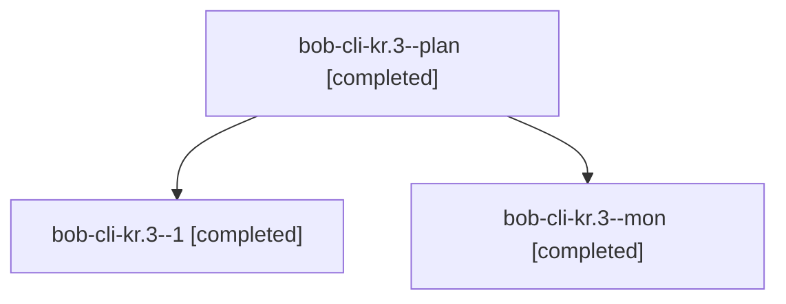

# Session: bob-cli-kr.3

[Agent Hoods](../README.md) / [bbugyi200](../users/bbugyi200/README.md) / [apollo](../users/bbugyi200/machines/apollo/README.md) / [bob-cli-kr](../users/bbugyi200/machines/apollo/hoods/bob-cli-kr/README.md) / bob-cli-kr.3

Owner: `bbugyi200.apollo` · Hood: `bob-cli-kr` · Members: 3 · Bead: [bob-cli-kr.3](https://github.com/bobs-org/bob-cli--beads/blob/main/pages/bob-cli-kr/bob-cli-kr.3.md)

## Lineage

The diagram is an optional enhancement; the ordered table below contains the same lineage in accessible text.

| Role | Agent | State | Model / provider | Timing | Commits | Prompt | Chat |
|---|---|---|---|---|---:|---|---|
| plan | bob-cli-kr.3--plan | completed | grok-4.6 / grok | 2026-11-12T12:46:43.622064+00:00 → 2026-11-12T12:54:14.274111+00:00 | 0 | [Prompt](../agents/bbugyi200.apollo.bob-cli-kr.3--plan/prompt.md) | [Chat](../agents/bbugyi200.apollo.bob-cli-kr.3--plan/chat.md) |
| 1 | bob-cli-kr.3--1 | completed | grok-4.6 / grok | 2026-11-12T16:26:27.882058+00:00 → 2026-11-12T16:48:37.540897+00:00 | 0 | [Prompt](../agents/bbugyi200.apollo.bob-cli-kr.3--1/prompt.md) | [Chat](../agents/bbugyi200.apollo.bob-cli-kr.3--1/chat.md) |
| mon | bob-cli-kr.3--mon | completed | grok-4.6 / grok | 2026-11-12T12:53:23.817484+00:00 → 2026-11-12T16:25:48.983688+00:00 | 0 | — | [Chat](../agents/bbugyi200.apollo.bob-cli-kr.3--mon/chat.md) |

## Neighbors

| Agent | Relation | State |
|---|---|---|
| [bob-cli-kr.1](bbugyi200.apollo.bob-cli-kr.1.md) (session · 3) | bob-cli-kr hood | completed 2, failed 1 |
| [bob-cli-kr.2](bbugyi200.apollo.bob-cli-kr.2.md) (session · 3) | bob-cli-kr hood | active 1, completed 2 |
| [bob-cli-kr.2.1.1](../agents/bbugyi200.apollo.bob-cli-kr.2.1.1/README.md) | bob-cli-kr hood | completed |
| [bob-cli-kr.2.1.2](../agents/bbugyi200.apollo.bob-cli-kr.2.1.2/README.md) | bob-cli-kr hood | completed |
| [bob-cli-kr.2.1.3](../agents/bbugyi200.apollo.bob-cli-kr.2.1.3/README.md) | bob-cli-kr hood | completed |
| [bob-cli-kr.2.1.land](bbugyi200.apollo.bob-cli-kr.2.1.land.md) (session · 3) | bob-cli-kr hood | completed 3 |
| [bob-cli-kr.4](../agents/bbugyi200.apollo.bob-cli-kr.4/README.md) | bob-cli-kr hood | waiting |
| [bob-cli-kr.land](../agents/bbugyi200.apollo.bob-cli-kr.land/README.md) | bob-cli-kr hood | waiting |
