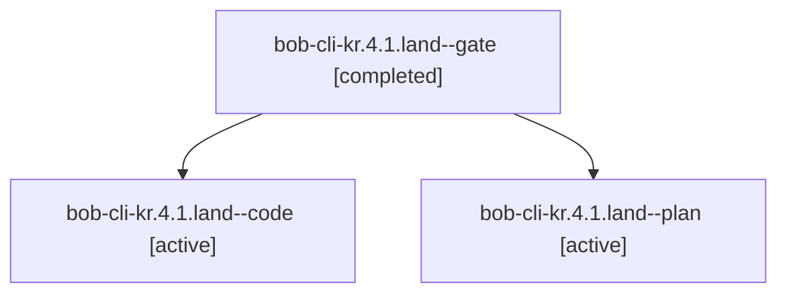

# Session: bob-cli-kr.4.1.land

[Agent Hoods](../README.md) / [bbugyi200](../users/bbugyi200/README.md) / [apollo](../users/bbugyi200/machines/apollo/README.md) / [bob-cli-kr](../users/bbugyi200/machines/apollo/hoods/bob-cli-kr/README.md) / bob-cli-kr.4.1.land

Owner: `bbugyi200.apollo` · Hood: `bob-cli-kr` · Members: 3 · Bead: [bob-cli-kr.4.1](https://github.com/bobs-org/bob-cli--beads/blob/main/pages/bob-cli-kr/bob-cli-kr.4.1.md)

## Lineage



The diagram is an optional enhancement; the ordered table below contains the same lineage in accessible text.

| Role | Agent | State | Model / provider | Timing | Commits | Prompt | Chat |
|---|---|---|---|---|---:|---|---|
| <a id="member-gate"></a>gate | bob-cli-kr.4.1.land--gate | completed | opus / claude | 2026-11-13T11:24:54.097146+00:00 → 2026-11-13T11:25:12.384265+00:00 | 0 | — | [Chat](../agents/bbugyi200.apollo.bob-cli-kr.4.1.land--gate/chat.md) |
| <a id="member-code"></a>code | bob-cli-kr.4.1.land--code | active | muse-spark-1.3-contributor / muse | 2026-11-13T11:25:30.962442+00:00 | 0 | — | — |
| <a id="member-plan"></a>plan | bob-cli-kr.4.1.land--plan | active | opus / claude | 2026-11-13T10:54:31.928057+00:00 | 0 | [Prompt](../agents/bbugyi200.apollo.bob-cli-kr.4.1.land--plan/prompt.md) | [Chat](../agents/bbugyi200.apollo.bob-cli-kr.4.1.land--plan/chat.md) |

## Variables

| Role | Variable | Value |
|---|---|---|
| plan | `artifacts` | \[{bead: bob-cli-kr.4.1, kind: file, label: kr.4.1 retry9 Athena Schema Card acceptance report (failed: Escape closes card), path: /home/bryan/.sase/artifacts/agents/gh\_bobs-org\_\_bob-cli/2026111305524… |

#### artifacts

**Role:** `plan`

```yaml
- bead: bob-cli-kr.4.1
  kind: file
  label: kr.4.1 retry9 Athena Schema Card acceptance report (failed: Escape closes card)
  path: /home/bryan/.sase/artifacts/agents/gh_bobs-org__bob-cli/20261113055247/kr41-retry9-report-618fb0e21afe.json
  ref: file:explicit:8e68c5d0513e71274d202fee
  source_path: /tmp/kr41-retry9-report.json
- bead: bob-cli-kr.4.1
  kind: image
  label: kr.4.1 retry9 failure screenshot (Schema Card closed after stage Escape)
  path: /home/bryan/.sase/artifacts/agents/gh_bobs-org__bob-cli/20261113055247/kr41-retry9-failure-f646ff4354a3.png
  ref: file:explicit:75cb5d89ae49e96e3e71d623
  source_path: /tmp/kr41-retry9-failure.png
- bead: bob-cli-kr.4.1
  kind: file
  label: kr.4.1 restored uncommitted Schema Card plugin tree (b6f3dd9 + tale repairs; retry9)
  path: /home/bryan/.sase/artifacts/agents/gh_bobs-org__bob-cli/20261113055247/kr41-restored-plugin-tree.tar-ae91803b5c38.gz
  ref: file:explicit:4faa9afe6d48156b45617f53
  source_path: /tmp/kr41-restored-plugin-tree.tar.gz
```

Values are truncated for display; see each member's agent meta.json for the full values.

## Neighbors

| Agent | Relation | State |
|---|---|---|
| [bob-cli-kr.4](bbugyi200.apollo.bob-cli-kr.4.md) (session · 3) | ancestor | active 1, completed 2 |
| [bob-cli-kr.4.1.1](../agents/bbugyi200.apollo.bob-cli-kr.4.1.1/README.md) | bob-cli-kr.4.1 hood | completed |
| [bob-cli-kr.4.1.2](bbugyi200.apollo.bob-cli-kr.4.1.2.md) (session · 3) | bob-cli-kr.4.1 hood | completed 3 |
| [bob-cli-kr.4.1.3](../agents/bbugyi200.apollo.bob-cli-kr.4.1.3/README.md) | bob-cli-kr.4.1 hood | completed |
| [bob-cli-kr.4.1.4](../agents/bbugyi200.apollo.bob-cli-kr.4.1.4/README.md) | bob-cli-kr.4.1 hood | completed |
| [bob-cli-kr.1](bbugyi200.apollo.bob-cli-kr.1.md) (session · 3) | bob-cli-kr hood | completed 2, failed 1 |
| [bob-cli-kr.2](bbugyi200.apollo.bob-cli-kr.2.md) (session · 3) | bob-cli-kr hood | active 1, completed 2 |
| [bob-cli-kr.2.1.1](../agents/bbugyi200.apollo.bob-cli-kr.2.1.1/README.md) | bob-cli-kr hood | completed |
| [bob-cli-kr.2.1.2](../agents/bbugyi200.apollo.bob-cli-kr.2.1.2/README.md) | bob-cli-kr hood | completed |
| [bob-cli-kr.2.1.3](../agents/bbugyi200.apollo.bob-cli-kr.2.1.3/README.md) | bob-cli-kr hood | completed |
| [bob-cli-kr.2.1.land](bbugyi200.apollo.bob-cli-kr.2.1.land.md) (session · 3) | bob-cli-kr hood | completed 3 |
| [bob-cli-kr.3](bbugyi200.apollo.bob-cli-kr.3.md) (session · 3) | bob-cli-kr hood | completed 3 |
| [bob-cli-kr.land](../agents/bbugyi200.apollo.bob-cli-kr.land/README.md) | bob-cli-kr hood | waiting |
