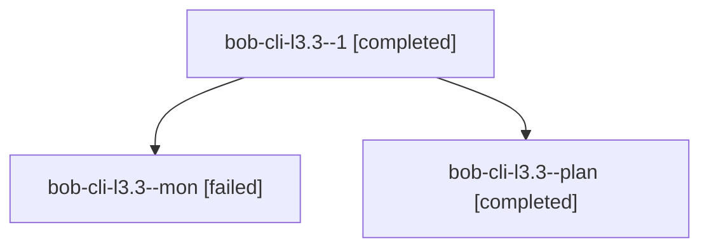

# Session: bob-cli-l3.3

[Agent Hoods](../README.md) / [bbugyi200](../users/bbugyi200/README.md) / [apollo](../users/bbugyi200/machines/apollo/README.md) / [bob-cli-l3](../users/bbugyi200/machines/apollo/hoods/bob-cli-l3/README.md) / bob-cli-l3.3

Owner: `bbugyi200.apollo` · Hood: `bob-cli-l3` · Members: 3 · Bead: [bob-cli-l3.3](https://github.com/bobs-org/bob-cli--beads/blob/main/pages/bob-cli-l3/bob-cli-l3.3.md)

## Lineage

The diagram is an optional enhancement; the ordered table below contains the same lineage in accessible text.

| Role | Agent | State | Model / provider | Timing | Commits | Prompt | Chat |
|---|---|---|---|---|---:|---|---|
| 1 | bob-cli-l3.3--1 | completed | muse-spark-1.3-contributor / muse | 2026-11-12T23:59:45.695555+00:00 → 2026-11-13T00:03:49.839634+00:00 | 0 | [Prompt](../agents/bbugyi200.apollo.bob-cli-l3.3--1/prompt.md) | [Chat](../agents/bbugyi200.apollo.bob-cli-l3.3--1/chat.md) |
| mon | bob-cli-l3.3--mon | failed | muse-spark-1.3-contributor / muse | 2026-11-12T22:29:30.079017+00:00 → 2026-11-12T23:57:17.991589+00:00 | 0 | — | [Chat](../agents/bbugyi200.apollo.bob-cli-l3.3--mon/chat.md) |
| plan | bob-cli-l3.3--plan | completed | muse-spark-1.3-contributor / muse | 2026-11-12T21:49:42.908458+00:00 → 2026-11-12T23:48:12.062871+00:00 | 0 | [Prompt](../agents/bbugyi200.apollo.bob-cli-l3.3--plan/prompt.md) | [Chat](../agents/bbugyi200.apollo.bob-cli-l3.3--plan/chat.md) |

## Neighbors

| Agent | Relation | State |
|---|---|---|
| [bob-cli-l3.1](../agents/bbugyi200.apollo.bob-cli-l3.1/README.md) | bob-cli-l3 hood | completed |
| [bob-cli-l3.2](../agents/bbugyi200.apollo.bob-cli-l3.2/README.md) | bob-cli-l3 hood | completed |
| [bob-cli-l3.land](bbugyi200.apollo.bob-cli-l3.land.md) (session · 3) | bob-cli-l3 hood | active 2, completed 1 |
