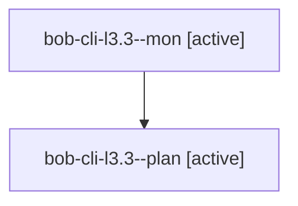

# Session: bob-cli-l3.3

[Agent Hoods](../README.md) / [bbugyi200](../users/bbugyi200/README.md) / [apollo](../users/bbugyi200/machines/apollo/README.md) / [bob-cli-l3](../users/bbugyi200/machines/apollo/hoods/bob-cli-l3/README.md) / bob-cli-l3.3

Owner: `bbugyi200.apollo` · Hood: `bob-cli-l3` · Members: 2 · Bead: [bob-cli-l3.3](https://github.com/bobs-org/bob-cli--beads/blob/main/pages/bob-cli-l3/bob-cli-l3.3.md)

## Lineage

The diagram is an optional enhancement; the ordered table below contains the same lineage in accessible text.

| Role | Agent | State | Model / provider | Timing | Commits | Prompt | Chat |
|---|---|---|---|---|---:|---|---|
| mon | bob-cli-l3.3--mon | active | muse-spark-1.3-contributor / muse | 2026-11-12T22:29:30.079017+00:00 | 0 | — | — |
| plan | bob-cli-l3.3--plan | active | muse-spark-1.3-contributor / muse | 2026-11-12T21:49:42.908458+00:00 | 0 | [Prompt](../agents/bbugyi200.apollo.bob-cli-l3.3--plan/prompt.md) | — |

## Neighbors

| Agent | Relation | State |
|---|---|---|
| [bob-cli-l3.1](../agents/bbugyi200.apollo.bob-cli-l3.1/README.md) | bob-cli-l3 hood | completed |
| [bob-cli-l3.2](../agents/bbugyi200.apollo.bob-cli-l3.2/README.md) | bob-cli-l3 hood | completed |
| [bob-cli-l3.land](../agents/bbugyi200.apollo.bob-cli-l3.land/README.md) | bob-cli-l3 hood | waiting |
