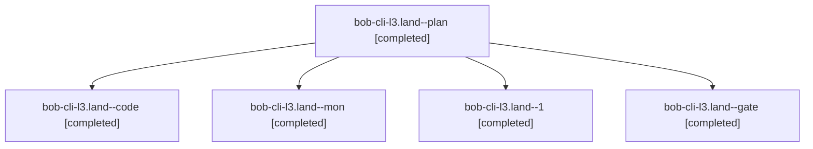

# Session: bob-cli-l3.land

[Agent Hoods](../README.md) / [bbugyi200](../users/bbugyi200/README.md) / [apollo](../users/bbugyi200/machines/apollo/README.md) / [bob-cli-l3](../users/bbugyi200/machines/apollo/hoods/bob-cli-l3/README.md) / bob-cli-l3.land

Owner: `bbugyi200.apollo` · Hood: `bob-cli-l3` · Members: 5 · Bead: [bob-cli-l3](https://github.com/bobs-org/bob-cli--beads/blob/main/pages/bob-cli-l3/README.md)

## Lineage



The diagram is an optional enhancement; the ordered table below contains the same lineage in accessible text.

| Role | Agent | State | Model / provider | Timing | Commits | Prompt | Chat |
|---|---|---|---|---|---:|---|---|
| <a id="member-plan"></a>plan | bob-cli-l3.land--plan | completed | gpt-6-astra / codex | 2026-11-13T00:03:58.937641+00:00 → 2026-11-13T01:49:04.626894+00:00 | 0 | [Prompt](../agents/bbugyi200.apollo.bob-cli-l3.land--plan/prompt.md) | [Chat](../agents/bbugyi200.apollo.bob-cli-l3.land--plan/chat.md) |
| <a id="member-code"></a>code | bob-cli-l3.land--code | completed | muse-spark-1.3-contributor / muse | 2026-11-13T00:23:26.185158+00:00 → 2026-11-13T01:49:04.626894+00:00 | 0 | — | [Chat](../agents/bbugyi200.apollo.bob-cli-l3.land--code/chat.md) |
| <a id="member-mon"></a>mon | bob-cli-l3.land--mon | completed | muse-spark-1.3-contributor / muse | 2026-11-13T01:43:14.243841+00:00 → 2026-11-13T02:10:05.221849+00:00 | 0 | — | [Chat](../agents/bbugyi200.apollo.bob-cli-l3.land--mon/chat.md) |
| <a id="member-1"></a>1 | bob-cli-l3.land--1 | completed | muse-spark-1.3-contributor / muse | 2026-11-13T02:10:28.201393+00:00 → 2026-11-13T02:56:14.516835+00:00 | 0 | [Prompt](../agents/bbugyi200.apollo.bob-cli-l3.land--1/prompt.md) | [Chat](../agents/bbugyi200.apollo.bob-cli-l3.land--1/chat.md) |
| <a id="member-gate"></a>gate | bob-cli-l3.land--gate | completed | gpt-6-astra / codex | 2026-11-13T00:22:11.177582+00:00 → 2026-11-13T00:22:35.414291+00:00 | 0 | — | [Chat](../agents/bbugyi200.apollo.bob-cli-l3.land--gate/chat.md) |

## Variables

| Role | Variable | Value |
|---|---|---|
| plan | `artifacts` | \[{bead: bob-cli-l3, kind: markdown, label: Record capture epic landing audit, path: /home/bryan/.sase/artifacts/agents/gh\_bobs-org\_\_bob-cli/20261112161252/l3\_landing\_audit-7ff1aad4714e.md, ref: file:… |

#### artifacts

**Role:** `plan`

```yaml
- bead: bob-cli-l3
  kind: markdown
  label: Record capture epic landing audit
  path: /home/bryan/.sase/artifacts/agents/gh_bobs-org__bob-cli/20261112161252/l3_landing_audit-7ff1aad4714e.md
  ref: file:explicit:e7464a79500ce17eac54934f
```

Values are truncated for display; see each member's agent meta.json for the full values.

## Neighbors

| Agent | Relation | State |
|---|---|---|
| [bob-cli-l3.1](../agents/bbugyi200.apollo.bob-cli-l3.1/README.md) | bob-cli-l3 hood | completed |
| [bob-cli-l3.2](../agents/bbugyi200.apollo.bob-cli-l3.2/README.md) | bob-cli-l3 hood | completed |
| [bob-cli-l3.3](bbugyi200.apollo.bob-cli-l3.3.md) (session · 3) | bob-cli-l3 hood | completed 2, failed 1 |
