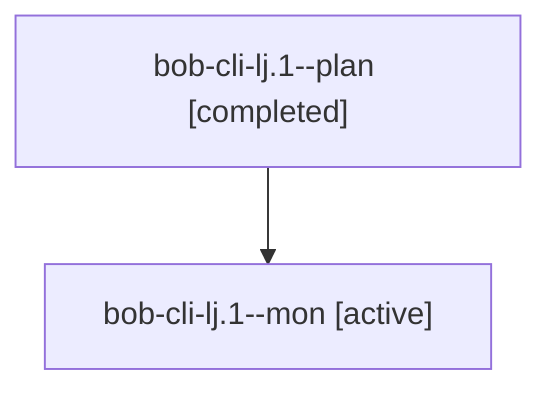

# Session: bob-cli-lj.1

[Agent Hoods](../README.md) / [bbugyi200](../users/bbugyi200/README.md) / [apollo](../users/bbugyi200/machines/apollo/README.md) / [bob-cli-lj](../users/bbugyi200/machines/apollo/hoods/bob-cli-lj/README.md) / bob-cli-lj.1

Owner: `bbugyi200.apollo` · Hood: `bob-cli-lj` · Members: 2 · Bead: [bob-cli-lj.1](https://github.com/bobs-org/bob-cli--beads/blob/main/pages/bob-cli-lj/bob-cli-lj.1.md)

## Lineage

The diagram is an optional enhancement; the ordered table below contains the same lineage in accessible text.

| Role | Agent | State | Model / provider | Timing | Commits | Prompt | Chat |
|---|---|---|---|---|---:|---|---|
| plan | bob-cli-lj.1--plan | completed | gpt-6-luna / codex | 2026-11-14T14:41:57.607907+00:00 → 2026-11-14T14:46:39.230269+00:00 | 0 | [Prompt](../agents/bbugyi200.apollo.bob-cli-lj.1--plan/prompt.md) | [Chat](../agents/bbugyi200.apollo.bob-cli-lj.1--plan/chat.md) |
| mon | bob-cli-lj.1--mon | active | gpt-6-luna / codex | 2026-11-14T14:45:44.149057+00:00 | 0 | — | — |

## Neighbors

| Agent | Relation | State |
|---|---|---|
| [bob-cli-lj.2](../agents/bbugyi200.apollo.bob-cli-lj.2/README.md) | bob-cli-lj hood | completed |
| [bob-cli-lj.3](../agents/bbugyi200.apollo.bob-cli-lj.3/README.md) | bob-cli-lj hood | waiting |
| [bob-cli-lj.4](../agents/bbugyi200.apollo.bob-cli-lj.4/README.md) | bob-cli-lj hood | waiting |
| [bob-cli-lj.5](../agents/bbugyi200.apollo.bob-cli-lj.5/README.md) | bob-cli-lj hood | waiting |
| [bob-cli-lj.land](../agents/bbugyi200.apollo.bob-cli-lj.land/README.md) | bob-cli-lj hood | waiting |
