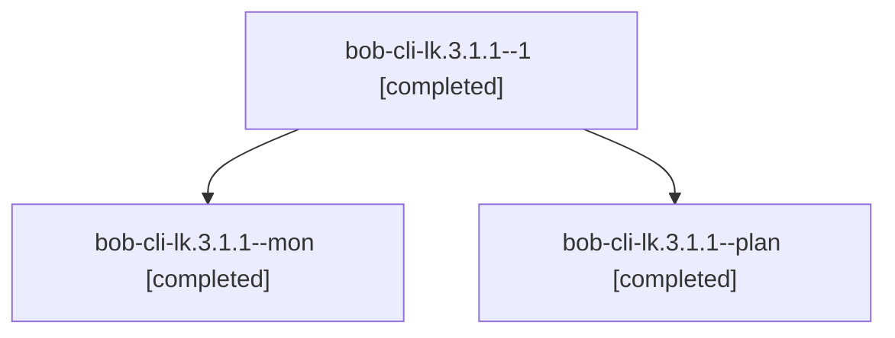

# Session: bob-cli-lk.3.1.1

[Agent Hoods](../README.md) / [bbugyi200](../users/bbugyi200/README.md) / [apollo](../users/bbugyi200/machines/apollo/README.md) / [bob-cli-lk](../users/bbugyi200/machines/apollo/hoods/bob-cli-lk/README.md) / bob-cli-lk.3.1.1

Owner: `bbugyi200.apollo` · Hood: `bob-cli-lk` · Members: 3 · Bead: [bob-cli-lk.3.1.1](https://github.com/bobs-org/bob-cli--beads/blob/main/pages/bob-cli-lk/bob-cli-lk.3.1.1.md)

## Lineage

The diagram is an optional enhancement; the ordered table below contains the same lineage in accessible text.

| Role | Agent | State | Model / provider | Timing | Commits | Prompt | Chat |
|---|---|---|---|---|---:|---|---|
| 1 | bob-cli-lk.3.1.1--1 | completed | gpt-6-luna / codex | 2026-11-14T19:52:05.636378+00:00 → 2026-11-14T20:06:17.661793+00:00 | [1](../agents/bbugyi200.apollo.bob-cli-lk.3.1.1--1/README.md#commits) | [Prompt](../agents/bbugyi200.apollo.bob-cli-lk.3.1.1--1/prompt.md) | [Chat](../agents/bbugyi200.apollo.bob-cli-lk.3.1.1--1/chat.md) |
| mon | bob-cli-lk.3.1.1--mon | completed | gpt-6-luna / codex | 2026-11-14T19:45:00.350506+00:00 → 2026-11-14T19:51:41.835440+00:00 | 0 | — | [Chat](../agents/bbugyi200.apollo.bob-cli-lk.3.1.1--mon/chat.md) |
| plan | bob-cli-lk.3.1.1--plan | completed | gpt-6-luna / codex | 2026-11-14T19:04:24.482502+00:00 → 2026-11-14T19:46:11.362950+00:00 | 0 | [Prompt](../agents/bbugyi200.apollo.bob-cli-lk.3.1.1--plan/prompt.md) | [Chat](../agents/bbugyi200.apollo.bob-cli-lk.3.1.1--plan/chat.md) |

## Commits

| Role | Repo | Commit | Subject | Committed |
|---|---|---|---|---|
| 1 | bob-cli | [`b112a61`](https://github.com/bobs-org/bob-cli/commit/b112a61805a529fa8e69ba0a86cd9114b10ccc49) | feat(gmail): prepare closed-thread replies with resumable activity cursors | 2026-11-14 15:05:13 EST |

## Neighbors

| Agent | Relation | State |
|---|---|---|
| [bob-cli-lk.3](bbugyi200.apollo.bob-cli-lk.3.md) (session · 3) | ancestor | active 1, completed 2 |
| [bob-cli-lk.3.1.2](../agents/bbugyi200.apollo.bob-cli-lk.3.1.2/README.md) | bob-cli-lk.3.1 hood | completed |
| [bob-cli-lk.3.1.3](bbugyi200.apollo.bob-cli-lk.3.1.3.md) (session · 7) | bob-cli-lk.3.1 hood | completed 5, failed 2 |
| [bob-cli-lk.3.1.4](bbugyi200.apollo.bob-cli-lk.3.1.4.md) (session · 3) | bob-cli-lk.3.1 hood | completed 2, failed 1 |
| [bob-cli-lk.3.1.land](bbugyi200.apollo.bob-cli-lk.3.1.land.md) (session · 5) | bob-cli-lk.3.1 hood | completed 4, failed 1 |
| [bob-cli-lk.1](../agents/bbugyi200.apollo.bob-cli-lk.1/README.md) | bob-cli-lk hood | completed |
| [bob-cli-lk.2](../agents/bbugyi200.apollo.bob-cli-lk.2/README.md) | bob-cli-lk hood | completed |
| [bob-cli-lk.land](bbugyi200.apollo.bob-cli-lk.land.md) (session · 3) | bob-cli-lk hood | completed 3 |
