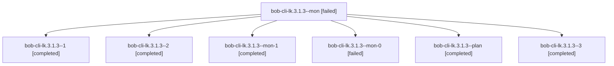

# Session: bob-cli-lk.3.1.3

[Agent Hoods](../README.md) / [bbugyi200](../users/bbugyi200/README.md) / [apollo](../users/bbugyi200/machines/apollo/README.md) / [bob-cli-lk](../users/bbugyi200/machines/apollo/hoods/bob-cli-lk/README.md) / bob-cli-lk.3.1.3

Owner: `bbugyi200.apollo` · Hood: `bob-cli-lk` · Members: 7 · Bead: [bob-cli-lk.3.1.3](https://github.com/bobs-org/bob-cli--beads/blob/main/pages/bob-cli-lk/bob-cli-lk.3.1.3.md)

## Lineage

The diagram is an optional enhancement; the ordered table below contains the same lineage in accessible text.

| Role | Agent | State | Model / provider | Timing | Commits | Prompt | Chat |
|---|---|---|---|---|---:|---|---|
| mon | bob-cli-lk.3.1.3--mon | failed | gpt-6-luna / codex | 2026-11-14T22:12:44.238800+00:00 → 2026-11-14T22:26:17.183553+00:00 | 0 | — | [Chat](../agents/bbugyi200.apollo.bob-cli-lk.3.1.3--mon/chat.md) |
| 1 | bob-cli-lk.3.1.3--1 | completed | gpt-6-luna / codex | 2026-11-14T22:26:40.573937+00:00 → 2026-11-14T22:38:07.245725+00:00 | 0 | [Prompt](../agents/bbugyi200.apollo.bob-cli-lk.3.1.3--1/prompt.md) | [Chat](../agents/bbugyi200.apollo.bob-cli-lk.3.1.3--1/chat.md) |
| 2 | bob-cli-lk.3.1.3--2 | completed | gpt-6-luna / codex | 2026-11-14T22:52:49.145429+00:00 → 2026-11-14T23:08:46.396193+00:00 | 0 | [Prompt](../agents/bbugyi200.apollo.bob-cli-lk.3.1.3--2/prompt.md) | [Chat](../agents/bbugyi200.apollo.bob-cli-lk.3.1.3--2/chat.md) |
| mon-1 | bob-cli-lk.3.1.3--mon-1 | completed | gpt-6-luna / codex | 2026-11-14T23:07:12.854762+00:00 → 2026-11-14T23:19:36.372476+00:00 | 0 | — | [Chat](../agents/bbugyi200.apollo.bob-cli-lk.3.1.3--mon-1/chat.md) |
| mon-0 | bob-cli-lk.3.1.3--mon-0 | failed | gpt-6-luna / codex | 2026-11-14T22:35:49.829664+00:00 → 2026-11-14T22:52:15.852275+00:00 | 0 | — | [Chat](../agents/bbugyi200.apollo.bob-cli-lk.3.1.3--mon-0/chat.md) |
| plan | bob-cli-lk.3.1.3--plan | completed | gpt-6-luna / codex | 2026-11-14T21:03:05.179300+00:00 → 2026-11-14T22:15:02.255245+00:00 | 0 | [Prompt](../agents/bbugyi200.apollo.bob-cli-lk.3.1.3--plan/prompt.md) | [Chat](../agents/bbugyi200.apollo.bob-cli-lk.3.1.3--plan/chat.md) |
| 3 | bob-cli-lk.3.1.3--3 | completed | gpt-6-luna / codex | 2026-11-14T23:20:15.929387+00:00 → 2026-11-14T23:47:57.178580+00:00 | [1](../agents/bbugyi200.apollo.bob-cli-lk.3.1.3--3/README.md#commits) | [Prompt](../agents/bbugyi200.apollo.bob-cli-lk.3.1.3--3/prompt.md) | [Chat](../agents/bbugyi200.apollo.bob-cli-lk.3.1.3--3/chat.md) |

## Commits

| Role | Repo | Commit | Subject | Committed |
|---|---|---|---|---|
| 3 | bob-cli | [`88fb9cb`](https://github.com/bobs-org/bob-cli/commit/88fb9cb46f345a6c4a4d1d41a1cbaf6826355742) | fix(gmail): reopen synced messages | 2026-11-14 18:46:15 EST |

## Neighbors

| Agent | Relation | State |
|---|---|---|
| [bob-cli-lk.3](bbugyi200.apollo.bob-cli-lk.3.md) (session · 3) | ancestor | active 1, completed 2 |
| [bob-cli-lk.3.1.1](bbugyi200.apollo.bob-cli-lk.3.1.1.md) (session · 3) | bob-cli-lk.3.1 hood | completed 3 |
| [bob-cli-lk.3.1.2](../agents/bbugyi200.apollo.bob-cli-lk.3.1.2/README.md) | bob-cli-lk.3.1 hood | completed |
| [bob-cli-lk.3.1.4](bbugyi200.apollo.bob-cli-lk.3.1.4.md) (session · 3) | bob-cli-lk.3.1 hood | completed 2, failed 1 |
| [bob-cli-lk.3.1.land](bbugyi200.apollo.bob-cli-lk.3.1.land.md) (session · 5) | bob-cli-lk.3.1 hood | completed 4, failed 1 |
| [bob-cli-lk.1](../agents/bbugyi200.apollo.bob-cli-lk.1/README.md) | bob-cli-lk hood | completed |
| [bob-cli-lk.2](../agents/bbugyi200.apollo.bob-cli-lk.2/README.md) | bob-cli-lk hood | completed |
| [bob-cli-lk.land](bbugyi200.apollo.bob-cli-lk.land.md) (session · 3) | bob-cli-lk hood | completed 3 |
