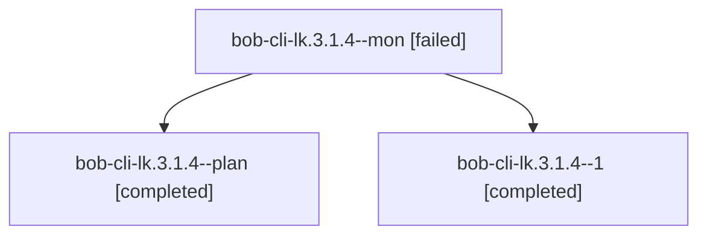

# Session: bob-cli-lk.3.1.4

[Agent Hoods](../README.md) / [bbugyi200](../users/bbugyi200/README.md) / [apollo](../users/bbugyi200/machines/apollo/README.md) / [bob-cli-lk](../users/bbugyi200/machines/apollo/hoods/bob-cli-lk/README.md) / bob-cli-lk.3.1.4

Owner: `bbugyi200.apollo` · Hood: `bob-cli-lk` · Members: 3 · Bead: [bob-cli-lk.3.1.4](https://github.com/bobs-org/bob-cli--beads/blob/main/pages/bob-cli-lk/bob-cli-lk.3.1.4.md)

## Lineage

The diagram is an optional enhancement; the ordered table below contains the same lineage in accessible text.

| Role | Agent | State | Model / provider | Timing | Commits | Prompt | Chat |
|---|---|---|---|---|---:|---|---|
| mon | bob-cli-lk.3.1.4--mon | failed | muse-spark-1.3-contributor / muse | 2026-11-15T00:34:14.014531+00:00 → 2026-11-15T00:52:32.741813+00:00 | 0 | — | [Chat](../agents/bbugyi200.apollo.bob-cli-lk.3.1.4--mon/chat.md) |
| plan | bob-cli-lk.3.1.4--plan | completed | muse-spark-1.3-contributor / muse | 2026-11-14T23:48:10.778160+00:00 → 2026-11-15T00:50:52.309800+00:00 | 0 | [Prompt](../agents/bbugyi200.apollo.bob-cli-lk.3.1.4--plan/prompt.md) | [Chat](../agents/bbugyi200.apollo.bob-cli-lk.3.1.4--plan/chat.md) |
| 1 | bob-cli-lk.3.1.4--1 | completed | muse-spark-1.3-contributor / muse | 2026-11-15T00:53:04.268798+00:00 → 2026-11-15T01:06:23.475690+00:00 | [1](../agents/bbugyi200.apollo.bob-cli-lk.3.1.4--1/README.md#commits) | [Prompt](../agents/bbugyi200.apollo.bob-cli-lk.3.1.4--1/prompt.md) | [Chat](../agents/bbugyi200.apollo.bob-cli-lk.3.1.4--1/chat.md) |

## Commits

| Role | Repo | Commit | Subject | Committed |
|---|---|---|---|---|
| 1 | — | `ff272bc` | feat(gmail): finish reply-reopen reports, docs and regression coverage | 2026-11-14 20:05:23 EST |

## Neighbors

| Agent | Relation | State |
|---|---|---|
| [bob-cli-lk.3](bbugyi200.apollo.bob-cli-lk.3.md) (session · 3) | ancestor | completed 2, dismissed 1 |
| [bob-cli-lk.3.1.1](bbugyi200.apollo.bob-cli-lk.3.1.1.md) (session · 3) | bob-cli-lk.3.1 hood | completed 3 |
| [bob-cli-lk.3.1.2](../agents/bbugyi200.apollo.bob-cli-lk.3.1.2/README.md) | bob-cli-lk.3.1 hood | completed |
| [bob-cli-lk.3.1.3](bbugyi200.apollo.bob-cli-lk.3.1.3.md) (session · 7) | bob-cli-lk.3.1 hood | completed 5, failed 2 |
| [bob-cli-lk.3.1.land](bbugyi200.apollo.bob-cli-lk.3.1.land.md) (session · 5) | bob-cli-lk.3.1 hood | completed 4, failed 1 |
| [bob-cli-lk.1](../agents/bbugyi200.apollo.bob-cli-lk.1/README.md) | bob-cli-lk hood | completed |
| [bob-cli-lk.2](../agents/bbugyi200.apollo.bob-cli-lk.2/README.md) | bob-cli-lk hood | completed |
| [bob-cli-lk.land](bbugyi200.apollo.bob-cli-lk.land.md) (session · 3) | bob-cli-lk hood | completed 3 |
