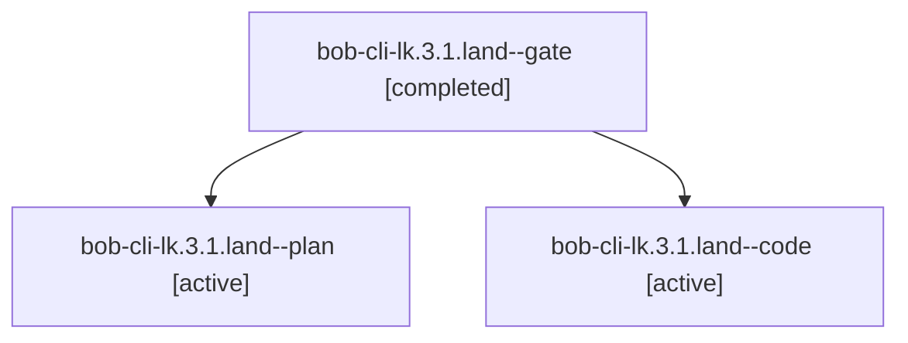

# Session: bob-cli-lk.3.1.land

[Agent Hoods](../README.md) / [bbugyi200](../users/bbugyi200/README.md) / [apollo](../users/bbugyi200/machines/apollo/README.md) / [bob-cli-lk](../users/bbugyi200/machines/apollo/hoods/bob-cli-lk/README.md) / bob-cli-lk.3.1.land

Owner: `bbugyi200.apollo` · Hood: `bob-cli-lk` · Members: 3 · Bead: [bob-cli-lk.3.1](https://github.com/bobs-org/bob-cli--beads/blob/main/pages/bob-cli-lk/bob-cli-lk.3.1.md)

## Lineage



The diagram is an optional enhancement; the ordered table below contains the same lineage in accessible text.

| Role | Agent | State | Model / provider | Timing | Commits | Prompt | Chat |
|---|---|---|---|---|---:|---|---|
| <a id="member-gate"></a>gate | bob-cli-lk.3.1.land--gate | completed | gpt-6-astra / codex | 2026-11-15T01:24:03.784491+00:00 → 2026-11-15T01:24:21.804208+00:00 | 0 | — | [Chat](../agents/bbugyi200.apollo.bob-cli-lk.3.1.land--gate/chat.md) |
| <a id="member-plan"></a>plan | bob-cli-lk.3.1.land--plan | active | gpt-6-astra / codex | 2026-11-15T01:06:33.384525+00:00 | 0 | [Prompt](../agents/bbugyi200.apollo.bob-cli-lk.3.1.land--plan/prompt.md) | [Chat](../agents/bbugyi200.apollo.bob-cli-lk.3.1.land--plan/chat.md) |
| <a id="member-code"></a>code | bob-cli-lk.3.1.land--code | active | gpt-6-luna / codex | 2026-11-15T01:24:52.763969+00:00 | 0 | — | — |

## Variables

| Role | Variable | Value |
|---|---|---|
| plan | `artifacts` | \[{kind: markdown, label: Gmail reopen landing audit and repair evidence, path: /home/bryan/.sase/artifacts/agents/gh\_bobs-org\_\_bob-cli/20261114140301/gmail\_reopen\_land\_audit-c529a92c74b6.md, ref: fil… |

#### artifacts

**Role:** `plan`

```yaml
- kind: markdown
  label: Gmail reopen landing audit and repair evidence
  path: /home/bryan/.sase/artifacts/agents/gh_bobs-org__bob-cli/20261114140301/gmail_reopen_land_audit-c529a92c74b6.md
  ref: file:explicit:755288a4b63f0c4483ea2fd7
  source_path: /home/bryan/.local/state/sase/workspaces/bobs-org/bob-cli/bob-cli_10/target/gmail_reopen_land_audit.md
```

Values are truncated for display; see each member's agent meta.json for the full values.

## Neighbors

| Agent | Relation | State |
|---|---|---|
| [bob-cli-lk.3](bbugyi200.apollo.bob-cli-lk.3.md) (session · 3) | ancestor | active 1, completed 2 |
| [bob-cli-lk.3.1.1](bbugyi200.apollo.bob-cli-lk.3.1.1.md) (session · 3) | bob-cli-lk.3.1 hood | completed 3 |
| [bob-cli-lk.3.1.2](../agents/bbugyi200.apollo.bob-cli-lk.3.1.2/README.md) | bob-cli-lk.3.1 hood | completed |
| [bob-cli-lk.3.1.3](bbugyi200.apollo.bob-cli-lk.3.1.3.md) (session · 7) | bob-cli-lk.3.1 hood | completed 5, failed 2 |
| [bob-cli-lk.3.1.4](bbugyi200.apollo.bob-cli-lk.3.1.4.md) (session · 3) | bob-cli-lk.3.1 hood | completed 2, failed 1 |
| [bob-cli-lk.1](../agents/bbugyi200.apollo.bob-cli-lk.1/README.md) | bob-cli-lk hood | completed |
| [bob-cli-lk.2](../agents/bbugyi200.apollo.bob-cli-lk.2/README.md) | bob-cli-lk hood | completed |
| [bob-cli-lk.land](../agents/bbugyi200.apollo.bob-cli-lk.land/README.md) | bob-cli-lk hood | waiting |
