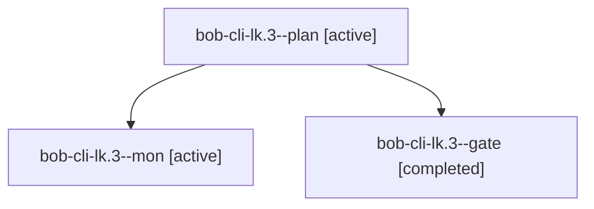

# Session: bob-cli-lk.3

[Agent Hoods](../README.md) / [bbugyi200](../users/bbugyi200/README.md) / [apollo](../users/bbugyi200/machines/apollo/README.md) / [bob-cli-lk](../users/bbugyi200/machines/apollo/hoods/bob-cli-lk/README.md) / bob-cli-lk.3

Owner: `bbugyi200.apollo` · Hood: `bob-cli-lk` · Members: 3 · Bead: [bob-cli-lk.3](https://github.com/bobs-org/bob-cli--beads/blob/main/pages/bob-cli-lk/bob-cli-lk.3.md)

## Lineage

The diagram is an optional enhancement; the ordered table below contains the same lineage in accessible text.

| Role | Agent | State | Model / provider | Timing | Commits | Prompt | Chat |
|---|---|---|---|---|---:|---|---|
| plan | bob-cli-lk.3--plan | active | gpt-6-astra / codex | 2026-11-14T18:47:36.782223+00:00 → 2026-11-14T19:00:54.803409+00:00 | 0 | [Prompt](../agents/bbugyi200.apollo.bob-cli-lk.3--plan/prompt.md) | [Chat](../agents/bbugyi200.apollo.bob-cli-lk.3--plan/chat.md) |
| mon | bob-cli-lk.3--mon | active | gpt-6-astra / codex | 2026-11-14T19:00:34.498229+00:00 | 0 | — | — |
| gate | bob-cli-lk.3--gate | completed | gpt-6-astra / codex | 2026-11-14T19:00:10.654983+00:00 → 2026-11-14T19:00:38.793419+00:00 | 0 | — | [Chat](../agents/bbugyi200.apollo.bob-cli-lk.3--gate/chat.md) |

## Neighbors

| Agent | Relation | State |
|---|---|---|
| [bob-cli-lk.3.1.1](../agents/bbugyi200.apollo.bob-cli-lk.3.1.1/README.md) | descendant | active |
| [bob-cli-lk.1](../agents/bbugyi200.apollo.bob-cli-lk.1/README.md) | bob-cli-lk hood | completed |
| [bob-cli-lk.2](../agents/bbugyi200.apollo.bob-cli-lk.2/README.md) | bob-cli-lk hood | active |
| [bob-cli-lk.land](../agents/bbugyi200.apollo.bob-cli-lk.land/README.md) | bob-cli-lk hood | waiting |
