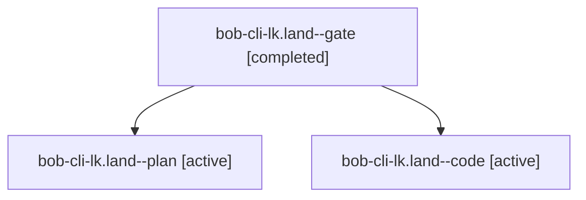

# Session: bob-cli-lk.land

[Agent Hoods](../README.md) / [bbugyi200](../users/bbugyi200/README.md) / [apollo](../users/bbugyi200/machines/apollo/README.md) / [bob-cli-lk](../users/bbugyi200/machines/apollo/hoods/bob-cli-lk/README.md) / bob-cli-lk.land

Owner: `bbugyi200.apollo` · Hood: `bob-cli-lk` · Members: 3 · Bead: [bob-cli-lk](https://github.com/bobs-org/bob-cli--beads/blob/main/pages/bob-cli-lk/README.md)

## Lineage



The diagram is an optional enhancement; the ordered table below contains the same lineage in accessible text.

| Role | Agent | State | Model / provider | Timing | Commits | Prompt | Chat |
|---|---|---|---|---|---:|---|---|
| <a id="member-gate"></a>gate | bob-cli-lk.land--gate | completed | gpt-6-astra / codex | 2026-11-15T03:18:34.125058+00:00 → 2026-11-15T03:18:55.224696+00:00 | 0 | — | [Chat](../agents/bbugyi200.apollo.bob-cli-lk.land--gate/chat.md) |
| <a id="member-plan"></a>plan | bob-cli-lk.land--plan | active | gpt-6-astra / codex | 2026-11-15T02:52:32.141246+00:00 | 0 | [Prompt](../agents/bbugyi200.apollo.bob-cli-lk.land--plan/prompt.md) | [Chat](../agents/bbugyi200.apollo.bob-cli-lk.land--plan/chat.md) |
| <a id="member-code"></a>code | bob-cli-lk.land--code | active | grok-4.6 / grok | 2026-11-15T03:19:44.179245+00:00 | 0 | — | — |

## Variables

| Role | Variable | Value |
|---|---|---|
| plan | `artifacts` | \[{kind: file, label: Gmail archive landing synthetic probes, path: /home/bryan/.sase/artifacts/agents/gh\_bobs-org\_\_bob-cli/20261114121444/lk\_archive\_probes-d59de3fb9b2d.py, ref: file:explicit:7c9a1b8… |

#### artifacts

**Role:** `plan`

```yaml
- kind: file
  label: Gmail archive landing synthetic probes
  path: /home/bryan/.sase/artifacts/agents/gh_bobs-org__bob-cli/20261114121444/lk_archive_probes-d59de3fb9b2d.py
  ref: file:explicit:7c9a1b8c8dc0ec3c318feaa6
  source_path: /tmp/lk_archive_probes.py
- kind: file
  label: Gmail archive landing probe results
  path: /home/bryan/.sase/artifacts/agents/gh_bobs-org__bob-cli/20261114121444/lk_archive_probes-cff3b6769f12.log
  ref: file:explicit:b03c85385f54e56455009b2e
  source_path: /tmp/lk_archive_probes.log
```

Values are truncated for display; see each member's agent meta.json for the full values.

## Neighbors

| Agent | Relation | State |
|---|---|---|
| [bob-cli-lk.1](../agents/bbugyi200.apollo.bob-cli-lk.1/README.md) | bob-cli-lk hood | completed |
| [bob-cli-lk.2](../agents/bbugyi200.apollo.bob-cli-lk.2/README.md) | bob-cli-lk hood | completed |
| [bob-cli-lk.3](bbugyi200.apollo.bob-cli-lk.3.md) (session · 3) | bob-cli-lk hood | active 1, completed 2 |
| [bob-cli-lk.3.1.1](bbugyi200.apollo.bob-cli-lk.3.1.1.md) (session · 3) | bob-cli-lk hood | completed 3 |
| [bob-cli-lk.3.1.2](../agents/bbugyi200.apollo.bob-cli-lk.3.1.2/README.md) | bob-cli-lk hood | completed |
| [bob-cli-lk.3.1.3](bbugyi200.apollo.bob-cli-lk.3.1.3.md) (session · 7) | bob-cli-lk hood | completed 5, failed 2 |
| [bob-cli-lk.3.1.4](bbugyi200.apollo.bob-cli-lk.3.1.4.md) (session · 3) | bob-cli-lk hood | completed 2, failed 1 |
| [bob-cli-lk.3.1.land](bbugyi200.apollo.bob-cli-lk.3.1.land.md) (session · 5) | bob-cli-lk hood | completed 4, failed 1 |
