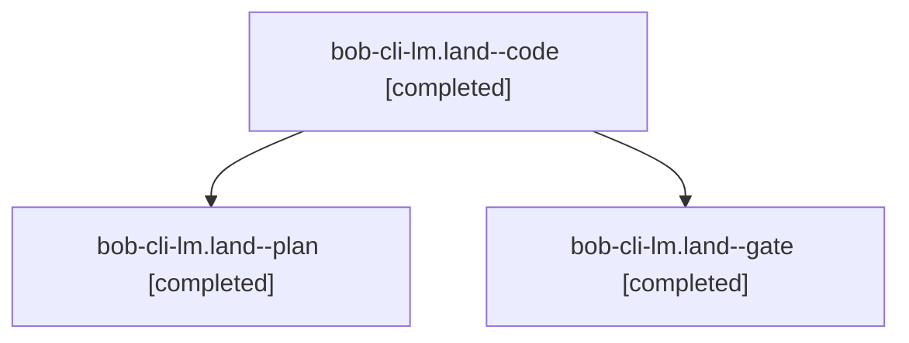

# Session: bob-cli-lm.land

[Agent Hoods](../README.md) / [bbugyi200](../users/bbugyi200/README.md) / [apollo](../users/bbugyi200/machines/apollo/README.md) / [bob-cli-lm](../users/bbugyi200/machines/apollo/hoods/bob-cli-lm/README.md) / bob-cli-lm.land

Owner: `bbugyi200.apollo` · Hood: `bob-cli-lm` · Members: 3 · Bead: [bob-cli-lm](https://github.com/bobs-org/bob-cli--beads/blob/main/pages/bob-cli-lm/README.md)

## Lineage

The diagram is an optional enhancement; the ordered table below contains the same lineage in accessible text.

| Role | Agent | State | Model / provider | Timing | Commits | Prompt | Chat |
|---|---|---|---|---|---:|---|---|
| code | bob-cli-lm.land--code | completed | grok-4.6 / grok | 2026-11-14T20:48:06.390576+00:00 → 2026-11-14T21:28:20.917874+00:00 | 0 | — | [Chat](../agents/bbugyi200.apollo.bob-cli-lm.land--code/chat.md) |
| plan | bob-cli-lm.land--plan | completed | opus / claude | 2026-11-14T20:14:04.591015+00:00 → 2026-11-14T21:28:20.917874+00:00 | 0 | [Prompt](../agents/bbugyi200.apollo.bob-cli-lm.land--plan/prompt.md) | [Chat](../agents/bbugyi200.apollo.bob-cli-lm.land--plan/chat.md) |
| gate | bob-cli-lm.land--gate | completed | opus / claude | 2026-11-14T20:46:45.931597+00:00 → 2026-11-14T20:47:11.563765+00:00 | 0 | — | [Chat](../agents/bbugyi200.apollo.bob-cli-lm.land--gate/chat.md) |

## Neighbors

| Agent | Relation | State |
|---|---|---|
| [bob-cli-lm.1](../agents/bbugyi200.apollo.bob-cli-lm.1/README.md) | bob-cli-lm hood | completed |
| [bob-cli-lm.2](../agents/bbugyi200.apollo.bob-cli-lm.2/README.md) | bob-cli-lm hood | completed |
| [bob-cli-lm.3](../agents/bbugyi200.apollo.bob-cli-lm.3/README.md) | bob-cli-lm hood | completed |
| [bob-cli-lm.4](../agents/bbugyi200.apollo.bob-cli-lm.4/README.md) | bob-cli-lm hood | completed |
| [bob-cli-lm.5](../agents/bbugyi200.apollo.bob-cli-lm.5/README.md) | bob-cli-lm hood | completed |
