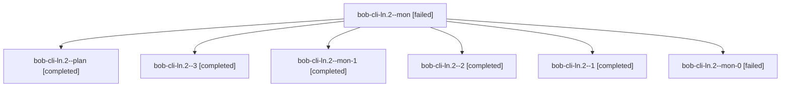

# Session: bob-cli-ln.2

[Agent Hoods](../README.md) / [bbugyi200](../users/bbugyi200/README.md) / [apollo](../users/bbugyi200/machines/apollo/README.md) / [bob-cli-ln](../users/bbugyi200/machines/apollo/hoods/bob-cli-ln/README.md) / bob-cli-ln.2

Owner: `bbugyi200.apollo` · Hood: `bob-cli-ln` · Members: 7 · Bead: [bob-cli-ln.2](https://github.com/bobs-org/bob-cli--beads/blob/main/pages/bob-cli-ln/bob-cli-ln.2.md)

## Lineage

The diagram is an optional enhancement; the ordered table below contains the same lineage in accessible text.

| Role | Agent | State | Model / provider | Timing | Commits | Prompt | Chat |
|---|---|---|---|---|---:|---|---|
| mon | bob-cli-ln.2--mon | failed | gpt-6-luna / codex | 2026-11-14T22:38:50.674029+00:00 → 2026-11-14T22:46:15.331852+00:00 | 0 | — | [Chat](../agents/bbugyi200.apollo.bob-cli-ln.2--mon/chat.md) |
| plan | bob-cli-ln.2--plan | completed | gpt-6-luna / codex | 2026-11-14T22:16:39.112573+00:00 → 2026-11-14T22:41:21.922714+00:00 | 0 | [Prompt](../agents/bbugyi200.apollo.bob-cli-ln.2--plan/prompt.md) | [Chat](../agents/bbugyi200.apollo.bob-cli-ln.2--plan/chat.md) |
| 3 | bob-cli-ln.2--3 | completed | muse-spark-1.3-contributor / muse | 2026-11-14T23:52:23.071739+00:00 → 2026-11-15T00:11:25.658374+00:00 | [1](../agents/bbugyi200.apollo.bob-cli-ln.2--3/README.md#commits) | [Prompt](../agents/bbugyi200.apollo.bob-cli-ln.2--3/prompt.md) | [Chat](../agents/bbugyi200.apollo.bob-cli-ln.2--3/chat.md) |
| mon-1 | bob-cli-ln.2--mon-1 | completed | muse-spark-1.3-contributor / muse | 2026-11-14T23:33:35.350854+00:00 → 2026-11-14T23:51:56.518487+00:00 | 0 | — | [Chat](../agents/bbugyi200.apollo.bob-cli-ln.2--mon-1/chat.md) |
| 2 | bob-cli-ln.2--2 | completed | muse-spark-1.3-contributor / muse | 2026-11-14T23:03:24.888854+00:00 → 2026-11-14T23:41:13.638737+00:00 | 0 | [Prompt](../agents/bbugyi200.apollo.bob-cli-ln.2--2/prompt.md) | [Chat](../agents/bbugyi200.apollo.bob-cli-ln.2--2/chat.md) |
| 1 | bob-cli-ln.2--1 | completed | gpt-6-luna / codex | 2026-11-14T22:47:01.990561+00:00 → 2026-11-14T22:56:49.101781+00:00 | 0 | [Prompt](../agents/bbugyi200.apollo.bob-cli-ln.2--1/prompt.md) | [Chat](../agents/bbugyi200.apollo.bob-cli-ln.2--1/chat.md) |
| mon-0 | bob-cli-ln.2--mon-0 | failed | gpt-6-luna / codex | 2026-11-14T22:55:04.165869+00:00 → 2026-11-14T23:02:55.339577+00:00 | 0 | — | [Chat](../agents/bbugyi200.apollo.bob-cli-ln.2--mon-0/chat.md) |

## Commits

| Role | Repo | Commit | Subject | Committed |
|---|---|---|---|---|
| 3 | bob-cli | [`719dbd4`](https://github.com/bobs-org/bob-cli/commit/719dbd45cbf4eaf21cdf96bd3f46eaa6da2c5974) | feat(areas): validated area graph and pure nested catalog planner | 2026-11-14 19:10:11 EST |

## Neighbors

| Agent | Relation | State |
|---|---|---|
| [bob-cli-ln.1](../agents/bbugyi200.apollo.bob-cli-ln.1/README.md) | bob-cli-ln hood | completed |
| [bob-cli-ln.3](bbugyi200.apollo.bob-cli-ln.3.md) (session · 5) | bob-cli-ln hood | completed 4, failed 1 |
| [bob-cli-ln.4](../agents/bbugyi200.apollo.bob-cli-ln.4/README.md) | bob-cli-ln hood | waiting |
| [bob-cli-ln.5](../agents/bbugyi200.apollo.bob-cli-ln.5/README.md) | bob-cli-ln hood | waiting |
| [bob-cli-ln.6](../agents/bbugyi200.apollo.bob-cli-ln.6/README.md) | bob-cli-ln hood | waiting |
| [bob-cli-ln.7](../agents/bbugyi200.apollo.bob-cli-ln.7/README.md) | bob-cli-ln hood | waiting |
| [bob-cli-ln.land](../agents/bbugyi200.apollo.bob-cli-ln.land/README.md) | bob-cli-ln hood | waiting |
