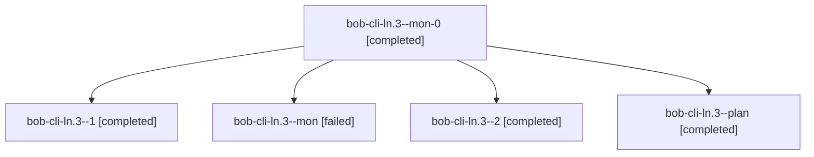

# Session: bob-cli-ln.3

[Agent Hoods](../README.md) / [bbugyi200](../users/bbugyi200/README.md) / [apollo](../users/bbugyi200/machines/apollo/README.md) / [bob-cli-ln](../users/bbugyi200/machines/apollo/hoods/bob-cli-ln/README.md) / bob-cli-ln.3

Owner: `bbugyi200.apollo` · Hood: `bob-cli-ln` · Members: 5 · Bead: [bob-cli-ln.3](https://github.com/bobs-org/bob-cli--beads/blob/main/pages/bob-cli-ln/bob-cli-ln.3.md)

## Lineage

The diagram is an optional enhancement; the ordered table below contains the same lineage in accessible text.

| Role | Agent | State | Model / provider | Timing | Commits | Prompt | Chat |
|---|---|---|---|---|---:|---|---|
| mon-0 | bob-cli-ln.3--mon-0 | completed | grok-4.6 / grok | 2026-11-15T01:43:45.294667+00:00 → 2026-11-15T01:59:33.958471+00:00 | 0 | — | [Chat](../agents/bbugyi200.apollo.bob-cli-ln.3--mon-0/chat.md) |
| 1 | bob-cli-ln.3--1 | completed | grok-4.6 / grok | 2026-11-15T01:23:11.376933+00:00 → 2026-11-15T01:45:35.744979+00:00 | 0 | [Prompt](../agents/bbugyi200.apollo.bob-cli-ln.3--1/prompt.md) | [Chat](../agents/bbugyi200.apollo.bob-cli-ln.3--1/chat.md) |
| mon | bob-cli-ln.3--mon | failed | grok-4.6 / grok | 2026-11-15T01:07:22.228613+00:00 → 2026-11-15T01:22:40.989865+00:00 | 0 | — | [Chat](../agents/bbugyi200.apollo.bob-cli-ln.3--mon/chat.md) |
| 2 | bob-cli-ln.3--2 | completed | grok-4.6 / grok | 2026-11-15T02:00:06.027960+00:00 → 2026-11-15T02:18:40.488890+00:00 | [1](../agents/bbugyi200.apollo.bob-cli-ln.3--2/README.md#commits) | [Prompt](../agents/bbugyi200.apollo.bob-cli-ln.3--2/prompt.md) | [Chat](../agents/bbugyi200.apollo.bob-cli-ln.3--2/chat.md) |
| plan | bob-cli-ln.3--plan | completed | grok-4.6 / grok | 2026-11-15T00:11:44.568868+00:00 → 2026-11-15T01:09:07.220623+00:00 | 0 | [Prompt](../agents/bbugyi200.apollo.bob-cli-ln.3--plan/prompt.md) | [Chat](../agents/bbugyi200.apollo.bob-cli-ln.3--plan/chat.md) |

## Commits

| Role | Repo | Commit | Subject | Committed |
|---|---|---|---|---|
| 2 | bob-cli | [`92813d0`](https://github.com/bobs-org/bob-cli/commit/92813d08ea57e1f2c5cff2ae6a85e0232ed0390e) | feat(areas): add read-only bob areas list and check | 2026-11-14 21:17:28 EST |

## Neighbors

| Agent | Relation | State |
|---|---|---|
| [bob-cli-ln.1](../agents/bbugyi200.apollo.bob-cli-ln.1/README.md) | bob-cli-ln hood | completed |
| [bob-cli-ln.2](bbugyi200.apollo.bob-cli-ln.2.md) (session · 7) | bob-cli-ln hood | completed 5, failed 2 |
| [bob-cli-ln.4](../agents/bbugyi200.apollo.bob-cli-ln.4/README.md) | bob-cli-ln hood | completed |
| [bob-cli-ln.5](bbugyi200.apollo.bob-cli-ln.5.md) (session · 5) | bob-cli-ln hood | completed 4, failed 1 |
| [bob-cli-ln.6](../agents/bbugyi200.apollo.bob-cli-ln.6/README.md) | bob-cli-ln hood | waiting |
| [bob-cli-ln.7](../agents/bbugyi200.apollo.bob-cli-ln.7/README.md) | bob-cli-ln hood | completed |
| [bob-cli-ln.land](../agents/bbugyi200.apollo.bob-cli-ln.land/README.md) | bob-cli-ln hood | waiting |
